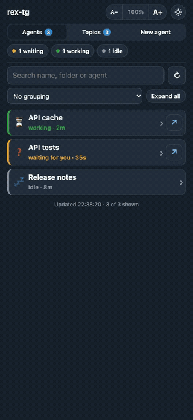
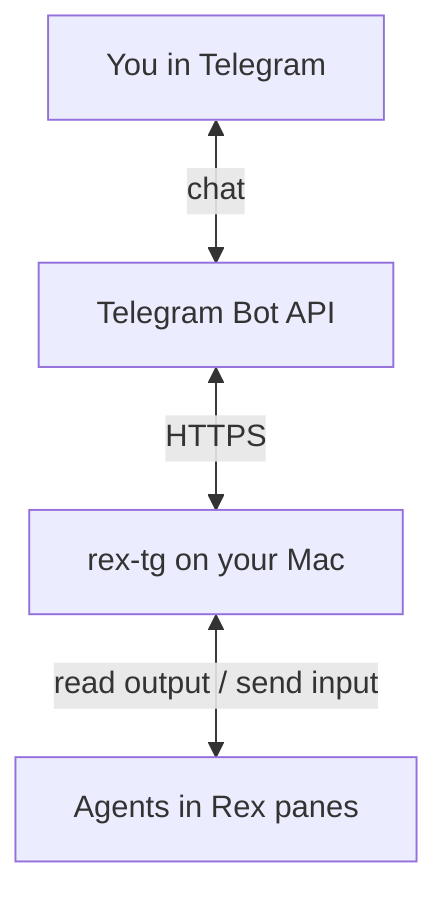

# rex-tg

**Use the coding agents on your Mac from Telegram.**

rex-tg connects pi, Claude Code, and Codex running in Rex terminal panes to topics in your private bot chat. Send a request, follow tool progress, answer a permission prompt, and read the result without staying at your desk.

[Install](#install) · [First conversation](#your-first-conversation) · [Commands](docs/architecture.md#telegram-commands) · [Configuration](docs/reference.md#configuration) · [Troubleshooting](#troubleshooting) · [Architecture and catalog](docs/architecture.md) · [Contribute](CONTRIBUTING.md)

[](docs/media/rex-tg-tour.mp4)

*The shipped Mini App, served by its Go handler with isolated local fixtures. No live Telegram account, bot, Rex pane, or agent was connected. [Watch the narrated 81-second tour](docs/media/rex-tg-tour.mp4) · [English captions (SRT)](docs/media/rex-tg-tour.en.srt).*

## What it does

- **One topic per agent session.** List agents, open topics, or start an agent in a new Rex tab.
- **Two-way conversation.** Your text goes into the agent's pane; its transcript supplies progress and answers.
- **Remote supervision.** Inspect the screen, answer supported permission prompts, pause typing, or interrupt a turn.
- **Useful output.** Receive images and file attachments, schedule messages, and optionally transcribe voice notes locally.
- **Optional Mini App.** Browse answers, screens, files, and git changes; annotate answers; create reusable message templates; manage agents and topics.
- **Recovery before guesswork.** Durable queues, target checks, retryable downloads, and explicit handling of uncertain sends.

See the [complete feature and command catalog](docs/architecture.md#feature-and-command-catalog), including defaults and limitations. Supported: **macOS, local Rex Beta panes, pi, Claude Code (including cux), and Codex**. Not supported: group chats, multiple owners, T3 Code panes, or agents on another Rex host.

## How it works



The daemon reads agent transcripts and uses the Rex CLI for state, captures, and checked input. SQLite keeps topic links and delivery state on your Mac. Telegram uses long polling: **the core bot needs no webhook or public inbound port**. The optional Mini App uses a local HTTP listener behind Tailscale Serve.

[Detailed architecture, features, and command catalog →](docs/architecture.md)

## Before you install

| Required | Why |
| --- | --- |
| macOS | Keychain stores the bot token; launchd runs the daemon. |
| Rex Beta with its `rex` CLI | Start Rex yourself. rex-tg never starts a Rex server. |
| pi, Claude Code, or Codex | Install and authenticate the agent separately, then run it in a Rex pane. |
| A Telegram account and bot | Create a bot in **@BotFather**, with **Threaded Mode** enabled. |
| Homebrew, or Go with make | Homebrew builds from source. For development, use the Go version in [`.tool-versions`](.tool-versions) through mise. |

Optional: **Tailscale on your Mac and phone** for the Mini App; **ffmpeg, whisper.cpp, and a model** for voice transcription. Rex, Telegram, and the agent tools are separate products; this project's MIT license does not license those products or provide their accounts.

> **Security:** this bot can type into your terminals. Protect your Telegram account and bot token. Bot chats are **not end-to-end encrypted**. Read [Security](#security) before connecting a sensitive project.

## Install

### 1. Install rex-tg

**Homebrew (recommended):**

```sh
brew tap arrokh/rex-tg https://github.com/arrokh/rex-tg
brew trust --formula arrokh/rex-tg/rex-tg  # if your Homebrew version requires tap trust
brew install rex-tg
rex-tg version
```

The tap uses a Git clone of the release tag. If repository access is restricted, your GitHub account must have access; see [installation details](docs/reference.md#install-with-homebrew). Adding an MIT license does not change GitHub repository visibility.

<details>
<summary>Build from source instead</summary>

Install [mise](https://mise.jdx.dev/) first, then:

```sh
git clone https://github.com/arrokh/rex-tg.git
cd rex-tg
mise install
mise exec -- make install
```

The binary goes to `~/.local/bin/rex-tg`. Add `~/.local/bin` to your shell's `PATH` if needed. Building does not install hooks or load the daemon; continue below.

</details>

### 2. Create your bot

In **@BotFather**, run `/newbot`. In the bot's settings, enable **Threaded Mode**. Keep the token private; do not put it in a config file, command argument, issue, or commit.

### 3. Log in and install integrations

```sh
rex-tg login
rex-tg install
```

`login` prompts for the token and stores it in the macOS Keychain. It prints a pairing code that expires after 10 minutes.

`install` adds agent hooks, the pi extension, rex-tg skills, and the launchd job. The skills teach agents how to use the Rex–Telegram bridge. Claude Code gets a personal skill; Codex and Pi share one. **Restart existing agent sessions after installation so they load the integrations and skills. Start Codex once and trust the new hook entries.** [See exactly what changes](docs/reference.md#agent-integrations-skills-and-daemon-rex-tg-install).

### 4. Pair and check

Send `/start <code>` to **your bot**, using the code from `login`. Your Telegram account becomes the owner. If the code expired, run `rex-tg pair` for another one.

```sh
rex-tg doctor
```

`✓` means OK, `!` is a warning, and `✗` is a failure. Fix failures before continuing. There should be only one daemon polling this bot token.

## Your first conversation

1. Open Rex Beta and start an authenticated agent in a project folder. Or, from that folder, run:
   ```sh
   rex-tg new pi
   # Alternatives: rex-tg new claude, rex-tg new codex
   ```
2. In Telegram, send `/agents` to your bot. Tap **Open** for the agent. Wait for its linked topic and intro card.
3. Write a request **in that topic**. Its replies appear there. Text outside a linked topic is not forwarded to an agent. In an existing unlinked Telegram topic, use `/attach` to choose a Rex agent that has no topic and connect it here.
4. Try `/info` or `/screen`. If the agent asks a supported permission question, read the prompt before tapping an answer.

With Threaded Mode, even the bot's “main chat” is a topic. Any topic not linked to an agent serves as the main chat for commands such as `/agents` and `/new`.

Agent arguments after the CLI agent name are passed through unchanged:

```sh
rex-tg new cux --resume <session>
```

`cux` must be installed separately. Only rex-tg options **before** the agent name are parsed by rex-tg.

### Everyday controls

| In Telegram | Use it to |
| --- | --- |
| `/agents`, `/new` | Find an agent or start one in a new Rex tab. |
| `/info`, `/screen` | Check the linked agent and inspect its screen. |
| `/pause`, `/unpause` | Stop or allow typing globally; outgoing replies continue. |
| `/interrupt` | Interrupt the linked agent's current turn. |
| `/model`, `/effort` | Show or change supported agent settings. |
| `/at 30m check the build` | Queue a request for later. |
| `/rename <name>`, `/unlink` | Rename or stop mirroring a linked topic. |
| `/help` | Show commands and restore the reply keyboard. |

**Bot commands versus agent commands:** in a linked topic, an unknown `/command` goes to the agent. To bypass a bot command, use two slashes: `//help` sends `/help` to the agent. [All commands and scopes →](docs/architecture.md#telegram-commands)

### Understand receipts and waiting

- **👀**: typed into the pane. **👍**: confirmed by an echo, or submitted as an agent command. **👎**: refused or delivery uncertain; read the notice.
- Ordinary text can join a working agent's turn by default. Commands and prompt notes wait for idle. Set `[input] while_busy = "wait"` to queue ordinary text too.
- An open prompt blocks ordinary typing. **Send now does not bypass prompt checks**; commands and notes still wait for idle. `/force` explicitly bypasses readiness and prompt waiting. It is risky and still retains ownership, target, and pause checks.
- If a send says **“may not have arrived”**, check the chat before using `/resend`: a user-requested resend can duplicate something already received.
- If typing says **“may be in the input box without Enter”**, inspect the pane. rex-tg does not retype it automatically.

[Waiting, reactions, and recovery →](docs/reference.md#waiting-and-sending)

## Optional setup

| Want to… | Read |
| --- | --- |
| Open the control panel, live screens, files, changes, Annotate, or Templates | [Mini App setup](docs/reference.md#mini-app): Tailscale Serve, not Funnel |
| Send voice notes for local transcription | [Voice notes](docs/reference.md#voice-notes) |
| Change display mode, busy behavior, proxy, or launch commands | [Every configuration key](docs/reference.md#configuration) |
| See everything available and what is enabled by default | [Feature and command catalog](docs/architecture.md#feature-and-command-catalog) |

Settings live in `~/.config/rex-tg/config.toml`. The file is optional; include only overrides. For example:

```toml
[input]
while_busy = "wait"  # keep ordinary text queued until the agent is idle

[display]
mode = "progress"   # progress, block, or final
stream = false      # optional live draft text; off by default
```

Restart the daemon after config changes. In a shared tailnet, configure `[miniapp] tailnet_users` **before** enabling the Mini App. A keyboard key can authorize validated control-panel actions; treat button addresses as credentials.

## Update, stop, or remove

```sh
# Homebrew install
brew update
brew upgrade rex-tg

# Inspect local state without sending input
rex-tg status
rex-tg status --all   # include closed-topic details
```

Status counts live, offline, and closed topics. Closed details stay hidden unless you pass `--all`.

A launchd-managed daemon notices a binary replacement and restarts when safe, usually within about a minute. A manually started daemon must be restarted by hand. If release notes say the agent integrations or skills changed, run `rex-tg install` and restart your agent sessions. Source users can run `git pull --ff-only && mise exec -- make install` from their checkout. Do not install over a Homebrew symlink with `make install`; [choose one installation path](docs/reference.md#install-with-homebrew).

- **Restart after a config change:** `launchctl kickstart -k gui/$(id -u)/local.rex-tg`. This interrupts the daemon; uncertain in-flight typing is not retried.
- **Stop:** `launchctl bootout gui/$(id -u)/local.rex-tg`. Run `rex-tg install` to load it again.
- **Uninstall:** `rex-tg uninstall`, then `brew uninstall rex-tg` for a Homebrew install. Database, backups, and Keychain token remain. [Removal and Codex trust cautions →](docs/reference.md#uninstall)

## Troubleshooting

Start with `rex-tg doctor`. The log is `~/.local/state/rex-tg/logs/rex-tg.log`; remove private data before sharing it.

| Symptom | First step |
| --- | --- |
| No agents, or “waiting for session” | Keep Rex running; restart the agent after installing hooks and send a prompt. |
| No linked topic | Send `/agents` and open the agent. |
| Telegram reports 409 Conflict | Stop the other program polling the same bot token. |
| Slow replies or bursts | Check network/proxy and rate-limit notices; [network guide](docs/reference.md#slow-or-unreliable-network). |
| A Mini App page will not open | Enable Tailscale on both devices and check `tailscale serve status`. |
| A download failed | Tap **↻ Retry download** on its notice. |

[Full troubleshooting guide →](docs/reference.md#troubleshooting)

## Security

- Only the paired owner in the paired private chat can control the bot.
- Input is checked against the expected agent and current topic binding. These checks reduce risk; they are not a security sandbox around the agent.
- The bot token is stored in the macOS Keychain. The local database contains message text; uploads are kept on disk.
- Secret redaction is best effort. Telegram bot chats are not end-to-end encrypted.
- Keep the optional Mini App tailnet-only. Do not expose it with Funnel. `/rekey` revokes keyboard keys; `/pause` blocks typing, but neither removes data already sent.

Read the [security policy](SECURITY.md) and [privacy details](docs/reference.md#privacy). Known reliability gaps are recorded in the [hardening review](docs/reviews/implementation-hardening.md#remaining-issues-and-limits); do not assume exactly-once delivery or unrestricted long-turn scalability.

## Documentation and contributing

| Document | Start here for |
| --- | --- |
| [Architecture and catalog](docs/architecture.md) | Component/recovery diagrams, features, CLI flags, Telegram commands, buttons, defaults, and limitations |
| [Reference](docs/reference.md) | Advanced setup, configuration defaults, operations, and troubleshooting |
| [System design](docs/design.md) | Detailed behavior and delivery rules |
| [Implementation](docs/implementation.md) | Package contracts |
| [Transcript formats](docs/agent-transcripts.md) | Agent adapters and hook payloads |
| [Contributing](CONTRIBUTING.md) | Local development, tests, pull requests, and public-launch checklist |
| [Security](SECURITY.md) | Private vulnerability reports and deployment boundaries |
| [Third-party notices](THIRD_PARTY_NOTICES.md) | Vendored code and dependency-license guidance |

The [plan](docs/plan.md) and [spikes](docs/spikes/) are dated research snapshots, not current compatibility guarantees. The [hardening review](docs/reviews/implementation-hardening.md) records its historical scope and remaining P2 issues. Use synthetic test data and isolated Rex services, never your own active panes.

## License

rex-tg's original code and documentation are available under the [MIT License](LICENSE). Third-party components retain their own notices and license terms; see [third-party notices](THIRD_PARTY_NOTICES.md).
