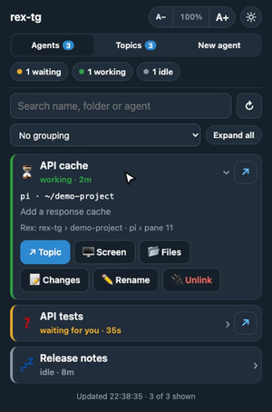

# rex-tg

**Keep working with the coding agents on your Mac from Telegram.**

Say Codex is running tests in Rex when you leave your desk. Open its Telegram topic to check the result, ask for a fix, or answer a supported permission prompt. The same session stays on your Mac with its workspace and permissions.

[Quick start](#quick-start) · [Daily use](docs/quickstart.md#daily-use) · [Troubleshooting](docs/reference.md#troubleshooting) · [All docs](docs/README.md)

[](docs/media/rex-tg-tour.mp4)

The tour shows the optional Mini App with sample data. [English captions](docs/media/rex-tg-tour.en.srt).

## Quick start

**You need:** macOS, [Rex Beta](https://www.superlogical.com/rex/docs/installation), Homebrew, and one agent already signed in and working in a Rex pane: pi, Claude Code (or CUX), or Codex.

1. **Install the CLI on your Mac.**

   ```sh
   brew tap arrokh/rex-tg https://github.com/arrokh/rex-tg
   brew install arrokh/rex-tg/rex-tg
   ```

2. **Create your bot.** In Telegram, open [@BotFather](https://t.me/BotFather), run `/newbot`, and enable **Bot Settings → Threaded Mode** for the new bot.
3. **Start the bridge and pair.** On your Mac, run `rex-tg login` and paste the bot token only into its local prompt. Run `rex-tg install` to add the agent integrations and start the background service. Send `/start <code>` to **your new bot**, using the one-time code printed by `login`. Then run `rex-tg doctor` on your Mac.
4. **Send your first prompt.** Start a fresh agent in a scratch folder in Rex. For Codex, review and trust the new rex-tg hooks when prompted. Send `/agents` to your bot, open the agent's topic, and send `Reply with: rex-tg is connected. Do not run tools.` The answer should appear in that topic.

[Full setup walkthrough](docs/quickstart.md) · [Build from source](docs/reference.md#build-from-source) · [Homebrew trust and upgrades](docs/reference.md#install-with-homebrew)

Core chat serves one owner in a private bot chat. It needs no webhook, public inbound port, or Tailscale. Bot chats are **not end-to-end encrypted**, and the paired account can send input to your terminals. See the [security policy](SECURITY.md) before linking a sensitive project.

## Where to go next

| I want to… | Go to |
| --- | --- |
| Follow progress, inspect a pane, or start another agent | [Daily controls](docs/quickstart.md#daily-use) · [All commands](docs/architecture.md#telegram-commands) |
| Browse files and Git changes, or annotate answers on my phone | [Optional Mini App](docs/reference.md#mini-app) |
| Send voice notes | [Local transcription setup](docs/reference.md#voice-notes) |
| Configure, update, or remove the bridge | [User reference](docs/reference.md) |
| Annotate an agent reply without leaving Rex | [Rex Annotation](https://github.com/arrokh/rex-annotation), a separate macOS plugin; not required by rex-tg |

[Report a bug or request a feature](https://github.com/arrokh/rex-tg/issues/new/choose) · [Contribute](CONTRIBUTING.md) · [Security](SECURITY.md) · [Releases](https://github.com/arrokh/rex-tg/releases) · [MIT license](LICENSE)
