# Architecture, features, and commands

[README](../README.md) · [Feature and command catalog](#feature-and-command-catalog) · [Detailed design](design.md) · [Package contracts](implementation.md) · [Security](../SECURITY.md)

This guide describes the current implementation, including its recovery limits. The diagrams are logical flows, not separate network services or a promise that every step is atomic. Each diagram stays focused so it can be read on a narrow screen. GitHub renders the Mermaid blocks directly; other Markdown readers may show their source.

## Contents

- [System context](#system-context)
- [Components and ownership](#components-and-ownership)
- [Agent discovery and topic lifecycle](#agent-discovery-and-topic-lifecycle)
- [Telegram input to a pane](#telegram-input-to-a-pane)
- [Transcript output to Telegram](#transcript-output-to-telegram)
- [Uncertain delivery and restart](#uncertain-delivery-and-restart)
- [Media processing](#media-processing)
- [Mini App](#mini-app)
- [Trust boundaries](#trust-boundaries)
- [Stored data and operations](#stored-data-and-operations)
- [Source map](#source-map)
- [Feature and command catalog](#feature-and-command-catalog)
  - [Feature catalog](#feature-catalog)
  - [Mac CLI commands](#mac-cli-commands)
  - [Development commands](#development-commands)
  - [Telegram commands](#telegram-commands)
  - [Buttons and message interactions](#buttons-and-message-interactions)
  - [Defaults and limits](#defaults-and-limits)
  - [Unsupported and known limitations](#unsupported-and-known-limitations)

## System context

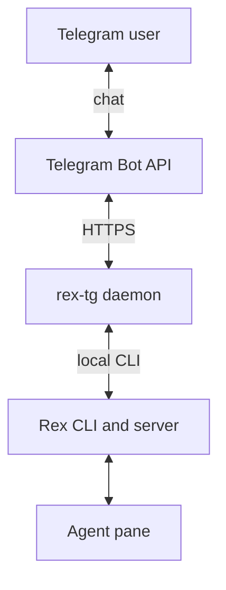

- Agents execute on the Mac, not in Telegram or rex-tg. Their own authentication and tool permissions still apply.
- The daemon long-polls Telegram and sends replies over HTTPS. No bot webhook or inbound internet listener is needed for core chat.
- `internal/rex` runs the CLI with `--autostart=false`. Rex must already be running; rex-tg never starts its server.
- Hooks identify sessions and transcript paths; transcript JSONL files supply agent text. The diagram above compresses these file flows; they are expanded below.
- One configured bot chat has one owner. Linked topics follow conversations; they are not independent users or agent workers.

## Components and ownership

The core loop coordinates mutable daemon state. Background workers do external I/O and return events. A serialized registry queue reconciles Rex and hook reports. SQLite is shared through store methods, not by allowing workers to mutate core maps directly.

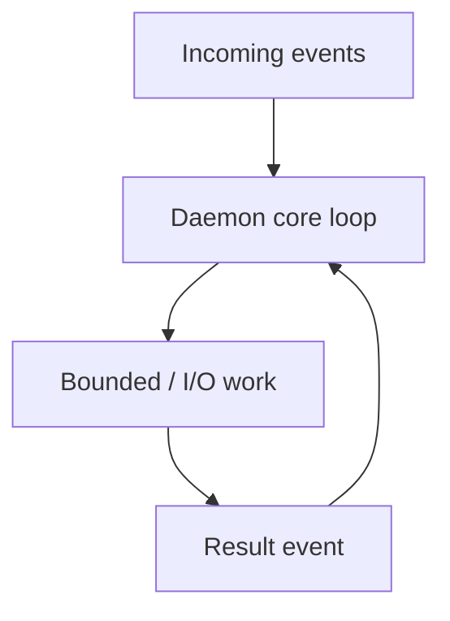

Not all legacy workers have a global cap. Media and Mini App filesystem work do; known unbounded paths are listed under [limits](#limits-and-open-work).

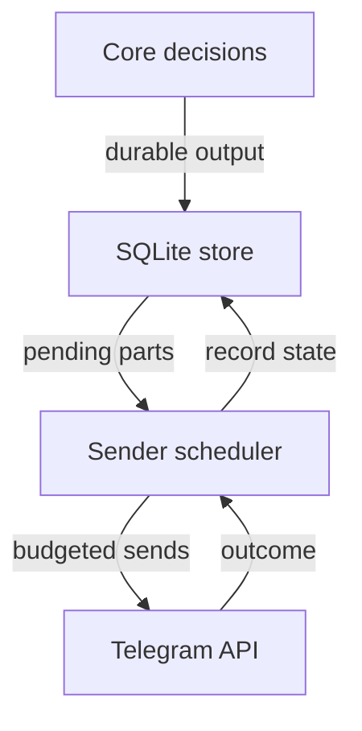

The sender also executes transient commands, edits, reactions, and progress operations. Not every bot notice is a durable outbox row. The core's command/worker paths decide whether to enqueue a durable message or request a transient sender call.

| Component | Responsibility |
| --- | --- |
| Daemon core | Routes Telegram updates; handles topic, queue, tracker, and lifecycle events. |
| Registry | Reconciles panes, process identities, conversations, state signals, takeovers, and resumes. |
| Tailers + adapters | Follow complete JSONL lines and normalize runtime-specific records. |
| Turn tracker | Reduce events into progress, posts, tool state, and turn boundaries. |
| Store | SQLite transactions, dedupe keys, cursors, queue states, snapshots, and small persistent settings. |
| Sender | Pick ready work, enforce budgets/holds, claim parts, send/edit, classify outcomes, and recover unknown parts. |
| Mini App server | Optional authenticated HTTP pages and actions; delegates mutations to daemon logic. |
| Install + hooks | Write integrations safely; hook processes spool small reports without owning the daemon's live maps. |

## Agent discovery and topic lifecycle

Rex events, periodic scans, and hook reports complement each other. A missing or delayed hook is not permission to type into an unverified process.

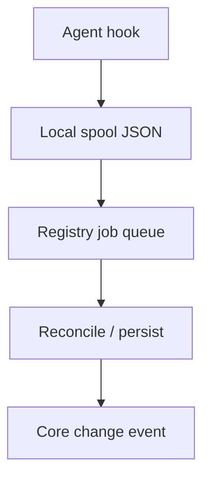

The Rex event stream and scheduled scans also feed the registry queue. The stream's event and error channels are drained together: a dropped-event report requests a rescan even while the stream stays open.

### Open a topic

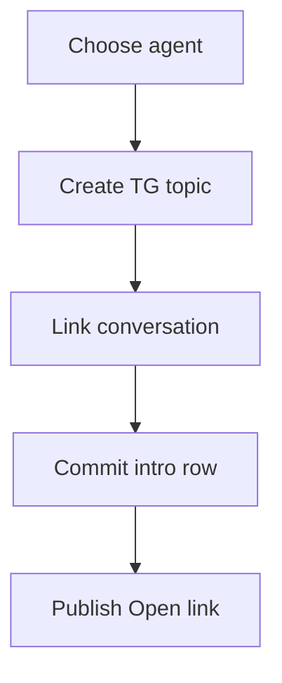

The source-chat Open link waits for successful linkage and a durable intro. Backfill and transcript following start after the intro is queued; the link does not wait for all backfill to finish sending. Failed initialization closes the incomplete local/Telegram topic rather than advertising it as ready. Unknown Telegram topic-creation outcomes are not retried blindly.

### Binding rules

- A topic's `current_conversation_id` identifies its current agent session.
- A new conversation in the same pane may take over the existing topic. Old conversations remain history.
- A resumed conversation may attach to its existing topic in a new pane while that topic is still open.
- An agent exit or gone pane waits for the turn and any in-flight paste, then tries to close its Telegram topic after queued answers. It closes the local binding even if Telegram's call fails. This does not stop a Rex pane or session; Telegram history stays.
- `/unlink` and a Telegram-side topic deletion close only the local binding. Telegram can delete a topic without notifying the bot; a failed send/rename or a validated Open action detects this and reconciles state.
- Startup question buttons retain the process that displayed the question, so another instance of the same runtime cannot inherit an old answer button.

## Telegram input to a pane

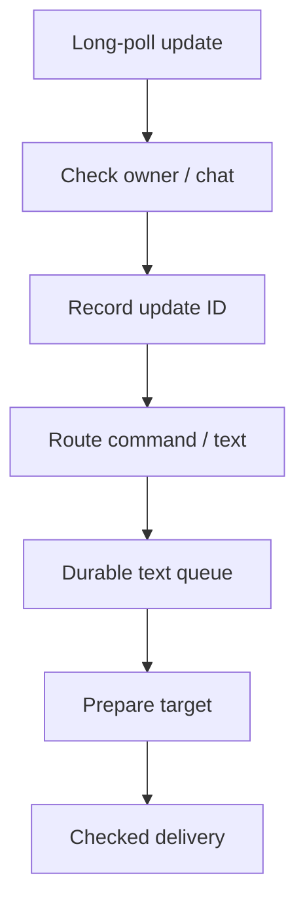

Only stored updates advance the durable poll position through the core. Text is joined when appropriate. Commands can be handled locally, invoke workers, or become queued agent text. The worker-to-queue handoff for controls/notes still has a known crash window; the diagram is not a claim that all preparation is durable.

### Delivery guards

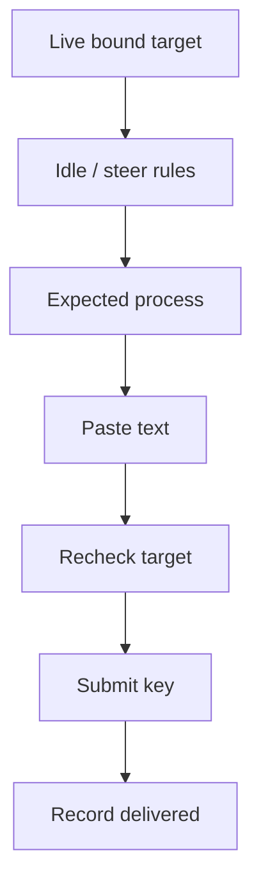

Pause, topic/conversation/pane/process identity, and prompt checks apply at the appropriate boundaries. After external reads, the binding is revalidated before Vim keys, paste, and submit. Unlink cancels an in-flight delivery. A same-PID `/clear` or conversation takeover still invalidates the prepared target.

- Ordinary text can steer a known working agent when configured. Controls, slash/shell commands, and prompt notes wait for idle.
- A steered message reads the screen before paste and Enter so a newly opened prompt cannot receive ordinary input.
- `/force` explicitly skips readiness/prompt waiting, not ownership, pause, or target checks.
- `/approve`, prompt buttons, `/key`, and startup answers are deliberate input operations with their own checks.
- Failure before paste may leave input queued or refused. Failure after an attempted paste/submit is uncertain and is not automatically repeated.
- 👀 means delivered to the pane; an observed echo normally produces 👍. Submitted agent slash commands can be acknowledged without an echo.

## Transcript output to Telegram

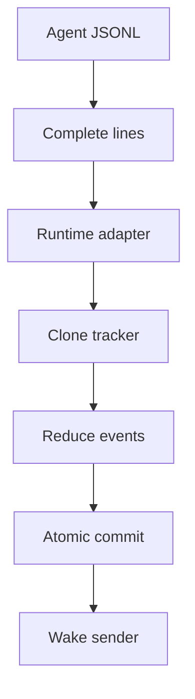

The transaction commits **outbox items + transcript cursor + tracker snapshot**. Backfill commits its answers and end cursor together. On commit failure, the candidate tracker is discarded and the follower restarts from durable state. The clone copies live-only flags as well as durable state.

Dedupe and replay have different jobs:

| Mechanism | What it protects |
| --- | --- |
| Transcript offset + file identity | Resume reading and detect replacement/truncation. |
| Replay timestamp guard | Skip historical events after a reset. |
| Outbox `(thread_id, event_key)` | Avoid inserting a second outgoing event. |
| Candidate tracker rollback | Avoid duplicate tool/progress state after a failed transaction. |
| Acknowledged event identity | Keep a replayed Telegram prompt classified as Telegram input, not Mac input. |
| Prompt-keyed git tree | Keep the original turn-start snapshot through replay; ignore stale snapshot workers. |

Progress/draft and some other side effects are handled outside the transcript transaction. The transaction is not a rollback of every external action. Detailed boundaries are in [the design](design.md#10-sqlite-schema) and the [hardening review](reviews/implementation-hardening.md).

The turn tracker emits a separate answer, progress edits, optional block/tool posts, and optional image/file/page actions. Formatting and redaction happen before output is enqueued. Sender scheduling preserves per-topic part order while sharing the chat's rate budget across topics.

## Uncertain delivery and restart

### Outbox outcome states

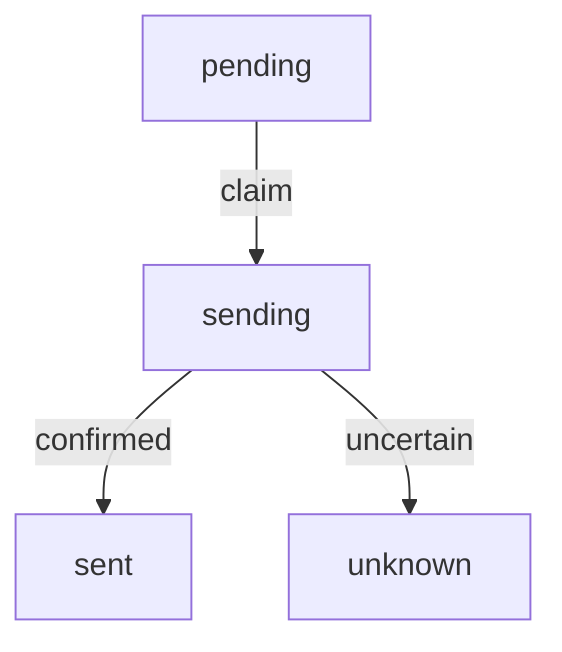

A definite non-send or rate-limit rejection can return work to pending after a wait. Permanent rejection fails the part. Unknown, failed, and sent rows do not block newer pending rows in the same topic; a part currently sending does.

### Unknown does not mean failed

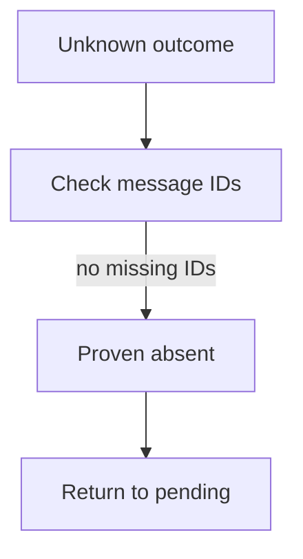

When absence cannot be proved, the part remains unknown and gets an owner recovery notice. The check waits for a suitable completed poll so not-yet-fetched messages are not mistaken for absence. If evidence stays ambiguous, only an explicit `/resend` or Send again action retries it. An owner resend can duplicate an already received message.

Terminal notice persistence and checked state commit together. When a check note is edited into a terminal notice, checked state and removal of its resume key commit together, so restart cleanup does not delete the actionable notice.

### Process restart

1. Acquire the instance lock and open/migrate SQLite.
2. Restore owner/pause/hold state. Convert interrupted `sending` parts to unknown; recover pending checks.
3. Convert interrupted `typing` rows to unknown, not queued; notify rather than retype.
4. Restore media recovery guidance, topic links, trackers, and tailers. Retry configured backfill when a live topic has no cursor.
5. Start poller, sender, registry/event/spool work, and the core loop.

launchd starts the daemon. When its binary changes, the updater waits for a settled replacement and no active typing/send before exiting for restart. A manually started daemon does not self-restart. No architecture diagram implies that a crash can always be distinguished from a successful external action.

## Media processing

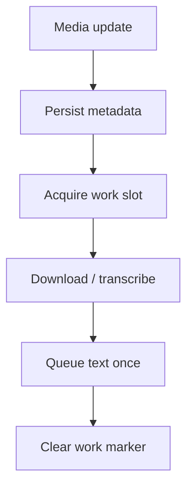

Up to four media workers share the budget. File downloads are read-only operations and can be retried explicitly. If no slot is available, a file retains its retry metadata; voice gets retry-later guidance. Workers hold their slots until they actually finish.

After restart, metadata without a queued text row produces a file-retry notice or voice-interruption notice. An existing queued row prevents duplicate typing. Oversized-file failures clear metadata with the terminal notice. Per-file limits and seven-day cleanup do not constitute an aggregate disk quota.

## Mini App

The optional web surface is a separate inbound path, not the Telegram poller:

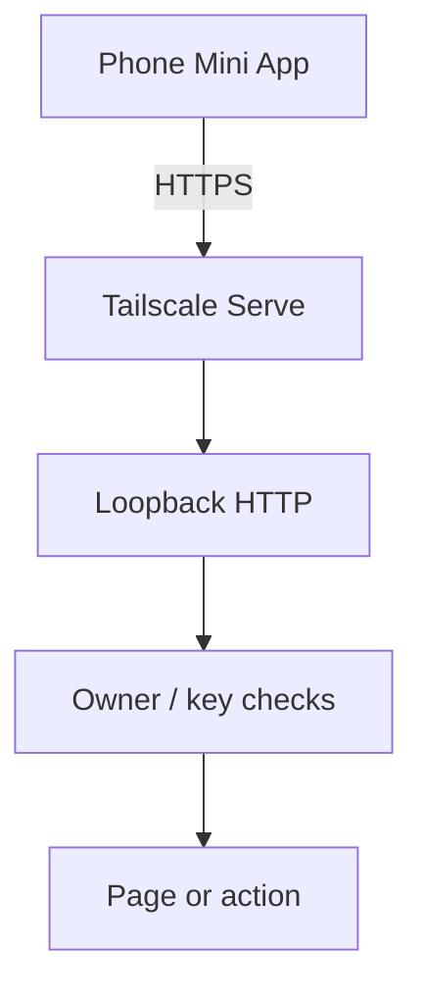

Read handlers serve answers, redacted captures, files, changes, and panel state. Mutating control actions go through daemon logic and use durable action IDs; repeats return the recorded result rather than rerunning an uncertain action. Actions do not bypass pause or agent-start restrictions.

Annotate has a separate send boundary:

- Keyboard launches have no Telegram init-data signature. They submit through the server only when the current key is paired with the owner's verified Tailscale login.
- Signed launches submit through a fresh signed request; both paths use a one-time action ID.
- The page binds notes to a topic and conversation. A stale or cross-session page cannot direct notes into a replacement agent.
- A keyboard key can send only the notes from its bound Annotate page, not arbitrary pane input or an unvalidated action. The validated control panel can also open/rename/unlink/start agents.

Directory enumeration keeps a bounded prefix and warns when incomplete. At most eight distinct filesystem reads can remain outstanding. A macOS permission wait can outlive an HTTP timeout; it keeps its slot until the underlying read completes. Duplicate reads join the same work.

## Trust boundaries

| Boundary | Checks / residual risk |
| --- | --- |
| Telegram → daemon | Pairing, owner user ID, private chat ID, stored update IDs. Telegram itself sees bot-chat content. |
| Daemon → pane | Current topic/session/pane/process, pause/readiness/prompt checks. Agent tools still have their own host permissions. |
| Hook → registry | Runtime payload validation and pane/session reconciliation. Local hook/spool access is not isolation from a malicious process under the same Mac user. |
| Phone → Mini App | Tailscale identity, signed owner data or current keyboard key, page kind and action validation. Loopback/proxy assumptions must hold. |
| Mini App → files | Root containment, regular-file checks, ignored/credential-name filtering, redaction, bounded previews. The daemon can still read as the Mac user. |
| Project → Telegram | Best-effort redaction, not a guarantee. Do not connect projects whose data must never leave the Mac. |

Token material stays in Keychain and is read into process memory, not a config file. Keyboard keys and user message text are stored locally. Preserve the distinction between authentication, process targeting, and at-most-once recovery; none replaces the others.

### Limits and open work

- One owner/private chat and local Rex host only; not a team gateway or remote-execution sandbox.
- Control/prompt-note preparation can still be lost across a stop before the worker-to-queue handoff becomes durable.
- Very long tool-heavy turns retain all tool-call history and grow snapshots.
- No aggregate upload-storage quota; bounded worker count is not a disk quota.
- External agent/Telegram formats and prompt layouts can change. Unsupported data is not safely inferred.

See [SECURITY.md](../SECURITY.md) and the [review's remaining issues](reviews/implementation-hardening.md#remaining-issues-and-limits).

## Stored data and operations

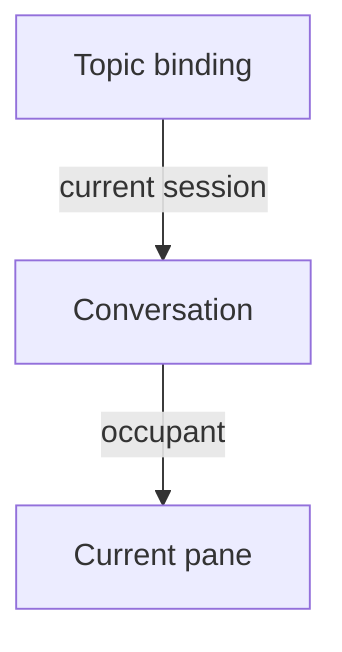

SQLite tables also hold outbox items/parts, inbound updates, transcript cursors, progress, alerts, and seen message numbers. Key-value entries hold tracker snapshots, pause, schedules, action claims, pages, and other bounded/retained state. A pane is not the conversation identity: session takeover/resume changes that association.

| Location | Contents |
| --- | --- |
| macOS Keychain (`rex-tg` / `bot-token`) | Bot token |
| `~/.config/rex-tg/config.toml` | Optional configuration overrides |
| `~/.local/state/rex-tg/rex-tg.db` | SQLite data and recovery state |
| State-folder `spool/` | Hook reports |
| State-folder `uploads/` | Downloaded media; caption/path can be queued as text |
| State-folder `live/` | pi live text for optional draft streaming |
| State-folder `logs/` | Rotating daemon logs and launchd output |

Paths can be relocated with configuration. State and spool permissions restrict access to the Mac user, not to the daemon alone. Cleanup of local rows/files does not delete already sent Telegram messages.

## Source map

| Area | Code |
| --- | --- |
| CLI and launchd entry | [`cmd/rex-tg`](../cmd/rex-tg), [`internal/install`](../internal/install) |
| Core / startup / polling | [`core.go`](../internal/daemon/core.go), [`lifecycle.go`](../internal/daemon/lifecycle.go) |
| Input / target safety | [`typing.go`](../internal/daemon/typing.go), [`internal/inbound`](../internal/inbound) |
| Discovery / binding | [`internal/registry`](../internal/registry), [`internal/rex`](../internal/rex) |
| Hooks and live stream | [`extensions/pi/rex-tg.ts`](../extensions/pi/rex-tg.ts), [`hook.go`](../cmd/rex-tg/hook.go) |
| Output pipeline | [`transcripts.go`](../internal/daemon/transcripts.go), [`internal/tail`](../internal/tail), [`internal/agents`](../internal/agents), [`internal/turn`](../internal/turn) |
| Persistence / delivery | [`internal/store`](../internal/store), [`internal/sender`](../internal/sender), [`internal/telegram`](../internal/telegram) |
| Mini App | [`internal/miniapp`](../internal/miniapp), [`daemon/miniapp.go`](../internal/daemon/miniapp.go), [`controlpanel.go`](../internal/daemon/controlpanel.go) |
| Format / redaction / images | [`internal/format`](../internal/format), [`internal/termimg`](../internal/termimg) |

For deeper behavior use [design.md](design.md); for exported APIs use [implementation.md](implementation.md). Neither the historical plan nor these diagrams are a substitute for checking the current code when changing a safety rule.


## Feature and command catalog

### Feature catalog

#### Sessions and control

| Feature | Availability / behavior |
| --- | --- |
| Agent discovery | Local Rex events, periodic scans, and agent hooks identify pi, Claude Code, and Codex. cux is a supported Claude launcher when installed. |
| Live agents list | `/agents` lists state and updates its message. Open a topic from its button; pin the list for quick access. |
| Topic binding | A topic follows an agent session. A new session in the same pane can take it over; a resumed session can be found in another pane. |
| Start from Telegram | `/new` offers agent and folder choices, or accepts both directly. Supported startup questions are forwarded with checked answer buttons. |
| Start from your shell | `rex-tg new` starts in the current folder and shares the daemon's configured/remembered Rex session. Agent arguments pass through unchanged. |
| Topic naming | Names follow agent/pane information. `/rename` can set topic, pane, and tab names; `/rename auto` clears the custom choice. |
| Readiness and steering | Ordinary text joins a working turn by default; wait mode is configurable. Prompt guards still apply. Commands and prompt notes wait for idle. |
| Agent controls | `/model` and `/effort` show current values or queue a validated setting command. Availability and choices are adapter/config-dependent. |
| Global pause | `/pause` blocks typing and Telegram-driven agent starts, not outgoing replies or agents already running. `/unpause` clears it. The local `rex-tg new` CLI is a separate explicit start. |
| Input safety | Owner, chat, topic, session, pane, process, pause, and prompt checks; special Vim handling for pi and Claude Code. This is not an agent sandbox. |
| Permission prompts | Supported permission/question layouts become buttons, including Pi's readable `Do you want to proceed?` Yes/No confirmation. Untyped screens without a recognized layout get no guessed actions and need the Mac. |
| Scheduled requests | `/at` stores a future request; due messages use normal queue/safety checks. |

#### Messages, progress, and media

| Feature | Availability / behavior |
| --- | --- |
| Progress display | `progress` mode keeps one edited tool-progress message. The first non-final text after a message steered into an active turn is posted separately; the final answer also stays separate. `block` and `final` modes are alternatives. |
| Completion summary | A short successful turn leaves its answer; longer turns, failures, and stopped turns can retain a summary. |
| Verbose / reasoning | Per-topic tool calls/output and stored reasoning can be shown. Reasoning is available only when the agent records it. |
| Live draft text | Optional `[display] stream`; off by default. Drafts are previews, not durable delivered answers. |
| Answers | Markdown rendered through the shared Telegram HTML formatter; long answers use documents or Mini App whole-answer pages. Previously queued rich-message parts remain supported. |
| Receipts and reply context | Reactions reflect delivery/acknowledgment. Replies and selected quotes carry context; compatible long input parts are joined. Commands do not receive appended quotes. |
| Work on the Mac | Mac-originated turns can stay on the Mac behind one notice. Send a Telegram message to return to Telegram; the notice can offer the latest answer. |
| Quick replies | Configurable one-tap answer buttons; off until `[display] quick_replies` is set. |
| Incoming photos/documents | Download to private local storage; type caption and path. Explicit retry after failure/interruption; successful queue insertion is deduplicated. |
| Voice / audio | Local Hex `transcribe` using Hex's selected speech model; first-time setup requires explicit Yes. A running Hex is checked until its model is ready. Failure/interruption is reported; no cloud speech service is built in. |
| Outgoing images | Images named by answers can be sent. Images viewed in tool results are also supported for pi and Claude Code, not Codex. |
| Outgoing file offers | Configured paths in answers get download buttons. Default extensions: `pdf`, `csv`, `tsv`, `html`, `htm`, `xlsx`, `docx`, `pptx`. |
| Mute | Per-topic answer sound setting; permission alerts still notify. |

#### Mini App (optional)

Requires `[miniapp] url` and HTTPS via Tailscale Serve. Keep the listener on loopback and tailnet-only protection enabled. [Setup and authorization details](reference.md#mini-app).

| Page / feature | Behavior |
| --- | --- |
| Control panel | Agents, Topics, and New agent tabs; search, state filters, grouping, open topics, rename, unlink, and clean up stopped topics. |
| Folder explorer | Starts in your home folder; shows folders, optional hidden entries, pinned/recent folders, and repository badges. Forget one/all recent folders without deleting files. |
| Live screen | Read-only terminal colors, refresh while visible, pause, fit width, and scroll-to-bottom controls. It sends no input. |
| File browser | Read-only folder tree; redacted text/Markdown, supported image and video previews. HTML/video browser links require the owner's Tailscale identity. Path containment, ignored-file filtering, and credential-name filtering apply. |
| Changes | Uncommitted, branch, and last-turn views; file tree, diffs, wrapping, next/previous files, and supported image previews. |
| Whole answer | Large answer page with formatted text, tables, and code. Older pages without a session binding may be copy-only. |
| Annotate | Select text or paragraphs, add notes, and send them to the page's bound agent session; copy or prefill chat as alternatives. Keyboard launches need the verified owner Tailscale login; signed launches need fresh Telegram init data. |
| Appearance | Per-device text scale and light/dark choice. |
| Authorization | Telegram-signed owner data or a keyboard key with the configured tailnet login checks. Keyed actions are page-bound and deduplicated; the key cannot unpause typing. |

#### Operations and recovery

- launchd runs one daemon; a lock prevents a second instance for the same state folder.
- SQLite persists queues, topic links, transcript cursors, snapshots, actions, and delivery states.
- Original sends with unknown outcomes are never retried on a guess. Message-number evidence can prove non-arrival; otherwise the owner decides with `/resend`.
- Unknown typing is not automatically repeated. Check the input box before taking action.
- Telegram retry/backoff, shared rate budget, durable long holds, and optional configured proxy/direct fallback.
- Bounded media work, directory scans, and outstanding Mini App filesystem reads.
- Best-effort secret redaction; private state/spool folders; bot token in Keychain.
- Status/doctor commands, rotating daemon logs, and safe binary-replacement restart under launchd.

### Mac CLI commands

Run these in a **Mac terminal**, not in Telegram. `rex-tg help` also lists the main command surface.

| Command and options | Purpose |
| --- | --- |
| `rex-tg login [--config F] [--token-stdin]` | Store a bot token in Keychain, validate it, and print a pairing code. Default uses a hidden interactive prompt. `--token-stdin` reads one line; never put the token in argv or shell history. |
| `rex-tg pair [--config F]` | Print a new pairing code; expires after 10 minutes. Wrong attempts lock each sender after 5 and everyone after 200; a new code resets the counts. |
| `rex-tg new [--config F] <pi\|cux\|claude\|codex> [agent args...]` | Start an agent in this folder, in the configured/remembered Rex session. If creation is unconfirmed, inspect Rex before trying again. |
| `rex-tg install [--only pi\|claude\|codex] [--no-load]` | Install hooks, skills, the pi extension, and launchd. `--only` limits agent integration changes; the Codex/Pi skill is shared. Launchd is still processed. `--no-load` writes the job without loading it. |
| `rex-tg uninstall [--only pi\|claude\|codex] [--force] [--keep-launchd]` | Remove integrations and owned skills. `--only` leaves launchd; the shared Codex/Pi skill stays while either integration remains. `--keep-launchd` preserves it on a full removal. `--force` permits Codex hook removals that shift other hooks' trust positions. State/token are kept. |
| `rex-tg daemon [--config F] [--log-stderr]` | Run foreground daemon; normally launchd starts it. `--log-stderr` also copies logs to stderr. Do not run alongside the installed daemon with the same token. |
| `rex-tg hook <pi\|claude\|codex>` | Internal agent-hook entry point: reads JSON stdin, writes spool metadata, and intentionally returns silently. Not a user messaging command. |
| `rex-tg status [--all] [--config F]` | Read local database status, topics, queues, and alerts. Closed-topic details need `--all`. |
| `rex-tg doctor [--config F]` | Check token/pairing, Rex, hooks, launchd, state, and optional Mini App setup. It makes diagnostic service requests but does not type into panes. |
| `rex-tg version` | Print build version. Aliases: `rex-tg --version`, `rex-tg -v`. Source builds without injected version may say `dev`. |
| `rex-tg help` | Print usage. Aliases: `rex-tg --help`, `rex-tg -h`. |

Subcommands with an option parser accept `-h` / `--help`. The internal `hook` entry point does not expose ordinary help parsing. There is **no global `--config` option**: only the subcommands shown above accept it. `install`/`uninstall` use the default config/path handling.

For `new`, flags **after the agent name belong to the agent**, including `--help` and `--config`:

```sh
rex-tg new --config /absolute/path/rex-tg.toml cux --resume <session>
rex-tg new pi --help  # starts pi with --help, not rex-tg's help
```

`new` also accepts `--config=F` and `--` before the agent name. Other Go flag-parser subcommands accept `--flag=value`; use the long forms above for clarity. See [install/removal details](reference.md#setup-details) before modifying existing integrations.

### Development commands

Run these in a source checkout, preferably with `mise exec -- make <target>`. They are not Telegram commands.

| Make target | Purpose |
| --- | --- |
| `make build` | Build `bin/rex-tg`; no installation or daemon restart. |
| `make test` | Run all Go package tests without the race flag. |
| `make core` | Run the selected core daemon flows. |
| `make check` | Check gofmt, vet, staticcheck, and all race tests. |
| `make fmt` | Format Go source; modifies files. |
| `make e2e` | Run tagged end-to-end tests against isolated real Rex services. |
| `make install` | Build and copy to `~/.local/bin`; affects the installed binary. `INSTALL_DIR` overrides that location. |
| `make clean` | Remove the checkout's `bin/` directory. |
| `make formula-release TAG=<tag>` | Print formula URL/tag/revision for an already pushed release tag; does not tag, push, or edit the formula. |

`go vet -tags e2e ./...` checks the tagged tests too. See [contribution guide](../CONTRIBUTING.md) before running tests or changing integrations.

### Telegram commands

These are the active text commands for your bot, including commands that are not in Telegram's slash menu. Ownership checks apply to all post-pairing commands. Bot command names are case-insensitive; a command addressed to another bot is ignored. See [routing](../internal/inbound/route.go) and [handlers](../internal/daemon/commands.go) for the source of truth.

#### Main-chat and global commands

An unlinked Threaded Mode topic acts as the main chat. These commands also work in linked topics unless noted. `/pause` and `/unpause` have global effect wherever sent.

| Command | Effect |
| --- | --- |
| `/start <code>` | Pair during setup with the code printed by `login`/`pair`. It is not an agent-start command. |
| `/agents` | Show the live agents list and topic-opening buttons. |
| `/attach` | List available agents to link to this existing Telegram topic. Requires a topic; unlink a live topic before attaching a different agent. |
| `/new [agent [folder]]` | Start an agent. Without arguments, pick agent/folder interactively. Example: `/new pi ~/work/app`. Agent arguments are a **CLI** feature, not free-form Telegram `/new` flags. |
| `/rt` | Open the Mini App control panel, if configured. |
| `/annotate` | Explain how to open Annotate from its keyboard button; the command itself does not submit notes. |
| `/templates` | Explain how to open Templates from its keyboard button; the command itself does not send a prompt. |
| `/topics` | List known topics and states. |
| `/status` | Show daemon health, queues, and relevant Telegram holds. |
| `/pause` | Persistently stop typing and Telegram-driven new-agent starts. Outgoing replies continue. |
| `/unpause` | Allow typing again. |
| `/rekey` | Revoke keyboard keys, reset learned Mini App logins, and issue new keyboard buttons. |
| `/help` | Show help for the current context and restore the reply keyboard. |

#### Linked-topic commands

| Command | Effect / restrictions |
| --- | --- |
| `/info` | Show session, pane, state, folder, and settings. |
| `/screen [lines]` | Send a redacted screen picture. Default 30 requested lines; maximum 80 requested, picture limited to 60 lines/200 columns. |
| `/screen text [lines]` | Send redacted text; `text` and count can be in either order. Keeps at most 3,800 trailing characters. |
| `/files` | Open the Mini App read-only file browser. |
| `/changes` | Summarize git changes and open the available Mini App comparison views. |
| `/approve` | Choose a recognized affirmative option on the open permission prompt. Not a general approval for arbitrary unreadable dialogs. |
| `/deny` | Choose a recognized negative option on the open permission prompt. |
| `/esc` | Send Escape after input checks. |
| `/interrupt` | Send configured agent interrupt keys, with pi Vim handling when needed. |
| `/key <keys>` | Send 1–10 key names, e.g. `/key down enter` or `/key ctrl+c`. Names allow letters, digits, `+`, `-`, `_`; options and arbitrary terminal escape payloads are not accepted. |
| `/force <text>` | Explicitly queue text while bypassing readiness/prompt waiting. Owner, live-target, process, and pause checks still apply. Use carefully. |
| `/model [value]` | Show model card/current value or queue a validated model command. |
| `/effort [value]` | Show effort card/current value or queue a validated effort command. Supported values are agent/config-specific. |
| `/mode [progress\|block\|final]` | Show current mode/choices when omitted, or set it. |
| `/verbose [off\|on\|full]` | Show current value or set tool-call/output detail. |
| `/reasoning [on\|off]` | Show current value or set stored-reasoning display. |
| `/resend [id]` | Resend unknown parts of a reply in this topic; omit ID for newest unknown reply. `#<id>` is accepted; a notice ID can resolve to its reply. Check for an existing copy first. |
| `/mute` | Make answers silent; alerts still notify. |
| `/unmute` | Restore answer sound. |
| `/at` | List this topic's schedules. |
| `/at <HH:MM> <text>` | Schedule for the next occurrence in the Mac's local time. |
| `/at <delay> <text>` | Schedule using a duration, e.g. `30m`, `2h`, `1h30m`. Maximum delay 30 days. |
| `/at cancel <n>` | Cancel the schedule identified by the list. |
| `/rename <name>` | Rename topic, Rex pane, and eligible tab; the response reports what succeeded. |
| `/rename auto` | Clear manual naming and resume automatic naming. |
| `/queue` | Show the linked topic’s waiting messages and offer Send now for the eligible messages at the front of the queue. |
| `/unlink` | Stop mirroring the topic and cancel queued/in-flight work where possible. Leaves Telegram history; does not close the agent's pane. |

#### Sending commands to the agent

- Plain text in a linked topic goes to that agent. Plain text in the main chat is ignored, except replies in an active `/new` folder-choice flow.
- Unknown slash commands in a linked topic are passed through. Known bot commands are intercepted.
- `//help`, `//new`, or `//model` remove one slash and send the command directly to the agent.
- Replies/selected quotes provide context when appropriate. Agent/shell commands do not get appended reply text.

### Buttons and message interactions

| Surface | Actions |
| --- | --- |
| Reply keyboard | 🎛 Panel, 🖥 Screen, 📁 Project, ✍️ Annotate, and 🧩 Templates. Project groups Files, Changes, and session-bound Config. Buttons never route as agent prompt text. |
| Waiting notice | Send now / Send all now, Cancel / Cancel all. Sending stops at the first non-steerable command or note and never bypasses prompt checks. |
| Permission / question | Options from the supported prompt, Escape, and where supported tick/next/text-answer flows. Read the full prompt. |
| Startup question | Checked cursor movement and Enter; buttons are bound to the question's process. |
| Reminder | Jump to the original prompt or dismiss the reminder. |
| Recovery notice | Send again for an uncertain outgoing reply; Retry download for a failed/interrupted file. These are different actions. |
| Answers | Whole answer, turn changes, configured quick replies, and offered file downloads when available. |
| Mac-use notice | Latest-answer page or return-to-Telegram action when available. |
| Mini App | Open/rename/unlink agents/topics, clean stopped topics, start agents, manage recent folders, navigate read-only pages, annotate/copy/prefill notes, text scale, and theme. |

Typing the exact reply-keyboard label by hand also routes as its bot command. Labels and available actions can vary with state and configuration.

### Defaults and limits

These are selected shipped defaults, not the full configuration schema. [All defaults](reference.md#configuration).

| Item | Default / bound |
| --- | --- |
| Busy behavior | Steer ordinary text; commands and notes wait for idle. |
| Display | Progress mode; rich answers on; Mac-use notice on; live draft streaming and quick replies off. |
| Queue expiry | 30 minutes for ordinary queued input. |
| Topic backfill | Last 3 final answers when opening/resuming without a saved cursor. |
| Schedules | Up to 20 per topic; late requests after downtime are delivered only within the supported one-hour lateness window, otherwise reported/dropped. |
| Incoming file size | 20 MB; configurable `max_upload_mb`. |
| Active media workers | 4 shared downloads/transcriptions; retries share the limit. |
| Local upload cleanup | Older than 7 days; no aggregate storage quota. |
| Sent-message retention | 30 days, with state-specific cleanup; this does not delete Telegram's copy. |
| Prompt reminder | Starts after 10 minutes by default. |
| Mini App | Off until URL set; tailnet-only on; whole-answer threshold 3,000 characters. |
| Directory work | Inspect at most 4,096 raw names plus truncation probe; file list at most 2,000 entries, folder explorer at most 1,000 folders. Large directories can omit entries and say so. |
| Outstanding filesystem reads | 8 distinct Mini App reads; timed-out reads keep slots until completion. |
| Preview sizes | Text 512 KB, image 4 MB, individual diff 1 MB. |

### Unsupported and known limitations

- macOS only; one paired owner, one private bot chat, local Rex host. No group/team chat or remote Rex-host orchestration.
- No T3 Code pane integration. No built-in agent account provisioning or agent/model subscription.
- Stickers, videos, and unrelated media are not forwarded; edited messages are not retyped.
- Not every startup/permission layout is supported. Unsupported prompts require the Mac.
- No exactly-once guarantee. Network uncertainty can leave a message awaiting an owner decision; explicit resend may duplicate it.
- Secret redaction is best effort. Bot chats are not end-to-end encrypted; stored state and uploads contain user data.
- Known P2 follow-ups: asynchronous control/note preparation has a crash-loss window, and very long tool-heavy turns retain unbounded tool history. See the [hardening review](reviews/implementation-hardening.md#remaining-issues-and-limits).

### Source map for keeping this catalog current

CLI: [`cmd/rex-tg/env.go`](../cmd/rex-tg/env.go) and each subcommand's parser. Telegram routing: [`internal/inbound/route.go`](../internal/inbound/route.go), [`commands.go`](../internal/daemon/commands.go), and [`lifecycle.go`](../internal/daemon/lifecycle.go). Defaults: [`internal/config/config.go`](../internal/config/config.go). Mini App: [`internal/miniapp`](../internal/miniapp) and daemon Mini App integrations. When behavior changes, update this catalog and the detailed reference together.
