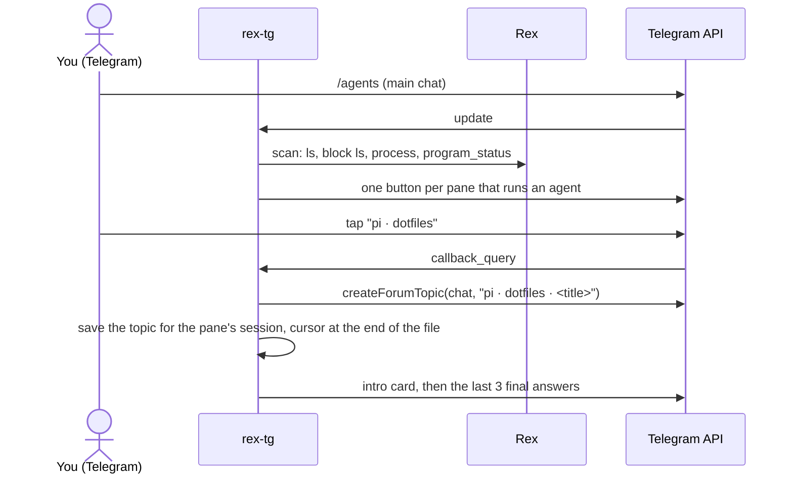
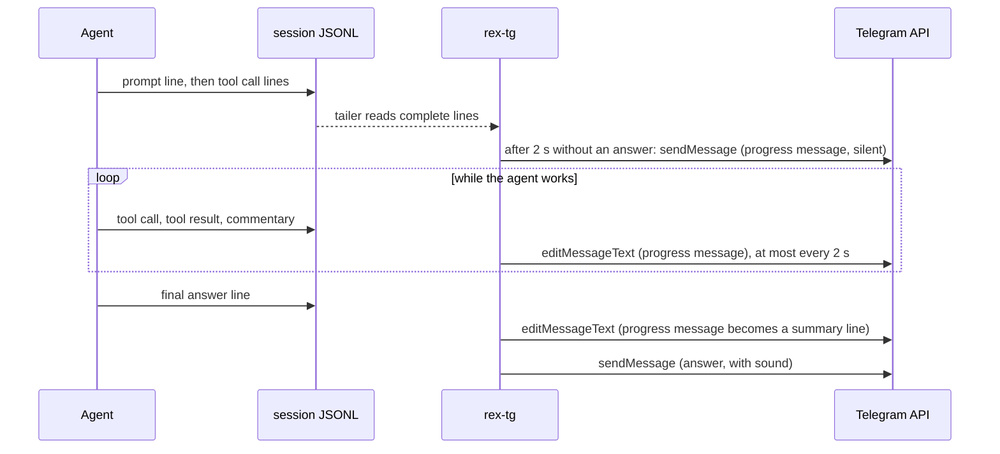
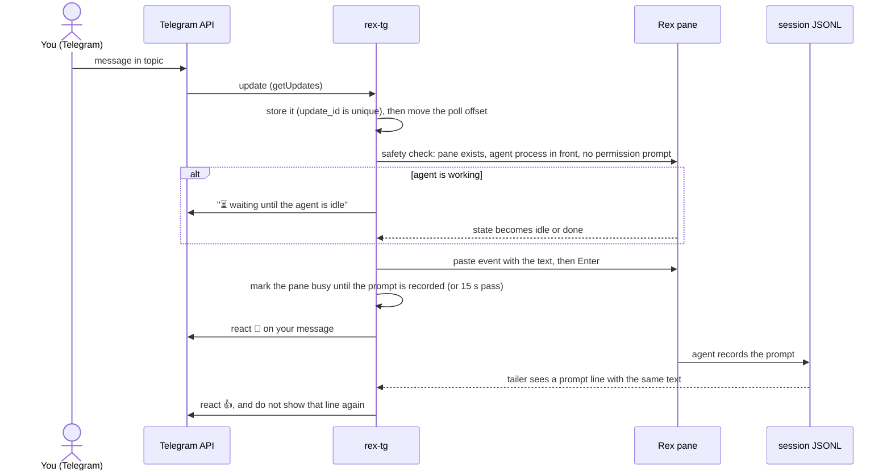
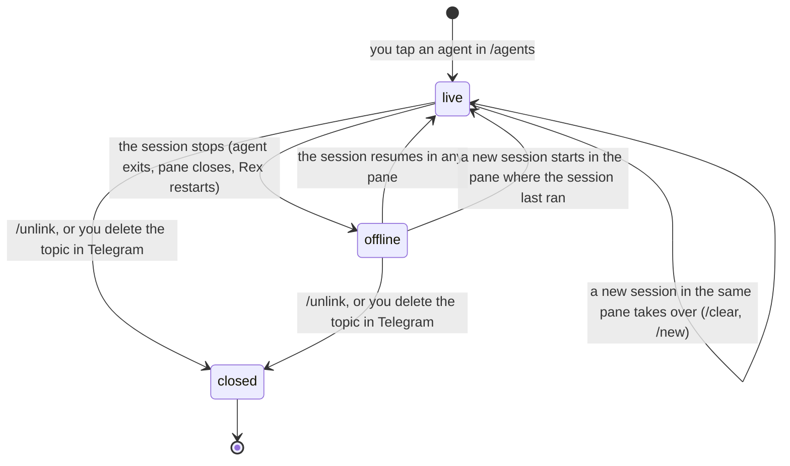
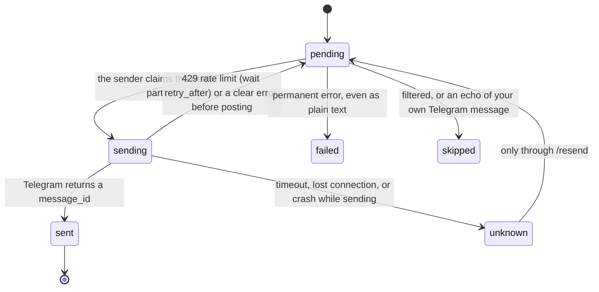

# rex-tg system design

Status: draft, 2026-11-11. It includes the answers to plan questions Q1–Q10 and the revised topic binding (D5). No code exists yet. Work starts with the spikes in [plan.md](plan.md).

Related documents:

- [plan.md](plan.md): decisions, traceability, spikes, phases, rollout, tests, and risks.
- [agent-transcripts.md](agent-transcripts.md): the JSONL formats and hook surfaces of pi, Claude Code, and Codex, as observed on this Mac.

## 1. Goal

rex-tg connects coding agents that run in Rex panes to Telegram.

- **Main chat.** You list the coding agents that are active in Rex panes. You pick one. The bot creates a Telegram topic for the agent session in that pane.
- **A topic follows the agent session.** When you start a new session in the same pane (`/clear`, `/new`), the new session takes over the topic. After a Rex restart, the topic follows the session to the pane that continues it. So in practice, one pane keeps one topic.
- **Agent to Telegram.** When the agent writes new lines to its session JSONL file, the bot shows them in the topic. The display follows OpenClaw and Hermes Agent: one live progress message while the agent works, then the answer as a normal message.
- **Telegram to agent.** When you write in the topic, rex-tg waits until the agent is idle, then types your text into the pane.
- **No duplicates.** SQLite records what was sent. A transcript entry goes to a topic at most once.

Supported agents: pi, Claude Code, and Codex, as CLIs that run in Rex panes on this Mac.

Not supported: T3 Code panes (`tr3x`) and Rex servers on other hosts.

Not in the first version: photos, files, voice notes, group chats, and more than one Telegram user.

## 2. Decisions

| # | Topic | Decision | Status |
| --- | --- | --- | --- |
| D1 | Telegram surface | Topics in the private chat with the bot. BotFather calls this "Threaded Mode"; `getMe` then reports `has_topics_enabled`. | Decided (Q1) |
| D2 | Source of shown text | Each agent's session JSONL file | Decided (your requirement) |
| D3 | Source of agent state | Rex `program_status_changed` events. All three agents report to Rex (observed in S2). The agent's hooks and its transcript lines are the second sources. | Proposed; S2 confirmed that all three agents report to Rex |
| D4 | Path for typed text | Rex pane input: a paste event, then Enter | Decided (your requirement) |
| D5 | What a topic is bound to | The agent session. A new session in the same pane takes over the topic. | Decided (Q5, revised on 2026-11-11) |
| D6 | Finding the transcript of a pane | Agent hooks report the pane and the transcript path. A process scan with a "newest file" guess is the fallback. | Proposed |
| D7 | Delivery guarantee | At most once per (topic, transcript entry). rex-tg never resends on its own when the outcome of a send is unknown. | Proposed |
| D8 | Language | Go | Decided (Q7) |
| D9 | Process model | One daemon, which only one copy may run, owns the database. Hooks only write small JSON files to a spool folder. | Proposed |
| D10 | Display style | Like OpenClaw's `progress` mode and Hermes's grouped tool progress: one edited progress message per turn, then the answer as a new message | Decided (Q2) |
| D11 | Text sent while the agent works | Wait until the agent is idle | Decided (Q3) |
| D12 | History when a topic opens | The last 3 final answers | Decided (Q4) |
| D13 | Progress message at the end of a turn | It becomes one summary line, with the tool rows in a collapsed quote | Decided (Q9) |
| D14 | Label of a shell row | The agent's own description when it gives one. Otherwise the start of the command, after secret removal. | Decided (Q10) |
| D15 | Bot commands and agent commands | In a topic, text that starts with `/` goes to the agent, except the bot's own commands. `//name` sends `/name` to the agent. | Proposed |

Why at most once (D7): Telegram has no idempotency key. If rex-tg crashes after a send leaves but before Telegram answers, it cannot know whether the message arrived. Resending could duplicate it. So rex-tg marks it "unknown" and asks you instead.

## 3. Architecture

```
 This Mac
 ┌───────────────────────────────────────────────────────────────────────────┐
 │  Rex panes                                                                │
 │  ┌─────────┐  ┌──────────┐  ┌─────────┐                                   │
 │  │ pi      │  │ claude   │  │ codex   │ ── agent hooks ──▶ spool/*.json   │
 │  └────┬────┘  └────┬─────┘  └────┬────┘                         │         │
 │       │ append     │ append      │ append                       │         │
 │       ▼            ▼             ▼                              ▼         │
 │   ~/.pi/…jsonl  ~/.claude/…jsonl  ~/.codex/…jsonl       ┌───────────────┐ │
 │       └────────────┴───────┬──────┘                     │ rex-tg daemon │ │
 │                            └── tail from saved offsets ▶│     (Go)      │ │
 │                                                         │    SQLite     │ │
 │  Rex server ── events, process info, status ──────────▶│               │ │
 │             ◀── paste + Enter into the pane ─────────── │               │ │
 │                                                         └───────┬───────┘ │
 └─────────────────────────────────────────────────────────────────┼─────────┘
                                         HTTPS: getUpdates long polling, send
                                                                   ▼
                                         Telegram Bot API  ⇄  your phone
                                         (private chat, one topic per agent session)
```

rex-tg makes only outgoing connections. It opens no port, so it needs no webhook, tunnel, or Tailscale setup.

### 3.1 Components of the daemon

| Component | Job |
| --- | --- |
| Instance lock | Takes an exclusive lock on `~/.local/state/rex-tg/daemon.lock` at start. A second copy exits with a message. |
| Rex gateway | Runs the `rex` CLI with `--autostart=false` and JSON output. Keeps one `rex events --all --json` stream open and restarts it with backoff. rex-tg never starts a Rex server. |
| Pane registry | Knows which panes run an agent, which session each one runs, and its state. Its inputs are Rex scans, Rex events, hook reports from the spool folder, and transcript lines. |
| Transcript tailers | One per session that belongs to a live topic. Each reads new, complete lines from a saved byte offset. A runtime adapter turns each line into normalized events. |
| Turn tracker | Groups events into turns. Drives the live progress message and decides when a turn ends. |
| Outbox and sender | Removes duplicates, keeps order, splits long text, formats it, respects rate limits, and sends or edits messages. |
| Telegram poller and router | Reads updates with `getUpdates` long polling. Routes commands, button presses, and topic messages. |
| Input deliverer | Checks that typing is safe, waits until the agent is idle, types the text, and adds delivery receipts. |

The Rex gateway uses the CLI, not the server socket. The Rex skill guide asks tools to use the CLI's commands instead of the socket. The CLI path is set in the config, because `rex` is not on `PATH` in every shell.

Scans run when you use `/agents`, when Rex events show a change, and every 30 seconds as a safety net. A scan calls `rex ls`, `rex block ls`, and the block methods `process` and `program_status`.

## 4. Main flows

### 4.1 List agents and open a topic



- If the session already has a topic, the button links to it instead of making a new one. Bot API 10.4 supports topic links of the form `https://t.me/<bot_username>/<message_thread_id>`.
- A pane whose session file is not known yet (section 6) shows "(waiting for session)". Tapping it explains that it resolves at the agent's next prompt or turn end.

### 4.2 Agent turn to topic



Every new line passes through the outbox (section 9), so each transcript entry is shown at most once.

### 4.3 Topic message to pane



### 4.4 Agent state

The pane registry keeps one state per pane: `idle`, `working`, `done`, `blocked` (with kind `permission`, `question`, or `auth`), or `error`. It takes the state from three sources (D3):

1. **Rex status.** `program_status_changed` events. All three agents report their state to Rex: pi, Claude Code, and Codex (observed in spike S2).
2. **Hooks.** These are the second source. `UserPromptSubmit` means working. `Stop` means idle. The `PermissionRequest` hooks of Claude Code and Codex mean blocked. Claude Code's `Notification` hook fires both for permission requests and for "waiting for your input". Only `notification_type` = `permission_prompt` means blocked (observed in S3). Claude Code sends no `Stop` after Esc or after a denied permission. So after those, Rex status and the transcript are the only signals (observed in S2). For pi, the extension events `agent_start` and `agent_end` mark the start and end of a run (observed in S3). Codex hook payloads are not yet checked at runtime.
3. **Transcript lines.** These are the third source. A prompt line means working. A final answer means idle.

How the sources combine:

- Each signal has a time: when rex-tg received the Rex event, the time that the hook wrote into its spool file, or the timestamp of the transcript line. The newest signal sets the state.
- A prompt line or a `UserPromptSubmit` hook always means `working`, even when Rex still shows an older `done`. Rex keeps `done` until the agent reports again, so it can be stale.
- A waiting message is delivered only after an `idle` or `done` signal that is newer than the last `working` signal. Silence never counts as idle.
- If no signal arrives for 2 minutes while the state is `working`, rex-tg stops "typing…" but keeps the state. `/info` shows the state and the time of its last signal. `⚡ Send now` stays available.

What the states drive:

- `working`: the turn tracker starts or continues a turn. "typing…" is shown in the topic you used last.
- `blocked` with kind `permission` or `question`: post the bottom of the screen with answer buttons (section 8.6).
- `done` or `idle`: end the turn, and deliver the next waiting message.
- `error`: post a short notice.

End of a turn:

- A turn ends when the final answer line arrives, or when a state source says `idle` or `done`.
- The state often arrives before the answer line is read. So after `idle` or `done`, the turn tracker waits up to 5 seconds for the answer line. In the Claude Code and Codex spikes, the state and the final line came within about 40 ms of each other (observed in S2 and S4).
- If the answer arrives after that, it is still sent, and the summary line is corrected.

The registry detects agents by the pane's foreground process, not by the `app` field of the Rex status. T3 Code panes report `app=claude` while their foreground process is `tr3x`, and they are not supported.

## 5. Agent adapters

Each runtime has one adapter. Its parser is a pure function: it takes one line and returns events. It does no I/O, so fixtures can test it.

```go
type Runtime string

const (
	Pi     Runtime = "pi"
	Claude Runtime = "claude"
	Codex  Runtime = "codex"
)

type EventKind int

const (
	AssistantText EventKind = iota // Phase says commentary, final, or error
	UserPrompt
	ToolCall
	ToolResult
	Title
	SessionBoundary // compaction, clear, branch
	TurnEnd
)

type Event struct {
	Kind  EventKind
	Key   string // deduplication key, for example "pi:<session id>:<entry id>"
	Text  string
	Phase Phase
	Tool  *Tool // for ToolCall and ToolResult
	At    time.Time
}

type Tool struct {
	CallID string
	Name   string
	Label  string // short, safe text (D14): a description, a file path, a search pattern
	OK     bool   // for ToolResult
	Took   time.Duration
}

type Adapter interface {
	Runtime() Runtime
	IsAgentProcess(p rex.Process) bool // uses argv0, invoked path, and executable path
	TranscriptCandidates(cwd string, startedAfter time.Time) ([]string, error)
	ReadHeader(path string) (Header, error)
	ParseLine(line []byte, ctx LineContext) ([]Event, error)
	Input() InputProfile // interrupt keys, permission keys, paste behavior (spike S2)
}
```

Summary of the three formats (details in [agent-transcripts.md](agent-transcripts.md)):

| | pi | Claude Code | Codex |
| --- | --- | --- | --- |
| Detect in a pane | `argv0` is `pi`; the process name is `node` | `argv0` is `claude`, or the invoked path ends in `/.local/bin/claude`. The executable is `~/.local/share/claude/versions/<version>`, so the process name is the version string, for example `2.1.322` (S2) | the executable is the Codex binary (Homebrew Caskroom); name `codex` |
| Transcript | `~/.pi/agent/sessions/--<cwd>--/<time>_<id>.jsonl` | `~/.claude/projects/<cwd folder>/<session_id>.jsonl`. Use the hook's `transcript_path`, because the folder name uses the real path (S2) | `~/.codex/sessions/YYYY/MM/DD/rollout-<time>-<id>.jsonl` |
| Reply lines | `type=message`, `role=assistant`, `text` blocks | `type=assistant`, `text` block (one block per line) | `response_item`, `payload.type=message`, `role=assistant` |
| Final or commentary | `stopReason`: `stop` = final, `toolUse` = commentary | `stop_reason`: `end_turn` = final | `payload.phase`: `final_answer` or `commentary` |
| Tool call and result | `toolCall.id` ↔ `toolResult.toolCallId`, `isError` | `tool_use.id` ↔ `tool_result.tool_use_id`, `is_error` | `call_id` ↔ `call_id` of `*_output` |
| Deduplication key | `pi:<id>:<entry id>` | `claude:<sessionId>:<uuid>` | `codex:<id>:<payload.id>` |
| Prompt lines | `role=user`, `text` blocks | `type=user` with text content, not `tool_result`, not `isMeta` | `event_msg` `item_completed` with `UserMessage` (confirmed in S4) |
| Must skip | `toolResult` content, `custom*`, subagent files | `isSidechain`, `attachment` (except `queued_command`), `queue-operation`, `api-request*`, text that starts with `[Request interrupted`, `subagents/` | `event_msg` `AgentMessage` and `task_complete` (same text again) |
| Hook surface | pi extension: `session_start`, `session_shutdown`, `agent_start`, `agent_end` | `settings.json` hooks | `~/.codex/hooks.json`, with `[features] hooks = true` in `~/.codex/config.toml`. Payloads are not checked at runtime (S3) |

Spike S2 records the real `process` output of each agent in a pane. The detection rules are config values, so a new install path needs no code change.

Spike S2 also set the input profile. Each agent takes a paste, then Enter after a 300 ms wait. A message sent during a run steers the current run. Claude Code and Codex stop a running turn with `escape` (observed). For pi, `escape` comes from its source and was not run. Shorter waits were not tested.

Rules for every adapter:

- Ignore unknown line types. Formats change often between agent versions.
- Never stop a tailer on a bad line. Log the file, the byte offset, and the error, then go on.
- Never pass on thinking blocks or tool output, except when you turn them on (section 8.4).
- Use one source per kind of event. For example, Codex writes each reply twice, so the adapter reads only one of the two records.
- If a line has no ID for its key, the key falls back to `<runtime>:<session id>@<byte offset>`.

## 6. Panes, sessions, and transcripts

The registry keeps one `pane` row per Rex pane and one `conversation` row per agent session. It learns which session runs in which pane from three sources, in this order.

1. **Hook report (exact).** Each agent runs `rex-tg hook <runtime>` from its hooks. The hook reads the hook JSON from stdin and `REX_SESSION` and `REX_BLOCK` from its environment. It writes one JSON file to the spool folder and exits 0. It must finish in under 50 ms and must never fail the agent. It does nothing when `REX_BLOCK` is not set.
2. **Scan and guess.** For a pane whose foreground process is an agent but that has no hook report yet, the registry looks for that runtime's transcripts in the same folder. It takes the newest file that changed after the process started. The row is marked `guess`, and `/agents` shows "(guess)".
3. **Unresolved.** When two agents of the same runtime run in the same folder without hook reports, the registry cannot tell them apart. `/agents` shows them as "(waiting for session)". They resolve at their next hook event, for example the next prompt or turn end.

Rules that protect the mapping:

- The daemon reads the pane's foreground process from Rex when it takes in a hook report. It accepts the report only when that process belongs to the reporting runtime. This rejects reports from nested agents that inherit `REX_BLOCK`, such as a `codex exec` started by Claude, or pi subagents.
- Transcript paths of subagents are ignored: `…/subagents/…` for Claude, and nested `run-*/session.jsonl` and `subagent-artifacts/…` files for pi.
- A process is identified by PID and name together, because the system reuses PIDs.
- A session runs in at most one pane at a time. When it shows up in a new pane, the old pane no longer runs it.

Rules for the hooks:

- **No output.** The hook prints nothing on stdout or stderr. Claude Code adds the stdout of `SessionStart` and `UserPromptSubmit` hooks to the agent's context, so any output would leak into the conversation.
- **Absolute path.** Hook entries call the binary by its absolute path, so they do not depend on `PATH`.
- **Codex trust.** Codex trusts each hook by a hash of its entry, stored under a key that contains the entry's position, such as `hooks.json:session_start:0:0`. The installer appends rex-tg's entries at the end of each event's list, so the positions of existing entries stay the same. Codex then asks you once to trust the new entries (spike S3 confirms).
- **Safe edits.** Other tools edit the same files. The installer finds its own entries by their exact command string, re-reads each file right before it writes, and writes through a temporary file and a rename. The plan's Rollout section has the full rules, including when `uninstall` must refuse.

Hook events per runtime. This table is the full list of the hook entries that `rex-tg install` adds:

| Runtime | Events that report | Data used |
| --- | --- | --- |
| Claude Code | `SessionStart` (source `startup`, `resume`, `clear`, or `compact`), `UserPromptSubmit`, `Stop`, `PermissionRequest`, `Notification`, `SessionEnd` | `session_id`, `transcript_path`, `cwd`, `source`, `hook_event_name` from stdin, and `notification_type` on `Notification` |
| Codex | `SessionStart`, `UserPromptSubmit`, `Stop`, `PermissionRequest` | The names `session_id`, `transcript_path`, `hook_event_name`, `permission_mode`, and `tool_input` occur in the Codex 0.167.0 binary. The spike ran with hooks off, so no payload was checked at runtime (S3). |
| pi | `session_start`, `session_shutdown`, `agent_start`, `agent_end`. The rex-tg extension subscribes to these four. `/new`, `/resume`, and forks are not yet observed. | `ctx.sessionManager.getSessionFile()`, plus `reason`, `previousSessionFile`, and `targetSessionFile` |

Where a tailer starts reading:

| Case | Start |
| --- | --- |
| A topic is created | The end of the file. The last 3 final answers are read from the part before it. |
| A new session takes over a topic (`startup`, `clear`, `/new`) | Byte 0 of the new file |
| A session of a topic resumes (`/resume`, `--continue`, after a Rex restart) | Its saved cursor. Without one: the end of the file, plus the last 3 final answers. |
| A file that rex-tg first sees through a resume | The end of the file, plus the last 3 final answers, even when the file is new. Claude Code and Codex append to the old file and copy no old lines (observed in S3 and S4). pi is not checked yet. |
| No hook says whether a session is new or resumed | Resumed if the file's first line that has a timestamp is older than the agent process; otherwise new. Claude Code's first lines have no timestamp (observed in S4). |
| The path does not exist yet | The tailer waits for the file. pi and Codex create it at the first prompt. Claude Code creates it at session start (observed in S4). |

Resume rule: Claude Code and Codex resume into the same transcript file, with the same session ID. Old lines stay, and no history is copied (observed in S3 and S4). pi is not checked yet, so its resume rule is still an assumption (section 14).

Two guards stop repeats:

- Keys that a topic already shows are skipped (section 10).
- After a re-read from byte 0 (section 13), lines with a timestamp at or before `cursor.last_event_at` are skipped. So a replaced file never replays old turns, and old outbox rows can be deleted safely.

## 7. Topic lifecycle

A topic belongs to one current agent session (D5). A new session in the same pane takes it over.



Rules:

- **One topic per session.** Each session belongs to at most one topic. A topic shows one current session at a time, and it keeps the history of the sessions before it.
- **Take-over.** A new session that has no topic starts in a pane. The session that ran in that pane just before is the current session of a topic, and that topic is not live in another pane. Then the new session takes over the topic, and rex-tg posts a divider such as `── claude · new session (clear) ──`. This covers `/clear`, `/new`, and a different agent started in the same pane.
- **Resume.** A session that already belongs to a topic runs again, in any pane. That topic becomes live again, with the new pane as its address. The divider says `resumed`. The last 3 final answers follow, if the topic does not show them yet.
- **Resume while the topic is busy.** If the topic is live with another session in another pane, the resumed session does not take the topic. `/agents` lists it, and opening it moves it to a new topic. In the same pane there is no conflict: the session that ran there before has stopped, so the resumed session takes the topic back.
- **Resume under a new session ID.** If an agent gives a resumed session a new ID, rex-tg cannot link it to the old one. The take-over rule still applies in the same pane, so the topic stays the same.
- **Rex restart.** After one restart, the block IDs and the session ID stayed the same (spike S5). A new block ID is still possible, because only one restart was tested. A restored pane does not run its creation command again, so the agent must resume in that pane, for example through rexume. That resume was not tested (S5). The topic then follows the session. If the restored pane starts a new session instead, rex-tg has no history for that pane, so the session appears in `/agents` as a new agent.
- **Agent exits.** The topic becomes `offline`, and rex-tg posts "🔴 agent stopped". Messages that you send there are refused with a reason.
- **Deleted topic.** Telegram does not tell the bot that you deleted a topic. rex-tg finds out in two ways, and then the topic becomes `closed`: a send or a rename fails with "message thread not found", or you tap the agent in `/agents`. That button reports the tap to rex-tg instead of opening a link, and rex-tg first sets the topic's name with `editForumTopic` (Telegram answers `TOPIC_NOT_MODIFIED` when the name is the same). When the topic is gone and the pane and the session still exist, rex-tg makes a new topic for the session, with the intro card and the backfill (found live, spike S1).
- **Unlink.** `/unlink` closes the topic in rex-tg. The topic stays in Telegram as history.
- **Topic name.** A short name, at most 32 characters, cut at the end of a word: the name that you gave the Rex pane, else the session name, else the project folder, else the runtime. Rex's default pane name `shell` (and shell or agent program names) do not count. Every 30 seconds, rex-tg compares each live topic's name with its pane and session and renames the topic with `editForumTopic` when it changed. A take-over renames at once.

## 8. Telegram display

The display follows two references:

- OpenClaw's Telegram channel, in its default `progress` mode.
- Hermes Agent's Telegram gateway, with its default tool progress: all tools, grouped in one message that is edited in place.

Section 14 lists the sources and their settings.

There is one difference that rex-tg cannot remove. OpenClaw and Hermes run the model loop themselves, so they get the answer token by token. rex-tg reads the agent's JSONL file, which holds only complete blocks. So the answer arrives whole, not as a live stream of words. Tool calls, tool results, and commentary still arrive one by one, which is enough for a live progress message.

### 8.1 A turn in a topic

While the agent works, one progress message is edited in place:

```
⚙️ Running the parser tests to find the failure
✅ 📖 Read · src/parser.go
✅ 🔍 Grep · "func parseLine"
✅ ✏️ Edit · src/parser.go
▸ 💻 Bash · Run the parser tests
⏱ 1m 12s · 4 tools
```

- **Headline.** The first line of the agent's latest commentary, or "Working…" before there is any.
- **Rows.** One row per tool call: `▸` while it runs, `✅` when it ends, `❌` when it fails. Repeated calls of the same tool in a row collapse, for example `📖 Read ×3`. At most 8 rows of at most 120 characters, as in OpenClaw. Older rows drop off the top.
- **Labels (D14).** A row shows a short label: Claude's Bash `description`, a file path relative to the project, or a search pattern. For a shell call without a description, it shows the start of the command after secret removal. A row never shows tool output or file contents.
- **Footer.** Elapsed time and the number of tools.
- **When it appears.** Only after 2 seconds without an answer, so that quick answers do not flash a progress message first.
- **Silent.** The progress message is sent with `disable_notification`, as Hermes does with tool progress. Edits never make a sound. Answers and alerts do.
- **Edits.** At most one edit every 2 seconds per topic, within the shared rate budget (section 9.3).
- **It stays at the bottom.** If other messages arrive below it while the turn runs, rex-tg posts a new progress message and deletes the old one, as OpenClaw does.
- **At the end (D13).** rex-tg edits the progress message into one summary line, with the tool rows in a collapsed quote. Then it sends the answer as a new message:

```
✅ Done · 1m 12s · 4 tools
┃ 📖 Read · src/parser.go
┃ 🔍 Grep · "func parseLine"
┃ … (tap to show all)
```

- The collapsed quote holds at most 30 rows. Longer turns end with a row such as `… and 12 more`.
- When the turn ends without an answer, the summary line says so, for example `⏹ Interrupted · 1m 12s · 4 tools`, or `❌ Error: <first line>`.

Emoji per tool kind: 📖 read, ✏️ edit or write, 💻 shell, 🔍 search, 🌐 web, 🤖 subagent, 📝 plan or to-do, 🧩 other.

### 8.2 The answer

- The final answer is a normal message, with Markdown turned into Telegram HTML.
- Long answers are split into parts of at most 4000 characters, as in OpenClaw. Splits happen at blank lines first, and never inside a code block. Each part ends with its number, such as `(1/3)`, as in Hermes.
- Tables become monospace blocks.
- Link previews are off, because agent answers often hold URLs from logs and code.
- An answer that needs more than 4 parts is sent as a short preview plus the full text as a `.md` file.

### 8.3 Modes

Set per topic with `/mode`:

| Mode | Shows |
| --- | --- |
| `progress` (default) | Progress message while working, then the final answer |
| `block` | Each assistant text block as its own message, commentary included. No progress message. |
| `final` | Final answers only, plus alerts |

### 8.4 Extra detail, off by default

- `/verbose on`: also post one message per tool call, as a permanent record.
- `/verbose full`: also post each tool's output, shortened and inside a collapsed quote. Secret removal still applies.
- `/reasoning on`: also post thinking text, when the transcript has it. pi stores thinking text. Claude Code often stores it empty. Codex stores reasoning summaries.

### 8.5 Receipts and status signals

| Signal | Meaning |
| --- | --- |
| 👀 on your message | rex-tg typed it into the pane |
| 👍 on your message | the agent's transcript recorded it |
| 👎 on your message | it was refused or failed; a reply says why |
| `⏳ Waiting until the agent is idle` | your message is queued (D11), with buttons `⚡ Send now` and `✖ Cancel` |
| `⛔ Not sent: the pane now runs zsh, not pi.` | the safety check refused it |
| "typing…" | the agent is working; refreshed about every 5 seconds, only in the topic you used last |
| `💻 You (on Mac): …` | a prompt you typed in the pane on the Mac |
| `── pi · new session ──` | a new session took over the topic |

Telegram allows only a fixed set of reaction emoji. Hermes uses 👀, 👍, and 👎. ✅ is probably not in the set, so rex-tg does not use it as a reaction. Spike S1 checks the set.

### 8.6 Permission prompts and questions

When the pane's state is `blocked` with kind `permission` or `question`:

1. rex-tg captures the pane (`rex capture --trim`) and takes the last 25 lines.
2. It posts them as monospace text, with one button per answer, for example `1 Yes`, `2 Always`, `4 No`, and `Esc`. For a question that allows free text, a `✍ Other…` button makes your next message the answer. OpenClaw and Hermes both use buttons like these. `/approve` and `/deny` also work, as in Hermes.
3. A button press sends the matching keys through `rex send-key`. The keys seen in the spikes are listed below.

The `PermissionRequest` hooks of Claude Code carry the tool name and input (observed in S3). rex-tg uses them for the alert's first line. The Codex hook payload is not yet checked at runtime (S3). The screen capture is still needed, because the answer keys are on the screen.

Answer keys seen in the spikes (S2):

- **Claude Code.** `1` (Yes) and `4` (No) were pressed. A digit works alone, without Enter. `2` (always allow) and `3` (auto mode) are on the screen, but were not pressed. Do not offer `3`. `escape` cancels, as the footer says.
- **Codex.** `y` (Yes) was pressed, and the command ran. No Enter was needed. `p` (do not ask again for this command prefix) and `escape` (No) are printed on the prompt. They were not pressed on it.
- **pi.** No permission prompt was seen.

Each alert is stored as a row, with a hash of the prompt text on the screen (section 10). Its buttons carry the alert ID and the answer number, such as `a:17:2`, because callback data is limited to 64 bytes.

Before rex-tg sends the keys for a button:

1. It checks that the button press comes from the owner, in the owner's chat.
2. It captures the pane again. If the prompt text no longer matches the alert's hash, it refuses: "This prompt is gone."
3. It sends the keys and marks the alert `answered`.

When the prompt ends, by a button or on the Mac, rex-tg removes the buttons from the alert message with `editMessageReplyMarkup`. So an old button can never type into whatever is on the screen later.

### 8.7 Main chat and commands

```
/agents

Active agents (3)
🟢 [dotfiles][chore] Plan Rex… · working
   pi · dotfiles
🟡 api migration · waiting for you
   claude · lovina · "Move the API to Go"
⚪ rhasia-scret · idle (guess)
   codex · rhasia-scret

[ Open [dotfiles][chore] Plan Rex… ]
[ ↗ api migration ]
[ Open rhasia-scret ]
[ ↻ Refresh ]
```

The first line is the topic name (section 7). The second line is the runtime and the folder; when the name comes from the pane, the session name follows. `↗` marks a session that already has a topic. Every button reports the tap to rex-tg: for `↗`, rex-tg checks that the topic still exists and posts a link to it, or makes a new topic when it was deleted.

Commands in the main chat: `/agents`, `/topics` (topics and their states), `/status` (daemon health), `/help`.

Commands in a topic: `/info`, `/screen [lines]`, `/approve`, `/deny`, `/esc`, `/interrupt`, `/key <keys>`, `/force <text>`, `/mode progress|block|final`, `/verbose on|full|off`, `/reasoning on|off`, `/resend <id>`, `/unlink`, `/help`.

How a topic routes text that starts with `/` (D15):

- The commands above go to the bot.
- Any other `/` text goes to the agent unchanged, for example `/compact`, `/model`, or `/clear`.
- `//name` sends `/name` to the agent. Use it for an agent command that has the same name as a bot command, such as `//help`.

The topic commands avoid the names that the agents use most, such as `/status`. Telegram cannot show a different command menu per topic, so `setMyCommands` registers the topic commands. In the main chat, a topic command answers "Use this inside a topic."

rex-tg registers the menu twice: for the default scope, and for the owner's chat once paired. Telegram shows a chat's own list first, so the second list also replaces an older list that another program left for that chat (found live: the menu showed `/commands /sessions /sync /upgrade`). `rex-tg doctor` shows which list the owner sees. Lists for one language are not checked.

Intro card when a topic opens:

```
🔗 Linked: pi · dotfiles
Session: Plan Rex annotation plugin
Pane: Personal › shell
Folder: ~/work/personal/dotfiles
Mode: progress · Input: waits until idle
Write here to type into the pane. /help lists the commands.
```

### 8.8 Messages that rex-tg does not pass on

| Message | Answer |
| --- | --- |
| Sticker, video, or another kind not listed in 8.9 | "Only text is supported for now." |
| A voice note when voice notes are not set up (8.9) | "Voice notes need whisper.cpp; see the README." |
| An edited message | "Edits are not sent to the agent." The edit is ignored. |
| A message in a topic that rex-tg did not create, or in a `closed` topic | "This topic is not linked. Use /agents in the main chat." |
| A reply to a bot message | Only your text is sent. The quoted message is not. |
| A message from anyone but the owner | No answer. |

### 8.9 Optional features (Phase 6)

These features are built. Some are off until you set them up.

| Feature | How it works | Default |
| --- | --- | --- |
| Photos and files | rex-tg downloads a photo or document, up to `[input] max_upload_mb` (20 MB, the Bot API limit), to `~/.local/state/rex-tg/uploads/<topic>/`, with mode 0600. Then it types the file's path, after the caption if there is one, like a text message. The agents read image and file paths from the prompt. Uploads older than 7 days are deleted. | On |
| Voice notes | rex-tg downloads the voice note, converts it to 16 kHz mono WAV with ffmpeg, and runs `whisper_cli -m <model> -l <language> -nt -np -f <wav>`. It posts "🎤 <text>" in the topic and types the text like a text message. | Off until `[voice] whisper_cli` and `model` are set |
| Rich messages | Final answers of up to 32768 characters go out with `sendRichMessage` (Bot API 10.1) as Markdown, so Telegram renders tables, code, and headings itself. On a 400 error, rex-tg sends the same text as plain text, or as a `.md` file when it is longer than 4000 characters. This is safe for "at most once", because Telegram posted nothing. | Off (`[display] rich_messages`) |
| `/pause`, `/unpause` | In the main chat. `/pause` stops all typing into panes, for every topic, until `/unpause`. Outgoing messages continue. The flag survives a restart. | Not paused |
| `/mute`, `/unmute` | In a topic. Muted topics send every message without sound. | Not muted |

## 9. Delivery rules

### 9.1 Outgoing message states



- **Claims.** The sender claims a part with `UPDATE … SET state = 'sending' WHERE … AND state = 'pending'` in a transaction, so no part can be claimed twice.
- **Parts.** Each long message is split into parts, and each part has its own state. After a crash, sending continues at the next part, not from the start.
- **Unknown.** rex-tg marks the part `unknown` and posts one notice: `⚠️ Part of reply #42 may not have arrived. /resend 42`. It never retries on its own. `/resend 42` sends only the parts of #42 that are `unknown`.
- **A message's state comes from its parts.** It is `sent` when all parts are `sent`, `unknown` when any part is `unknown`, and `failed` when any part is `failed`.
- **An unknown progress message is not sent again.** The turn goes on without a progress message, and the answer is still sent. The `progress` row is deleted at the end of the turn.
- **Edits and deletes are safe to repeat.** Editing a progress message twice gives the same result, and so does deleting it twice. So edits and deletes retry freely. Only the first send of a progress message follows the rules for sends.

Timeouts:

- `getUpdates` waits up to 50 seconds, with an HTTP timeout of 60 seconds. It asks only for `message`, `edited_message`, and `callback_query` updates.
- Sends, edits, and deletes have an HTTP timeout of 15 seconds. A send that times out is `unknown`.

Telegram errors:

| Error | Handling |
| --- | --- |
| 429 Too Many Requests | Wait for `retry_after`, then retry. Telegram posted nothing. |
| 400 "can't parse entities" | Send the same part again as plain text. Telegram posted nothing. |
| 400 "message is not modified" | The edit counts as done. |
| 400 "message to edit not found" | The progress message is gone. Post a new one. |
| 400 "message to delete not found" | The delete counts as done. |
| 400 "message thread not found" | The topic was deleted. Mark it `closed`. |
| 403 "bot was blocked by the user" | Stop sending. `/status` and `rex-tg doctor` report it. |
| 409 Conflict on `getUpdates` | Another program polls with the same token. Stop polling and report it. |
| Network error or 5xx before an answer | A send is `unknown`. An edit or delete is retried with backoff. |

### 9.2 Order

The sender handles each topic's rows in `id` order, with one request in flight per topic. A final answer is never sent before the tool rows and commentary that came before it in the transcript.

### 9.3 Rate limits

All topics are in one private chat, so they share one budget. The Telegram FAQ says to send about 1 message per second per chat. Edits count against the same limits.

- One token bucket for the chat: 1 request per second, with bursts of up to 5. Both values are config settings. The bucket also honors 429 responses.
- When the budget is short, work goes in this order: answers, alerts, new progress messages, progress edits, "typing…".
- Several pending progress changes merge into one edit.

### 9.4 Text length

Telegram counts the length of a message in UTF-16 code units, after it parses the formatting. rex-tg counts the same way, not in bytes or in runes, so emoji and other non-ASCII text cannot push a part over the limit.

### 9.5 Incoming messages

Before rex-tg types anything, all of these checks must pass. It runs them right before it types.

1. The sender is the owner (`from.id`), and the chat is the owner's private chat with the bot.
2. The topic is `live`.
3. The pane exists, and the agent's process is the pane's foreground process or one of its ancestors. For Claude Code and Codex, the agent stays the foreground process while a tool runs (spike S2). For pi, this was not checked during a tool run. This check stops rex-tg from typing into a plain shell, where the text would run as a command.
4. The agent is not showing a permission prompt. Free text could pick an answer there. Use the buttons instead, or `/force`.

Which checks apply to which action:

| Action | 1 Owner | 2 Live | 3 Agent in front | 4 No open prompt | Alert still matches |
| --- | --- | --- | --- | --- | --- |
| Text message, `⚡ Send now` | yes | yes | yes | yes | — |
| `/force <text>` | yes | yes | yes | skipped | — |
| `/key`, `/esc`, `/interrupt` | yes | yes | yes | — | — |
| Prompt button, `/approve`, `/deny` | yes | yes | yes | a prompt must be open | yes |
| `/screen`, `/info`, `/mode`, other bot commands | yes | — | — | — | — |

Checks 1 and 3 can never be skipped. Only `/force` skips check 4.

Waiting (D11):

- When the agent is working, the message waits in SQLite. rex-tg delivers it when the pane's state becomes `idle` or `done`.
- After rex-tg types a message, it treats the pane as busy until the transcript records the prompt or the state becomes `working`. If neither happens within 15 seconds, it treats the pane as idle again. This stops it from typing two messages into one prompt.
- A waiting message expires after 30 minutes, and rex-tg tells you. The time is a config setting.
- `⚡ Send now` types it at once. All three agents steer: a message sent during a run joins the current run (spike S2). Claude Code reads it after the current tool result.

Joining messages:

- Telegram splits long texts into several messages. rex-tg joins messages that arrive within 300 ms into one prompt, or within 1500 ms when a message is 4000 characters or longer. These are OpenClaw's values.
- Messages that wait while the agent works are delivered one per turn, in the order they arrived. This matches Hermes's `queue` mode and OpenClaw's `followup` mode.

How text is typed:

- rex-tg sends a paste event to the pane: `rex api call block.event` with type `paste` and payload `{"text": "…"}`. Then it sends Enter. A paste keeps multi-line text together as one prompt, because the terminal uses bracketed paste when the program asks for it.
- rex-tg waits between the paste and Enter. The wait is 300 ms for all three agents, and it worked in the spikes (S2). Shorter waits were not tested.
- The pi-vim package (a modal prompt editor for pi) drops a paste unless it is in INSERT mode (found live, spike S1). So before a paste into a pi pane, rex-tg reads the mode label that pi-vim draws at the right end of the input box's bottom border, in the bottom 20 lines of the screen. It presses one key, reads the screen until the label changes, and repeats, up to 6 keys: `i` in plain NORMAL mode, and `escape` in VISUAL mode, on an EX line, or with a pending command (for example `NORMAL 3d_`). pi-vim keeps those Escapes for itself, and each one goes a step back toward plain NORMAL. In plain NORMAL mode an Escape would reach pi and stop the agent, so rex-tg never presses one there. Without a label, nothing is pressed.
- If the label does not change within about 600 ms of a key, rex-tg presses no more keys into that pane while the label stays the same, so keys cannot pile up in a pane that does not read them. The message waits (you get one note), and the next try comes after 3 seconds. It is typed once the editor shows INSERT, and it still expires after 30 minutes like any waiting message.
- In a pi pane, `/interrupt` first brings pi-vim to plain NORMAL mode the same way, then presses the interrupt keys, so the Escape reaches pi. Without the label it adds nothing: pi opens its session tree on a double `escape` by default (`doubleEscapeAction`).
- Claude Code's `/vim` mode needs no extra keys: its prompt takes a paste in every vim mode, and Enter submits in NORMAL and INSERT mode (read from the Claude Code 2.1.322 bundle). It shows no label in NORMAL mode. Known gap: in VISUAL mode, Enter does not submit, so a message stays in the input box. Codex has no vim mode.
- The `inbound` row is `typing` from before the paste until after Enter. If the daemon stops in between, the row stays `typing`. On start, rex-tg marks such rows `unknown` and never types them again. It tells you: "Your message may be in the input box without Enter. Check with /screen." This is the "at most once" rule for typing.

Echo:

- rex-tg matches the prompt in the transcript to your message by a hash of the normalized text, within 10 minutes.
- If no hash matches, the first prompt within 30 seconds of the delivery counts as the echo when its normalized text starts with the same 40 characters. Agents sometimes change a prompt slightly when they store it.
- An echo is not posted to the topic again. It only turns 👀 into 👍.
- A message sent during a run has no `user` line in Claude Code. Its echo is the `queued_command` attachment (spike S2). Codex writes a `user` line and a `UserMessage` item for it. pi writes a `user` line after the tool result.

## 10. SQLite schema

The database lives at `~/.local/state/rex-tg/rex-tg.db` and uses WAL mode. Only the daemon writes to it. `Open` sets WAL mode, foreign keys, and a 5-second busy timeout (`internal/store/store.go`). The schema is in `internal/store/schema.sql`, which the binary embeds. The SQL below is a copy of that file.

```sql
-- rex-tg schema, version 1. See docs/design.md section 10.
-- PRAGMAs (WAL, foreign_keys, busy_timeout) are set by Open, not here.

CREATE TABLE conversation (
  id            INTEGER PRIMARY KEY,
  runtime       TEXT NOT NULL CHECK (runtime IN ('pi', 'claude', 'codex')),
  native_id     TEXT NOT NULL,
  transcript    TEXT NOT NULL,
  cwd           TEXT,
  title         TEXT,
  thread_id     INTEGER REFERENCES thread (id),
  first_seen_at INTEGER NOT NULL,
  UNIQUE (runtime, native_id)
) STRICT;

CREATE TABLE pane (
  id                   INTEGER PRIMARY KEY,
  rex_host             TEXT NOT NULL,
  rex_block            TEXT NOT NULL,
  rex_session          TEXT NOT NULL,
  label                TEXT,
  conversation_id      INTEGER REFERENCES conversation (id),
  last_conversation_id INTEGER REFERENCES conversation (id),
  pid                  INTEGER,
  process_name         TEXT,
  source               TEXT CHECK (source IN ('hook', 'scan', 'guess')),
  state                TEXT,
  state_kind           TEXT,
  state_at             INTEGER,
  busy_until           INTEGER,
  seen_at              INTEGER NOT NULL,
  gone_at              INTEGER,
  UNIQUE (rex_host, rex_block)
) STRICT;
CREATE UNIQUE INDEX pane_conversation ON pane (conversation_id) WHERE conversation_id IS NOT NULL;

CREATE TABLE thread (
  id                      INTEGER PRIMARY KEY,
  chat_id                 INTEGER NOT NULL,
  message_thread_id       INTEGER NOT NULL,
  current_conversation_id INTEGER NOT NULL REFERENCES conversation (id),
  name                    TEXT NOT NULL,
  mode                    TEXT NOT NULL DEFAULT 'progress' CHECK (mode IN ('progress', 'block', 'final')),
  verbose                 TEXT NOT NULL DEFAULT 'off' CHECK (verbose IN ('off', 'on', 'full')),
  reasoning               INTEGER NOT NULL DEFAULT 0 CHECK (reasoning IN (0, 1)),
  muted                   INTEGER NOT NULL DEFAULT 0 CHECK (muted IN (0, 1)),
  status                  TEXT NOT NULL DEFAULT 'live' CHECK (status IN ('live', 'offline', 'closed')),
  created_at              INTEGER NOT NULL,
  closed_at               INTEGER,
  UNIQUE (chat_id, message_thread_id)
) STRICT;
CREATE UNIQUE INDEX thread_current ON thread (current_conversation_id) WHERE status <> 'closed';

CREATE TABLE cursor (
  transcript    TEXT PRIMARY KEY,
  dev_ino       TEXT NOT NULL,
  offset        INTEGER NOT NULL,
  last_event_at INTEGER,
  updated_at    INTEGER NOT NULL
) STRICT;

CREATE TABLE outbox (
  id         INTEGER PRIMARY KEY,
  thread_id  INTEGER NOT NULL REFERENCES thread (id),
  event_key  TEXT NOT NULL,
  kind       TEXT NOT NULL,
  body       TEXT NOT NULL,
  state      TEXT NOT NULL CHECK (state IN ('pending', 'sending', 'sent', 'unknown', 'failed', 'skipped')),
  silent     INTEGER NOT NULL DEFAULT 0 CHECK (silent IN (0, 1)),
  attempts   INTEGER NOT NULL DEFAULT 0,
  last_error TEXT,
  created_at INTEGER NOT NULL,
  sent_at    INTEGER,
  UNIQUE (thread_id, event_key)
) STRICT;

CREATE TABLE outbox_part (
  outbox_id     INTEGER NOT NULL REFERENCES outbox (id),
  part          INTEGER NOT NULL,
  state         TEXT NOT NULL CHECK (state IN ('pending', 'sending', 'sent', 'unknown', 'failed')),
  content       TEXT NOT NULL,
  format        TEXT NOT NULL CHECK (format IN ('html', 'plain', 'document')),
  filename      TEXT,
  tg_message_id INTEGER,
  PRIMARY KEY (outbox_id, part)
) STRICT;
CREATE INDEX outbox_part_state ON outbox_part (state);

CREATE TABLE progress (
  thread_id     INTEGER PRIMARY KEY REFERENCES thread (id),
  turn_key      TEXT NOT NULL,
  state         TEXT NOT NULL CHECK (state IN ('waiting', 'sending', 'shown', 'unknown')),
  tg_message_id INTEGER,
  headline      TEXT,
  rows          TEXT NOT NULL DEFAULT '[]' CHECK (json_valid(rows)),
  started_at    INTEGER NOT NULL,
  edited_at     INTEGER
) STRICT;

CREATE TABLE alert (
  id            INTEGER PRIMARY KEY,
  thread_id     INTEGER NOT NULL REFERENCES thread (id),
  kind          TEXT NOT NULL CHECK (kind IN ('permission', 'question')),
  screen_hash   TEXT NOT NULL,
  options       TEXT NOT NULL CHECK (json_valid(options)),
  tg_message_id INTEGER,
  state         TEXT NOT NULL CHECK (state IN ('open', 'answered', 'gone')),
  created_at    INTEGER NOT NULL
) STRICT;

CREATE TABLE inbound (
  update_id         INTEGER PRIMARY KEY,
  chat_id           INTEGER NOT NULL,
  message_thread_id INTEGER,
  tg_message_id     INTEGER,
  from_id           INTEGER NOT NULL,
  kind              TEXT NOT NULL,
  body              TEXT NOT NULL,
  body_hash         TEXT,
  thread_id         INTEGER REFERENCES thread (id),
  state             TEXT NOT NULL CHECK (state IN ('queued', 'typing', 'delivered', 'acked', 'refused', 'expired', 'unknown', 'done')),
  reason            TEXT,
  created_at        INTEGER NOT NULL,
  delivered_at      INTEGER,
  acked_event_key   TEXT
) STRICT;
CREATE INDEX inbound_thread ON inbound (thread_id, state);

CREATE TABLE kv (key TEXT PRIMARY KEY, value TEXT NOT NULL) STRICT;
```

What each table holds. The notes that were in the old inline comments are kept here:

- `conversation`: one agent session, which is one session JSONL file. `native_id` is the agent's session ID. `transcript` is the absolute path of the JSONL file. `thread_id` is the topic this session belongs to (D5).
- `pane`: one Rex pane, and what runs in it now. `rex_host` is the Rex host ID. `conversation_id` is NULL when no agent runs. `last_conversation_id` is the session that ran here before (take-over). `process_name` is compared with `pid`, because PIDs are reused. `state` is `idle`, `working`, `done`, `blocked`, or `error`. `state_kind` is `permission`, `question`, or `auth`. `state_at` is when `state` was last set. `busy_until` is set after typing (section 9.5). `gone_at` is set when the pane closes.
- `thread`: one Telegram topic, and the session it shows now. `current_conversation_id` changes on take-over and resume. `mode`, `verbose`, and `reasoning` are the display settings (sections 8.3 and 8.4). `muted` = 1 means answers are sent without sound. `closed_at` is set when the topic is closed, and cleared when it is reopened. The outbox rows of a topic closed for more than 30 days are deleted (see Housekeeping).
- `cursor`: the read position in one transcript file. `dev_ino` detects a replaced file. `offset` is the byte offset after the last complete line. `last_event_at` is the timestamp of the newest line read (the replay guard in section 6).
- `outbox`: one outgoing message. The unique key (`thread_id`, `event_key`) is the "no duplicates" rule. `event_key` looks like `pi:<session id>:<entry id>`. `kind` is `answer`, `block`, `tool`, `prompt`, `notice`, `divider`, or `backfill`. `body` is normalized Markdown, after secret removal. `silent` = 1 means the message is sent without sound.
- `outbox_part`: one part of an outgoing message. `content` is the text to send. `format` is `html`, `plain`, or `document`. `filename` is set for documents only.
- `progress`: the live progress message of the running turn. At most one per topic. `turn_key` is the session and the key of the turn's first event. `tg_message_id` is set once the message exists. `rows` is a JSON array.
- `alert`: a permission prompt or question with answer buttons (section 8.6). `screen_hash` is a hash of the prompt text on the screen. `options` holds the button labels and keys, in order.
- `inbound`: one incoming Telegram update. `update_id` makes each update count once. `kind` is `text`, `command`, `callback`, or `other`. `body_hash` is used to match the echo in the transcript. For text, `state` goes from `queued` to `typing`, then `delivered`, then `acked`. A `typing` row becomes `unknown` after a crash. `refused` and `expired` are the other end states. A handled command or button press is `done`. `reason` says why a message was refused or expired. `acked_event_key` is the transcript line that confirmed it.
- `kv`: small values, such as the Telegram poll offset, the owner user ID and chat ID, and the schema version.
- Indexes: `pane_conversation` allows one pane per session. `thread_current` allows one open topic per current session. `outbox_part_state` and `inbound_thread` speed up lookups by state.

`conversation` and `thread` refer to each other. The daemon writes them in one transaction, in this order: the `conversation` row with an empty `thread_id`, then the `thread` row, then `conversation.thread_id`. One rule must always hold, and a test checks it: the current session of a topic belongs to that topic. In other words, `thread.current_conversation_id` points to a conversation whose `thread_id` is that topic.

The rules that make this work:

- **One transaction per batch of lines.** The tailer inserts the outbox rows and moves the cursor in the same transaction. If the daemon stops before the commit, it reads the same lines again, and `UNIQUE (thread_id, event_key)` ignores them.
- **Keys survive session changes.** Each key contains the session ID. When a topic changes sessions, old and new keys never collide.
- **The poll offset moves after the insert.** An update is stored in `inbound` before the `getUpdates` offset moves past it. If the daemon stops in between, Telegram sends the update again, and the primary key ignores it. Telegram keeps unread updates for 24 hours.
- **Progress messages survive restarts.** After a restart, rex-tg reads the `progress` rows. It keeps editing a progress message whose turn still runs. It turns the others into a summary line.

Housekeeping:

- Spool files are deleted once they are read. Files older than 24 hours are deleted unread.
- Once a day, rex-tg deletes `sent` and `skipped` outbox rows older than 30 days, rows of topics closed more than 30 days ago, and `inbound` and `alert` rows older than 30 days. The replay guard in section 6 makes this safe.
- Before a schema migration, the daemon copies the database to `rex-tg.db.bak-<version>`. A failed migration leaves the copy in place and stops the daemon.

## 11. Security and privacy

- **The bot can type into terminals.** Treat the Telegram account and the bot token like an SSH key. Turn on two-step verification in Telegram.
- **Pairing.** `rex-tg login` stores the bot token, then shows a one-time code. You send `/start <code>` to the bot. The daemon saves your user ID and chat ID as the owner. Until then, the bot answers nobody. The code is random, works once, and expires after 10 minutes. After 5 wrong codes, pairing stops until you run `rex-tg login` again.
- **Allowlist.** After pairing, rex-tg accepts updates only from the owner's user ID in the owner's private chat. It drops everything else and logs only `update_id` and `from.id`.
- **Token.** The bot token is stored in the macOS Keychain. It is never in the config file, the logs, or the dotfiles repository. `rex-tg login` runs `security add-generic-password -U -s rex-tg -a bot-token -w` with no value after `-w`, so `security` asks for the token, and the token never appears in a process list. The daemon reads it with `security find-generic-password`. Because `security` created the item, launchd can start the daemon without a Keychain dialog (Phase 1 checks this).
- **Telegram is not end-to-end encrypted for bots.** Agent replies pass through Telegram's servers. rex-tg removes common secret formats before it sends text: API keys, GitHub tokens, AWS keys, private key blocks, JWTs, and bot tokens. The removal also runs on progress labels, screen captures, and backfill. It is a best effort, not a guarantee.
- **Progress rows hold no output.** Like OpenClaw's progress drafts, rows show only tool names and short labels, never tool output, file contents, or full arguments. `/verbose full` is the only way to show output, and you turn it on per topic.
- **Typing only into agents.** The check in 9.5 stops rex-tg from typing into anything but the session's agent process.
- **No server start.** rex-tg calls `rex` with `--autostart=false`.
- **Local files.** The state folder and the spool folder are only readable by you (mode 0700). Spool files are mode 0600.

## 12. Files, processes, and code

| Item | Location |
| --- | --- |
| Binary | `~/.local/bin/rex-tg` (one Go binary for the daemon, the hooks, and the CLI) |
| Daemon | launchd agent `~/Library/LaunchAgents/local.rex-tg.plist`, with `KeepAlive` |
| Config | `~/.config/rex-tg/config.toml` |
| State | `~/.local/state/rex-tg/`: `rex-tg.db`, `daemon.lock`, `spool/`, `logs/` |
| Token | Keychain item, service `rex-tg`, account `bot-token` |
| pi extension | `~/.pi/agent/extensions/rex-tg.ts`, a few lines of TypeScript that call `rex-tg hook pi` |
| Claude Code hooks | entries in `~/.claude/settings.json` |
| Codex hooks | entries at the end of each event's list in `~/.codex/hooks.json` |

Config example:

```toml
[telegram]
# The token is in the Keychain. The owner is saved by pairing (rex-tg login).
rate_per_second = 1
rate_burst = 5

[rex]
cli = "/Applications/Rex Beta.app/Contents/Helpers/Rex Server.rex/Contents/MacOS/rex"
scan_interval = "30s"

[agents]
# Detection rules (section 5). Spike S2 confirms them.
pi_argv0 = ["pi"]
claude_argv0 = ["claude"]
claude_exec_glob = ["~/.local/share/claude/versions/*"]
codex_names = ["codex"]

[display]
mode = "progress"            # progress | block | final
backfill = 3                 # final answers to post when a topic opens
show_mac_prompts = true
progress_delay = "2s"
progress_edit_interval = "2s"

[input]
queue_expiry = "30m"
join_window = "300ms"
busy_after_typing = "15s"
```

CLI commands:

| Command | Job |
| --- | --- |
| `rex-tg daemon` | Run the daemon (launchd calls this). |
| `rex-tg hook <runtime>` | Called by agent hooks. Writes one spool file and prints nothing. |
| `rex-tg login` | Store the bot token in the Keychain, then pair your Telegram account (section 11). |
| `rex-tg install` / `uninstall` | Add or remove the launchd agent, the hooks, and the pi extension. `--only pi`, `--only claude`, or `--only codex` limits the change to one agent's hooks, plus the launchd agent on install. Back up each file before a change. Running either one twice changes nothing. |
| `rex-tg status` | Show topics, queues, and recent errors. Opens the database read-only. |
| `rex-tg doctor` | Check the Rex CLI path, the Rex server, the token, `getMe` (`has_topics_enabled`), the pairing, and the hooks. |

Go stack (Go 1.25, installed through mise):

| Need | Choice | Reason |
| --- | --- | --- |
| SQLite | `modernc.org/sqlite` with `database/sql` | Pure Go, so no cgo and simple builds. It bundles a recent SQLite with `STRICT` tables. |
| Telegram | Own small client on `net/http` | About 15 methods. Full control over retries, which D7 needs. |
| File changes | `github.com/fsnotify/fsnotify`, plus a 1-second size check | Watching can miss events, and the check is cheap for a few files. |
| Markdown | `github.com/yuin/goldmark`, with an own renderer for Telegram HTML | Telegram supports only a few tags. |
| Editing hook files | `github.com/tidwall/gjson` and `github.com/tidwall/sjson` | They change one JSON value and keep the rest of the file as it was, including key order. |
| Config | `github.com/BurntSushi/toml` | Small and stable. |
| Logs | `log/slog` with JSON output, rotated by `gopkg.in/natefinch/lumberjack.v2` | Standard logger, and logs do not grow without limit. |
| Instance lock | `syscall.Flock` | Standard library. |
| Keychain | the `/usr/bin/security` command | No cgo. |
| CLI | standard `flag` package with subcommands | Few commands. |

Source layout:

```
cmd/rex-tg/main.go          CLI entry: daemon, hook, login, install, status, doctor
internal/
  config/
  db/                       schema.sql (embedded), migrations
  rex/                      CLI wrapper, event stream
  registry/                 panes, sessions, scans, hook spool, resolver, take-over
  agents/                   adapter interface
  agents/pi/  agents/claude/  agents/codex/
  tail/                     offset-based JSONL tailer
  turn/                     turn tracker and progress message
  outbox/                   outbox, sender, parts, format, redact
  telegram/                 client, poller, router, views
  inbound/                  safety check, queue, typing, receipts
  install/                  claude, codex, pi, launchd
extensions/pi/rex-tg.ts     pi extension template
testdata/<runtime>/*.jsonl  synthetic transcripts only
```

## 13. Failure handling

| Failure | Effect | Handling |
| --- | --- | --- |
| Daemon is down | Nothing is sent or typed. | Hooks keep writing spool files. On start, tailers continue from their offsets, and the unique keys stop repeats. Telegram keeps updates for 24 hours. |
| A second daemon starts | Two copies would poll and send. | The instance lock stops the second copy. |
| Daemon restarts during a turn | A progress message may be left behind. | The `progress` table lists it. rex-tg keeps editing it, or turns it into a summary line. |
| Rex server is not running | No pane can be read or typed into. | All topics are `offline`. rex-tg retries every 10 seconds and never starts a server. |
| Rex server restarts | Block IDs and the session ID stayed the same after one restart (spike S5). A new block ID is still possible. | Topics follow their sessions when the agents resume (section 7). Input is refused until then. |
| A hook cannot write its spool file | One report is lost. | The hook still exits 0 without output. The next hook event or the next scan fills the gap. |
| Transcript replaced or shortened | The offset no longer fits the file. | A new `dev_ino`, or a size below the offset, starts a read from byte 0. The replay guard and the unique keys (section 6) absorb repeats. |
| Telegram is unreachable | Rows wait in the outbox. | They are sent later, in order. Stale progress edits are dropped. |
| Another program polls with the same token | Telegram answers 409. | Polling stops, and `rex-tg doctor` reports it. |
| A line is not complete yet | A half line is at the end of the file. | The tailer reads only up to the last newline. |
| A transcript line is very large | Tool output or images can be megabytes. | The tailer reads line by line and skips lines over a size limit after reading their type. |
| Agent format changes | The adapter does not know the new line types. | Each adapter returns a `KindUnknown` event with the type name. The daemon counts them per runtime in KV key `unknown_line_types`, and `rex-tg doctor` shows them as warnings. |

## 14. Evidence and assumptions

Checked on this Mac on 2026-11-10 and 2026-11-11:

- Rex `0.0.1793981048-g01d6c4` (API revision 11). `rex events --all --json` sends `block_event` items named `program_status_changed`, with `state`, `app`, and `msg`. A `pi` pane reported `state=done`. T3 Code panes report `app=claude`.
- Rex block method `process` returns the foreground process with `pid`, `name`, `path`, `invoked_path`, `argv0`, and `cwd`, plus `ancestors` and `child`. A pi pane showed `name=node` and `argv0=pi`.
- Rex `block.event` accepts input events of type `paste`, with the payload `{"text": "…"}` (from `rex api describe block.event`).
- The Rex binaries contain no Telegram support.
- `~/.local/bin/claude` is a link to `~/.local/share/claude/versions/2.1.322`. Claude Code also runs background helper processes (`claude daemon run`, `bg-pty-host`).
- `/opt/homebrew/bin/codex` is a link to the Codex 0.167.0 binary in the Homebrew Caskroom.
- `~/.codex/config.toml` stores a `trusted_hash` per hook, under keys such as `hooks.json:session_start:0:0`.
- `~/.claude/settings.json` and `~/.codex/hooks.json` are regular files, not links into the dotfiles repository.
- Transcript formats of pi 1.5.2, Claude Code 2.1.322, and Codex CLI 0.167.0, including the IDs that pair tool calls with results. See [agent-transcripts.md](agent-transcripts.md).
- Hooks are already in use for all three agents on this Mac.
- Go 1.25.1 is the active Go version (1.26.1 is also installed).
- Spikes S2 to S5 ran on the installed Rex Beta app, version 0.1.0 (bundle build 1925). Their results are in [spikes/s2-s4-claude.md](spikes/s2-s4-claude.md), [spikes/s2-s4-codex.md](spikes/s2-s4-codex.md), [spikes/s2-s4-pi.md](spikes/s2-s4-pi.md), and [spikes/s5-rex.md](spikes/s5-rex.md).
- Claude Code, Codex, and pi all report their state to Rex. Claude Code and Codex report `blocked` with kind `permission`. pi reports through its own reporter (OSC 7501). The `app` values are `claude-code`, `codex`, and `pi`.
- Rex `process` for pi shows `name=node` and `argv0=pi`. For Claude Code, `name` is the version string and `argv0` is `claude`. For Codex, `name` and `argv0` are both `codex`. For Claude Code and Codex, the agent stays the foreground process during a tool run.
- A paste, then Enter after a 300 ms wait, gave one prompt for each agent. A message sent during a tool run joined the same turn (Claude Code and Codex) or the same run (pi).
- Hooks saw `REX_SESSION` and `REX_BLOCK` for Claude Code and pi. No Codex hook ran in the spike.
- Transcript timing: each tool call line was written before its tool ran, for all three agents. pi and Codex create their transcript at the first prompt. Claude Code creates its transcript at session start.
- Resume: Claude Code and Codex resume into the same transcript file and session ID. No old lines were copied.
- Rex restart, on an isolated server with one restart and two panes: the block IDs and the session ID stayed the same. A restored pane does not run its creation command again.

From the Telegram Bot API changelog (latest version 10.4, 2026-11-09):

- 9.3 (2025-12-31): topics in private chats, `has_topics_enabled`, `message_thread_id` in private chats.
- 9.4 (2026-02-09): bots can call `createForumTopic` in private chats.
- 10.4 (2026-11-09): topic links `https://t.me/<bot_username>/<message_thread_id>`.
- FAQ: about 1 message per second per chat, about 30 messages per second in total.

From the OpenClaw docs (docs.openclaw.ai, read 2026-11-11; the pages show no version):

- Telegram streaming modes are `off`, `partial`, `block`, and `progress`. `progress` has been the default since release 2026.8.1.
- In `progress` mode, one status message is edited while the agent works. It is cleared at the end, and the answer is sent as a normal message. If messages land below it, it is posted again below them, and the old one is deleted.
- Progress rows have at most 8 lines of at most 120 characters. Repeated tools collapse (`Bash ×2`). Rows must never hold secrets, raw arguments, fetched content, or command output.
- OpenClaw does not use `sendMessageDraft` for answers. Its docs call those drafts ephemeral 30-second "typing" drafts. Previews use `sendMessage` plus `editMessageText`.
- `/verbose on` adds tool summaries as separate messages, and `/verbose full` adds tool output. `/reasoning on|off|stream` controls reasoning.
- Text parts are at most 4000 characters. Inbound Telegram text is joined within 300 ms, or 1500 ms for texts of 4000 characters or more.
- Private-chat topics map to separate sessions only when `getMe` reports `has_topics_enabled`, which BotFather's threaded mode turns on.

From the Hermes Agent docs (hermes-agent.nousresearch.com, read 2026-11-11; the pages show no version). Items marked "summary" come from a summary of a page part that could not be read word for word:

- Tool progress: `display.tool_progress` is `off`, `new`, `all`, `verbose`, or `log`, and the default is `all`. `display.tool_progress_grouping` is `accumulate` (the default: one message, edited in place) or `separate`. Example rows: "💻 `ls -la`...", "🔍 web_search...".
- Busy input: `display.busy_input_mode` is `interrupt` (the default), `queue`, or `steer`. In `queue` mode, each follow-up runs as its own next turn, in the order it arrived. A short reply (⚡, ⏳, or ⏩) tells you what happened.
- Approvals: native buttons, `/approve` and `/deny`, or text replies such as "yes" and "no". Questions offer "Other (type answer)" (summary).
- Private-chat topics need BotFather's Threaded Mode (summary).
- Reactions 👀 (processing), 👍 (delivered), and 👎 (error). Tool progress is sent silently. `cleanup_progress` defaults to `false`. Long messages are split into numbered parts such as `(1/3)`. Link previews are off. (All summary.)

Assumptions that the spikes in [plan.md](plan.md) must check. These are still open:

- S1: whether `closeForumTopic` works in private chats, and how the main chat looks when Threaded Mode is on.
- S1: which emoji Telegram allows as reactions. ✅ is probably not one of them.
- S1: how an expandable quote looks in a topic, and whether `deleteMessage` and `editMessageText` work in private-chat topics as in groups.
- S2: a paste followed by Enter with a delay under 300 ms. The 300 ms value is the wait that the spike set. The notes show longer gaps between the recorded paste and Enter times.
- S2: question prompts with a free-text choice, for all three agents. Permission prompts were tested.
- S2: pi's interrupt key. The default is `escape`, from pi's source.
- S2: the Rex `process` output for pi during a tool run. Claude Code and Codex were checked.
- S3: whether Claude Code sends an idle `Notification`. None was seen. The value `idle_prompt` comes from the Claude Code docs.
- S3: the Codex hooks at runtime. This covers the payload fields (their names occur in the Codex binary), whether Codex asks to trust new hook entries, and whether Codex hooks see `REX_BLOCK`.
- S3: pi's `/new`, `/resume`, and forks, and whether pi loads every file in `~/.pi/agent/extensions/`.
- S3: what pi does to the transcript on resume: the same file, or a new one.
