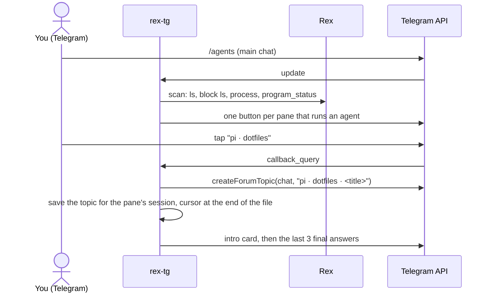
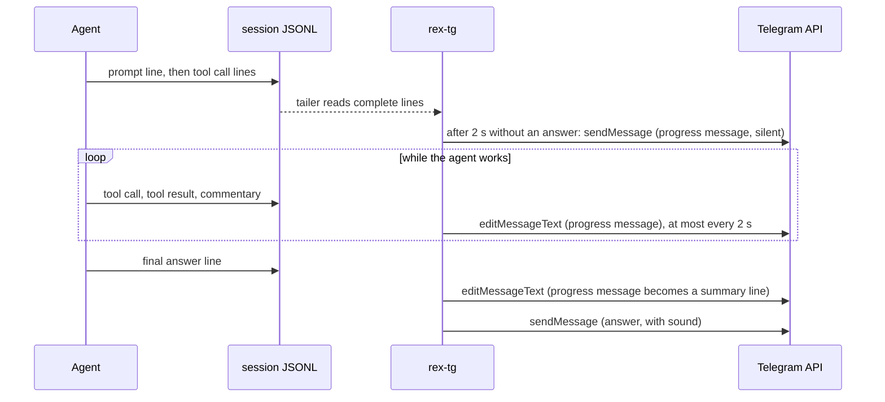
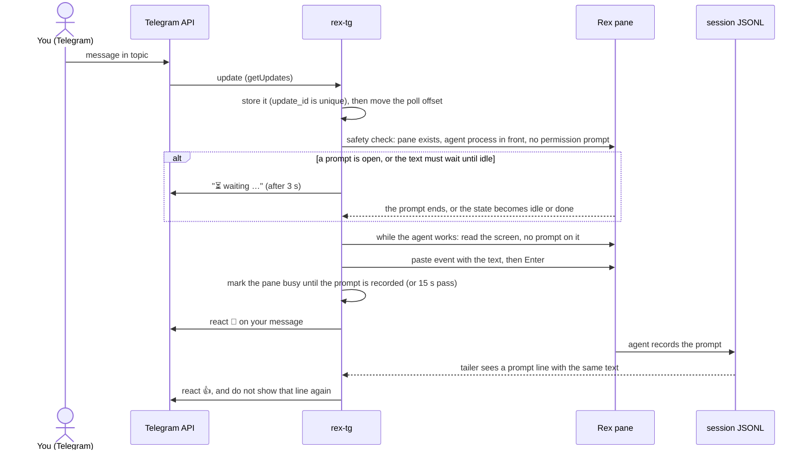
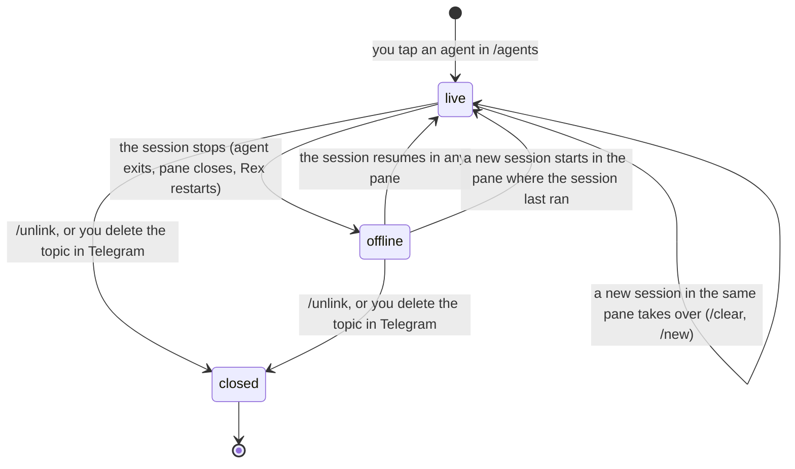
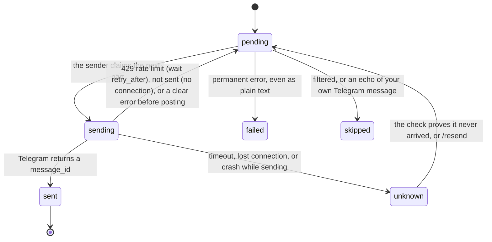

# rex-tg system design

Status: draft, 2026-11-11. It includes the answers to plan questions Q1–Q10 and the revised topic binding (D5). No code exists yet. Work starts with the spikes in [plan.md](plan.md).

Related documents:

- [plan.md](plan.md): decisions, traceability, spikes, phases, rollout, tests, and risks.
- [agent-transcripts.md](agent-transcripts.md): the JSONL formats and hook surfaces of pi, Claude Code, and Codex, as observed on this Mac.

## 1. Goal

rex-tg connects coding agents that run in Rex panes to Telegram.

- **Main chat.** You list the coding agents that are active in Rex panes. You pick one. The bot creates a Telegram topic for the agent session in that pane.
- **A topic follows the agent session.** When you start a new session in the same pane (`/clear`, `/new`), the new session takes over the topic. After a Rex restart, the topic follows the session to the pane that continues it. So in practice, one pane keeps one topic.
- **Agent to Telegram.** When the agent writes new lines to its session JSONL file, the bot shows them in the topic. The display follows OpenClaw and Hermes Agent: one live progress message while the agent works, then the answer as a normal message.
- **Telegram to agent.** When you write in the topic, rex-tg types your text into the pane. While the agent works, the text joins the current run, as typing on the Mac does (`[input] while_busy`, D11).
- **No duplicates.** SQLite records what was sent. A transcript entry goes to a topic at most once.

Supported agents: pi, Claude Code, and Codex, as CLIs that run in Rex panes on this Mac.

Not supported: T3 Code panes (`tr3x`) and Rex servers on other hosts.

Not in the first version: photos, files, voice notes, group chats, and more than one Telegram user.

## 2. Decisions

| # | Topic | Decision | Status |
| --- | --- | --- | --- |
| D1 | Telegram surface | Topics in the private chat with the bot. BotFather calls this "Threaded Mode"; `getMe` then reports `has_topics_enabled`. | Decided (Q1) |
| D2 | Source of shown text | Each agent's session JSONL file | Decided (your requirement) |
| D3 | Source of agent state | Rex `program_status_changed` events. All three agents report to Rex (observed in S2). The agent's hooks and its transcript lines are the second sources. | Proposed; S2 confirmed that all three agents report to Rex |
| D4 | Path for typed text | Rex pane input: a paste event, then Enter | Decided (your requirement) |
| D5 | What a topic is bound to | The agent session. A new session in the same pane takes over the topic. | Decided (Q5, revised on 2026-11-11) |
| D6 | Finding the transcript of a pane | Agent hooks report the pane and the transcript path. A process scan with a "newest file" guess is the fallback. | Proposed |
| D7 | Delivery guarantee | At most once per (topic, transcript entry). rex-tg never resends on its own when the outcome of a send is unknown. | Proposed |
| D8 | Language | Go | Decided (Q7) |
| D9 | Process model | One daemon, which only one copy may run, owns the database. Hooks only write small JSON files to a spool folder. | Proposed |
| D10 | Display style | Like OpenClaw's `progress` mode and Hermes's grouped tool progress: one edited progress message per turn, then the answer as a new message | Decided (Q2) |
| D11 | Text sent while the agent works | Steer: it joins the current run at once (`[input] while_busy = "steer"`). `while_busy = "wait"` waits until the agent is idle. | Decided (Q3; changed to steer on 2026-11-13) |
| D12 | History when a topic opens | The last 3 final answers | Decided (Q4) |
| D13 | Progress message at the end of a turn | It becomes one summary line, with the tool rows in a collapsed quote | Decided (Q9) |
| D14 | Label of a shell row | The agent's own description when it gives one. Otherwise the start of the command, after secret removal. | Decided (Q10) |
| D15 | Bot commands and agent commands | In a topic, text that starts with `/` goes to the agent, except the bot's own commands. `//name` sends `/name` to the agent. | Proposed |

Why at most once (D7): Telegram has no idempotency key. If rex-tg crashes after a send leaves but before Telegram answers, it cannot know whether the message arrived. Resending could duplicate it. So rex-tg marks it "unknown" and asks you instead.

## 3. Architecture

```
 This Mac
 ┌───────────────────────────────────────────────────────────────────────────┐
 │  Rex panes                                                                │
 │  ┌─────────┐  ┌──────────┐  ┌─────────┐                                   │
 │  │ pi      │  │ claude   │  │ codex   │ ── agent hooks ──▶ spool/*.json   │
 │  └────┬────┘  └────┬─────┘  └────┬────┘                         │         │
 │       │ append     │ append      │ append                       │         │
 │       ▼            ▼             ▼                              ▼         │
 │   ~/.pi/…jsonl  ~/.claude/…jsonl  ~/.codex/…jsonl       ┌───────────────┐ │
 │       └────────────┴───────┬──────┘                     │ rex-tg daemon │ │
 │                            └── tail from saved offsets ▶│     (Go)      │ │
 │                                                         │    SQLite     │ │
 │  Rex server ── events, process info, status ──────────▶│               │ │
 │             ◀── paste + Enter into the pane ─────────── │               │ │
 │                                                         └───────┬───────┘ │
 └─────────────────────────────────────────────────────────────────┼─────────┘
                                         HTTPS: getUpdates long polling, send
                                                                   ▼
                                         Telegram Bot API  ⇄  your phone
                                         (private chat, one topic per agent session)
```

rex-tg makes only outgoing connections. It opens no port, so it needs no webhook, tunnel, or Tailscale setup.

### 3.1 Components of the daemon

| Component | Job |
| --- | --- |
| Instance lock | Takes an exclusive lock on `~/.local/state/rex-tg/daemon.lock` at start. A second copy exits with a message. |
| Rex gateway | Runs the `rex` CLI with `--autostart=false` and JSON output. Keeps one `rex events --all --json` stream open and restarts it with backoff. rex-tg never starts a Rex server. |
| Pane registry | Knows which panes run an agent, which session each one runs, and its state. Its inputs are Rex scans, Rex events, hook reports from the spool folder, and transcript lines. |
| Transcript tailers | One per session that belongs to a live topic. Each reads new, complete lines from a saved byte offset. A runtime adapter turns each line into normalized events. |
| Turn tracker | Groups events into turns. Drives the live progress message and decides when a turn ends. |
| Outbox and sender | Removes duplicates, keeps order, splits long text, formats it, respects rate limits, and sends or edits messages. |
| Telegram poller and router | Reads updates with `getUpdates` long polling. Routes commands, button presses, and topic messages. |
| Input deliverer | Checks that typing is safe, steers a working agent or waits until it is idle, types the text, and adds delivery receipts. |

The Rex gateway uses the CLI, not the server socket. The Rex skill guide asks tools to use the CLI's commands instead of the socket. The CLI path is set in the config, because `rex` is not on `PATH` in every shell.

Scans run when you use `/agents`, when Rex events show a change, and every 30 seconds as a safety net. A scan calls `rex ls`, `rex block ls`, and the block methods `process` and `program_status`.

## 4. Main flows

### 4.1 List agents and open a topic



- If the session already has a topic, the button links to it instead of making a new one. Bot API 10.4 supports topic links of the form `https://t.me/<bot_username>/<message_thread_id>`.
- A pane whose session file is not known yet (section 6) shows "(waiting for session)". Tapping it explains that it resolves at the agent's next prompt or turn end.

### 4.2 Agent turn to topic



Every new line passes through the outbox (section 9), so each transcript entry is shown at most once.

### 4.3 Topic message to pane



### 4.4 Agent state

The pane registry keeps one state per pane: `idle`, `working`, `done`, `blocked` (with kind `permission`, `question`, or `auth`), or `error`. It takes the state from three sources (D3):

1. **Rex status.** `program_status_changed` events. All three agents report their state to Rex: pi, Claude Code, and Codex (observed in spike S2).
2. **Hooks.** These are the second source. `UserPromptSubmit` means working. `Stop` means idle. The `PermissionRequest` hooks of Claude Code and Codex mean blocked. Claude Code's `Notification` hook fires both for permission requests and for "waiting for your input". Only `notification_type` = `permission_prompt` means blocked (observed in S3). Claude Code sends no `Stop` after Esc or after a denied permission. So after those, Rex status and the transcript are the only signals (observed in S2). For pi, the extension events `agent_start` and `agent_end` mark the start and end of a run (observed in S3). Codex hook payloads are not yet checked at runtime.
3. **Transcript lines.** These are the third source. A prompt line means working. A final answer means idle.

How the sources combine:

- Each signal has a time: when rex-tg received the Rex event, the time that the hook wrote into its spool file, or the timestamp of the transcript line. The newest signal sets the state.
- A prompt line or a `UserPromptSubmit` hook always means `working`, even when Rex still shows an older `done`. Rex keeps `done` until the agent reports again, so it can be stale.
- A waiting message is delivered only after an `idle` or `done` signal that is newer than the last `working` signal. Silence never counts as idle.
- If no signal arrives for 2 minutes while the state is `working`, rex-tg stops "typing…" but keeps the state. `/info` shows the state and the time of its last signal. `⚡ Send now` stays available.

What the states drive:

- `working`: the turn tracker starts or continues a turn. "typing…" is shown in the topic you used last.
- `blocked` with kind `permission` or `question`: post the bottom of the screen with answer buttons (section 8.6).
- `done` or `idle`: end the turn, and deliver the next waiting message.
- `error`: post a short notice.

End of a turn:

- A turn ends when the final answer line arrives, or when a state source says `idle` or `done`.
- The state often arrives before the answer line is read. So after `idle` or `done`, the turn tracker waits up to 5 seconds for the answer line. In the Claude Code and Codex spikes, the state and the final line came within about 40 ms of each other (observed in S2 and S4).
- If the answer arrives after that, it is still sent, and the summary line is corrected.

The registry detects agents by the pane's foreground process, not by the `app` field of the Rex status. T3 Code panes report `app=claude` while their foreground process is `tr3x`, and they are not supported.

## 5. Agent adapters

Each runtime has one adapter. Its parser is a pure function: it takes one line and returns events. It does no I/O, so fixtures can test it.

```go
type Runtime string

const (
	Pi     Runtime = "pi"
	Claude Runtime = "claude"
	Codex  Runtime = "codex"
)

type EventKind int

const (
	AssistantText EventKind = iota // Phase says commentary, final, or error
	UserPrompt
	ToolCall
	ToolResult
	Title
	SessionBoundary // compaction, clear, branch
	TurnEnd
)

type Event struct {
	Kind  EventKind
	Key   string // deduplication key, for example "pi:<session id>:<entry id>"
	Text  string
	Phase Phase
	Tool  *Tool // for ToolCall and ToolResult
	At    time.Time
}

type Tool struct {
	CallID string
	Name   string
	Label  string // short, safe text (D14): a description, a file path, a search pattern
	OK     bool   // for ToolResult
	Took   time.Duration
}

type Adapter interface {
	Runtime() Runtime
	IsAgentProcess(p rex.Process) bool // uses argv0, invoked path, and executable path
	TranscriptCandidates(cwd string, startedAfter time.Time) ([]string, error)
	ReadHeader(path string) (Header, error)
	ParseLine(line []byte, ctx LineContext) ([]Event, error)
	Input() InputProfile // interrupt keys, permission keys, paste behavior (spike S2)
}
```

Summary of the three formats (details in [agent-transcripts.md](agent-transcripts.md)):

| | pi | Claude Code | Codex |
| --- | --- | --- | --- |
| Detect in a pane | `argv0` is `pi`; the process name is `node` | `argv0` is `claude`, or the invoked path ends in `/.local/bin/claude`. The executable is `~/.local/share/claude/versions/<version>`, so the process name is the version string, for example `2.1.322` (S2). `argv0` `cux` also counts: cux (a Claude account switcher) runs `claude` as its child in the same process group, so Rex reports cux as the foreground process. Claude's hooks still report the pane through `REX_BLOCK`. | the executable is the Codex binary (Homebrew Caskroom); name `codex` |
| Transcript | `~/.pi/agent/sessions/--<cwd>--/<time>_<id>.jsonl` | `~/.claude/projects/<cwd folder>/<session_id>.jsonl`. Use the hook's `transcript_path`, because the folder name uses the real path (S2) | `~/.codex/sessions/YYYY/MM/DD/rollout-<time>-<id>.jsonl` |
| Reply lines | `type=message`, `role=assistant`, `text` blocks | `type=assistant`, `text` block (one block per line) | `response_item`, `payload.type=message`, `role=assistant` |
| Final or commentary | `stopReason`: `stop` = final, `toolUse` = commentary | `stop_reason`: `end_turn` = final | `payload.phase`: `final_answer` or `commentary` |
| Tool call and result | `toolCall.id` ↔ `toolResult.toolCallId`, `isError` | `tool_use.id` ↔ `tool_result.tool_use_id`, `is_error` | `call_id` ↔ `call_id` of `*_output` |
| Deduplication key | `pi:<id>:<entry id>` | `claude:<sessionId>:<uuid>` | `codex:<id>:<payload.id>` |
| Prompt lines | `role=user`, `text` blocks | `type=user` with text content, not `tool_result`, not `isMeta` | `event_msg` `item_completed` with `UserMessage` (confirmed in S4) |
| Must skip | `toolResult` content, `custom*`, subagent files | `isSidechain`, `attachment` (except `queued_command`), `queue-operation`, `api-request*`, text that starts with `[Request interrupted`, `subagents/` | `event_msg` `AgentMessage` and `task_complete` (same text again) |
| Hook surface | pi extension: `session_start`, `session_shutdown`, `agent_start`, `agent_end` | `settings.json` hooks | `~/.codex/hooks.json`, with `[features] hooks = true` in `~/.codex/config.toml`. Payloads are not checked at runtime (S3) |

Spike S2 records the real `process` output of each agent in a pane. The detection rules are config values, so a new install path needs no code change.

Spike S2 also set the input profile. Each agent takes a paste, then Enter after a 300 ms wait. A message sent during a run steers the current run. Claude Code and Codex stop a running turn with `escape` (observed). For pi, `escape` comes from its source and was not run. Shorter waits were not tested.

Rules for every adapter:

- Ignore unknown line types. Formats change often between agent versions.
- Never stop a tailer on a bad line. Log the file, the byte offset, and the error, then go on.
- Never pass on thinking blocks or tool output, except when you turn them on (section 8.4).
- Use one source per kind of event. For example, Codex writes each reply twice, so the adapter reads only one of the two records.
- If a line has no ID for its key, the key falls back to `<runtime>:<session id>@<byte offset>`.

## 6. Panes, sessions, and transcripts

The registry keeps one `pane` row per Rex pane and one `conversation` row per agent session. It learns which session runs in which pane from three sources, in this order.

1. **Hook report (exact).** Each agent runs `rex-tg hook <runtime>` from its hooks. The hook reads the hook JSON from stdin and `REX_SESSION` and `REX_BLOCK` from its environment. It writes one JSON file to the spool folder and exits 0. It must finish in under 50 ms and must never fail the agent. It does nothing when `REX_BLOCK` is not set, but it still reads its input first, so the agent never writes into a closed pipe. Inside Rex it waits at most 2 seconds for the input, less than the agents' 5-second hook timeout. Outside Rex the input is not used, so it waits at most about 200 ms and never holds the agent.
2. **Scan and guess.** For a pane whose foreground process is an agent but that has no hook report yet, the registry looks for that runtime's transcripts in the same folder. It takes the newest file that changed after the process started. The row is marked `guess`, and `/agents` shows "(guess)".
3. **Unresolved.** When two agents of the same runtime run in the same folder without hook reports, the registry cannot tell them apart. `/agents` shows them as "(waiting for session)". They resolve at their next hook event, for example the next prompt or turn end.

Rules that protect the mapping:

- The daemon reads the pane's foreground process from Rex when it takes in a hook report. It accepts the report only when that process belongs to the reporting runtime. This rejects reports from nested agents that inherit `REX_BLOCK`, such as a `codex exec` started by Claude, or pi subagents.
- Transcript paths of subagents are ignored: `…/subagents/…` for Claude, and nested `run-*/session.jsonl` and `subagent-artifacts/…` files for pi.
- A process is identified by PID and name together, because the system reuses PIDs.
- A session runs in at most one pane at a time. When it shows up in a new pane, the old pane no longer runs it.

Rules for the hooks:

- **No output.** The hook prints nothing on stdout or stderr. Claude Code adds the stdout of `SessionStart` and `UserPromptSubmit` hooks to the agent's context, so any output would leak into the conversation.
- **Absolute path.** Hook entries call the binary by its absolute path, so they do not depend on `PATH`.
- **Codex trust.** Codex trusts each hook by a hash of its entry, stored under a key that contains the entry's position, such as `hooks.json:session_start:0:0`. The installer appends rex-tg's entries at the end of each event's list, so the positions of existing entries stay the same. Codex then asks you once to trust the new entries (spike S3 confirms).
- **Safe edits.** Other tools edit the same files. The installer finds its own entries by their exact command string, re-reads each file right before it writes, and writes through a temporary file and a rename. The plan's Rollout section has the full rules, including when `uninstall` must refuse.

Hook events per runtime. This table is the full list of the hook entries that `rex-tg install` adds:

| Runtime | Events that report | Data used |
| --- | --- | --- |
| Claude Code | `SessionStart` (source `startup`, `resume`, `clear`, or `compact`), `UserPromptSubmit`, `Stop`, `PermissionRequest`, `Notification`, `SessionEnd` | `session_id`, `transcript_path`, `cwd`, `source`, `hook_event_name` from stdin, and `notification_type` on `Notification` |
| Codex | `SessionStart`, `UserPromptSubmit`, `Stop`, `PermissionRequest` | The names `session_id`, `transcript_path`, `hook_event_name`, `permission_mode`, and `tool_input` occur in the Codex 0.167.0 binary. The spike ran with hooks off, so no payload was checked at runtime (S3). |
| pi | `session_start`, `session_shutdown`, `agent_start`, `agent_end`. The rex-tg extension subscribes to these four. `/new`, `/resume`, and forks are not yet observed. | `ctx.sessionManager.getSessionFile()`, plus `reason`, `previousSessionFile`, and `targetSessionFile` |

Where a tailer starts reading:

| Case | Start |
| --- | --- |
| A topic is created | The end of the file. The last 3 final answers are read from the part before it. |
| A new session takes over a topic (`startup`, `clear`, `/new`) | Byte 0 of the new file |
| A session of a topic resumes (`/resume`, `--continue`, after a Rex restart) | Its saved cursor. Without one: the end of the file, plus the last 3 final answers. |
| A file that rex-tg first sees through a resume | The end of the file, plus the last 3 final answers, even when the file is new. Claude Code and Codex append to the old file and copy no old lines (observed in S3 and S4). pi is not checked yet. |
| No hook says whether a session is new or resumed | Resumed if the file's first line that has a timestamp is older than the agent process; otherwise new. Claude Code's first lines have no timestamp (observed in S4). |
| The path does not exist yet | The tailer waits for the file. pi and Codex create it at the first prompt. Claude Code creates it at session start (observed in S4). |

Resume rule: Claude Code and Codex resume into the same transcript file, with the same session ID. Old lines stay, and no history is copied (observed in S3 and S4). pi is not checked yet, so its resume rule is still an assumption (section 14).

Two guards stop repeats:

- Keys that a topic already shows are skipped (section 10).
- After a re-read from byte 0 (section 13), lines with a timestamp at or before `cursor.last_event_at` are skipped. So a replaced file never replays old turns, and old outbox rows can be deleted safely.

## 7. Topic lifecycle

A topic belongs to one current agent session (D5). A new session in the same pane takes it over.



Rules:

- **One topic per session.** Each session belongs to at most one topic. A topic shows one current session at a time, and it keeps the history of the sessions before it.
- **Take-over.** A new session that has no topic starts in a pane. The session that ran in that pane just before is the current session of a topic, and that topic is not live in another pane. Then the new session takes over the topic, and rex-tg posts a divider such as `── claude · new session (clear) ──`. This covers `/clear`, `/new`, and a different agent started in the same pane.
- **Resume.** A session that already belongs to a topic runs again, in any pane. That topic becomes live again, with the new pane as its address. The divider says `resumed`. The last 3 final answers follow, if the topic does not show them yet.
- **Resume while the topic is busy.** If the topic is live with another session in another pane, the resumed session does not take the topic. `/agents` lists it, and opening it moves it to a new topic. In the same pane there is no conflict: the session that ran there before has stopped, so the resumed session takes the topic back.
- **Resume under a new session ID.** If an agent gives a resumed session a new ID, rex-tg cannot link it to the old one. The take-over rule still applies in the same pane, so the topic stays the same.
- **Rex restart.** After one restart, the block IDs and the session ID stayed the same (spike S5). A new block ID is still possible, because only one restart was tested. A restored pane does not run its creation command again, so the agent must resume in that pane, for example through rexume. That resume was not tested (S5). The topic then follows the session. If the restored pane starts a new session instead, rex-tg has no history for that pane, so the session appears in `/agents` as a new agent.
- **Agent exits, or its pane closes.** The topic becomes `offline`. rex-tg posts why: "🔴 pi stopped: its Rex pane was closed.", "…: it exited, and the pane is still open.", or "…: another session took its pane." A turn that was running ends within 2 seconds with a "🔴 Stopped" summary, so "typing…" stops (the agent's last lines are read by then; an answer gets 5 seconds). The topic's name, and the tab's name in the `/new` session, get a 🔴 in front until the agent runs again; then rex-tg posts "🟢 pi is running again." and the 🔴 goes away. Messages that you send while it is offline are refused with a reason.
- **Deleted topic.** Telegram does not tell the bot that you deleted a topic. rex-tg finds out in two ways, and then the topic becomes `closed`: a send or a rename fails with "message thread not found", or you tap the agent in `/agents`. That button reports the tap to rex-tg instead of opening a link, and rex-tg first sets the topic's name with `editForumTopic` (Telegram answers `TOPIC_NOT_MODIFIED` when the name is the same). When the topic is gone and the pane and the session still exist, rex-tg makes a new topic for the session, with the intro card and the backfill (found live, spike S1).
- **Unlink.** `/unlink` closes the topic in rex-tg. The topic stays in Telegram as history.
- **Topic name.** A short name, at most 32 characters, cut at the end of a word: the name that you gave the Rex pane, else the session name, else the project folder, else the runtime. Rex's default pane name `shell` (and shell or agent program names) do not count. A name starts with a letter or digit, because Telegram draws a topic's icon from its first character: leading tags in brackets (pi's `[folder][kind] title`) go, the one that repeats the folder's name is dropped and the others move to the end; Markdown marks and the symbols before the first letter or digit go too (`tidyName`). Every 30 seconds, rex-tg compares each live topic's name with its pane and session and renames the topic with `editForumTopic` when it changed. A take-over renames at once. When the agent's pane is in the Rex session for `/new` (`rex.new_session`, section 8.7), rex-tg gives the pane's tab the topic's name (`rex window rename`). It does this when the topic is linked and at every name check, whenever the tab's label (from `rex window ls`) differs, so nothing is renamed when it already matches. When the topic has only the folder name, the tab keeps the `<folder> · <agent>` form. rex-tg keeps the label it gave each tab (kv `tab_set:<thread>`); when a check finds another label, someone else named the tab (the user, or an agent with `rex window rename`). That name is kept (kv `tab_user:<thread>`): the tab is not renamed back, and it names the topic before the pane's name and the session name (the topic gets it with `tidyName`, the tab keeps it as typed). Two tabs in that session never share a label: rex-tg adds ` #2`, ` #3`. While the topic is offline, the tab gets the same 🔴 in front; it goes away when the agent runs again. Tabs in other sessions are yours, and keep their names.

## 8. Telegram display

The display follows two references:

- OpenClaw's Telegram channel, in its default `progress` mode.
- Hermes Agent's Telegram gateway, with its default tool progress: all tools, grouped in one message that is edited in place.

Section 14 lists the sources and their settings.

OpenClaw and Hermes run the model loop themselves, so they get the answer token by token. rex-tg reads the agent's JSONL file, which holds only complete blocks. So it streams what each agent gives it, as a draft (section 8.1a): pi word by word, through its extension, and Claude Code and Codex block by block. Tool calls, tool results, and commentary arrive one by one, which is enough for a live progress message.

### 8.1 A turn in a topic

While the agent works, one progress message is edited in place:

```
◓ Running the parser tests to find the failure
✅ 📖 Read · src/parser.go
✅ 🔍 Grep · "func parseLine"
✅ ✏️ Edit · src/parser.go
▸ 💻 Bash · Run the parser tests
⏱ 1m 12s · 4 tools
```

- **Headline.** The first line of the agent's latest commentary as plain text (Markdown marks such as `**` dropped), or "Working…" before there is any. Its icon is an hourglass (⏳ ⌛) that turns with each edit. A Telegram message cannot animate by itself, so `[display] progress_animation` (3 s by default, at least 2 s, `"0s"` off) edits the message that often while the agent works: the hourglass turns and the timer moves. Edits go through the shared rate budget at a low priority and merge per topic, so with many agents at work the animation slows down instead of delaying answers. While the turn waits for an answer, the message stays as it is. With the animation off, the hourglass turns only with the edits that go out anyway.
- **Rows.** One row per tool call: `▸` while it runs, `✅` when it ends, `❌` when it fails. Repeated calls of the same tool in a row collapse, for example `📖 Read ×3`. At most 8 rows of at most 120 characters, as in OpenClaw. Older rows drop off the top.
- **Labels (D14).** A row shows a short label: Claude's Bash `description`, a file path relative to the project, or a search pattern. For a shell call without a description, it shows the start of the command after secret removal. A row never shows tool output or file contents.
- **Footer.** Elapsed time and the number of tools. The time moves on even when nothing else changes, for example while the agent thinks or one long tool runs. Such an edit comes every 10 seconds at first. The step grows with the turn (a sixth of the elapsed time) up to one minute, so a long turn spends little of the rate budget. While the turn waits for the user's answer, the time stays.
- **When it appears.** Only after 2 seconds without an answer, so that quick answers do not flash a progress message first. When the turn ends before the progress message could go out (the chat's budget went to answers first), none is posted: a late "Working… 0s" below newer messages would only confuse.
- **Silent.** The progress message is sent with `disable_notification`, as Hermes does with tool progress. Edits never make a sound. Answers and alerts do.
- **Edits.** At most one edit every 2 seconds per topic, within the shared rate budget (section 9.3).
- **It stays at the bottom.** If other messages arrive below it while the turn runs, rex-tg posts a new progress message and deletes the old one, as OpenClaw does. This counts the agent's own posts, alerts, reminders, waiting notices, other notices, and your own messages, so the last message of a running turn is always the one that shows its progress. While the turn waits for your answer, the alert stays the last message; the progress message moves below it once the turn goes on.
- **At the end (D13).** rex-tg edits the progress message into one summary line, with the tool rows in a collapsed quote. Then it sends the answer as a new message:

```
✅ Done · 1m 12s · 4 tools
┃ 📖 Read · src/parser.go
┃ 🔍 Grep · "func parseLine"
┃ … (tap to show all)
```

- The collapsed quote holds at most 30 rows. Longer turns end with a row such as `… and 12 more`.
- When the turn ends without an answer, the summary line says so, for example `⏹ Interrupted · 1m 12s · 4 tools`, or `❌ Error: <first line>`.
- **Short turns leave no summary.** A turn that ends with its answer in less than `[display] summary_after` (2 minutes) deletes its progress message instead (the sender's `Remove`), so an agent that works in many short turns leaves just its answers. A longer turn, an error, a stop, and an interrupted turn keep the summary. `Remove` deletes only the running turn's progress message: a kept summary of an earlier turn stays, and a message whose send outcome is unknown has no number to delete. One exception stays: when the answer comes only after the turn ended without one (after the answer grace), the summary was already posted and stays.

Emoji per tool kind: 📖 read, ✏️ edit or write, 💻 shell, 🔍 search, 🌐 web, 🤖 subagent, 📝 plan or to-do, 🧩 other.

### 8.1a Drafts: the text while it is written

While a turn runs, the topic shows the agent's text as a Telegram draft (`sendMessageDraft`, Bot API 9.3; all bots since 9.5), as Hermes does. A draft is a preview at the bottom of the topic. It lasts about 30 seconds, and a real message from the bot ends it. It never becomes a message. So a draft can never be a second copy of an answer, and drafts need none of the at-most-once rules of section 9.1. OpenClaw instead posts a preview message and edits it; under rex-tg's rules, that message would have to become the answer, which the outbox cannot do safely.

- **Where the text comes from.**
  - **pi:** its extension sees each token (`message_update`). It writes the text of the message that pi is writing to `<state>/live/<session id>.json`, at most every 300 ms, and removes the file when the message is complete (`message_end`, `agent_end`, `session_shutdown`). rex-tg makes the folder with mode 0700 and reads it every 400 ms. A file older than 30 seconds does not count, and rex-tg removes one older than 10 minutes (pi was killed). So a pi draft grows word by word. The last word waits until it is whole, so a key that is half written cannot slip past the secret removal.
  - **Claude Code and Codex:** their transcripts hold only complete blocks, and Claude Code's screen shows no partial text either (checked live). Their draft shows the latest commentary block, so it changes block by block.
- **What it shows.** The end of the text, at most 3000 characters from the start of a line, rendered like an answer and with secrets removed. Block mode shows only pi's text, because its blocks are posted as messages anyway.
- **When.** Only while a turn runs that Telegram sees: not for a turn held for the Mac (8.4a), not in final mode (answers only), and not once its answer is out. A topic gets at most one draft every `[display] stream_interval` (1 second by default, which is also the least: drafts share the chat's budget of about one message a second, and a 429 from Telegram would pause every send). A draft that did not change is sent again after 20 seconds, so it does not fade during a long tool call; after 2 minutes without a change it may fade.
- **Order.** Drafts go last in the sender, after answers, alerts, and progress. The sender sends one request at a time. rex-tg closes a turn's draft before the answer's outbox row exists, and the draft request checks this when it is sent. So no draft comes after the answer.
- **Errors.** A draft that fails is not sent again at once; the next change sends the newest text, at most one per `stream_interval`. After 3 refusals (400) in a row, rex-tg sends no drafts until the next start, and logs it once.
- Drafts are off by default: at their fastest they change once a second, which is slower than the word-by-word stream of OpenClaw or Hermes. `[display] stream = true` turns them on.

### 8.2 The answer

- The final answer is a normal message, with Markdown turned into Telegram HTML.
- A long answer comes as several chat messages, split where a person would split it, not one transcript entry per message (`format.Messages`):
  - Each message aims at `[display] message_length` characters (1500 by default, 300 to 4000), and none is longer than 4000.
  - Splits fall between paragraphs, and a heading starts a new message. A message never ends with a heading or with a line that leads into the next block ("Here is the fix:").
  - A code block is never cut, unless it alone is longer than 4000 characters; then it is cut at its lines, and each piece is a code block again.
  - A short last message joins the one before.
  - An answer that would take more than 6 such messages comes in fuller ones, of up to 4000 characters, still split at paragraphs: more messages are too many to read on a phone, and each one costs a second of the chat's budget.
  - There are no `(1/3)` counters. Only the first message makes a sound; the others come silently, as when a person sends a long reply in a few messages.
- A fenced code block with a line longer than 80 characters (a tab counts 4) does not fit a phone, in either format. It stays in the message as a preview of its first 3 lines, each cut at 60 characters, with a line that names its file; the whole block follows as a document part of the same outbox item, such as `code-1.go` (`format.SplitWideCode`; the extension comes from the fence's language, else `.txt`). An answer too long for messages goes as one `answer.md` with its code inside.
- In rex-tg's own format (rich messages off, or a rich message that Telegram rejected), tables become monospace blocks when they fit a phone (40 characters or less). A wider grid would wrap on a phone and its columns would fall apart, so a wider table becomes a list: one block per row, with the first cell in bold and then `Column: value` for the others. Links and code in cells keep their format. With `[display] rich_messages`, Telegram renders the table itself.
- Link previews are off, because agent answers often hold URLs from logs and code.
- An answer longer than four full messages (16000 characters) is sent as a `.md` file.

### 8.3 Modes

Set per topic with `/mode`:

| Mode | Shows |
| --- | --- |
| `progress` (default) | Progress message while working, then the final answer |
| `block` | Each assistant text block as its own message, commentary included. No progress message. |
| `final` | Final answers only, plus alerts |

### 8.4 Extra detail, off by default

- `/verbose on`: also post one message per tool call, as a permanent record.
- `/verbose full`: also post each tool's output, shortened and inside a collapsed quote. Secret removal still applies.
- `/reasoning on`: also post thinking text, when the transcript has it. pi stores thinking text. Claude Code often stores it empty. Codex stores reasoning summaries.

### 8.4a Work on the Mac (the Mac hold)

The user may write in the pane on the Mac for a while, then go on from the phone. While they work on the Mac, the topic should not repeat everything.

- A prompt typed on the Mac starts a hold (`[display] mac_notice`, on by default).
- The topic gets one silent notice: `💻 In use on the Mac · working…`, the latest Mac prompt, and "Replies stay on the Mac. Write here to go on in Telegram."
- The prompts, progress, typing, and answers of held turns are not posted.
- The notice is edited as the turns go on: `✅ done`, `⚠️ ended with an error`, or `🔴 agent stopped`, and the next Mac prompt. It is posted once and then only edited, so it makes no sound again.
- When an answer was held, the notice has a `📄 Last answer` button. It posts the newest held answer, like any answer, once.
- A message from Telegram ends the hold. Its turn is shown as usual. The old notice keeps its text, but loses its button, and the held answer is dropped. The next Mac prompt starts a new hold with a new notice at the bottom of the topic.
- A turn that Telegram already sees stays shown: a Mac prompt sent into a running Telegram turn only updates the notice, and the turn's end sets it to done.
- A prompt that does not match the text rex-tg typed (an echo miss, section 9.5) is still taken as from Telegram when rex-tg typed into that pane within the last 30 seconds, and the prompt of that message was not seen yet. So a turn that Telegram started is never held.
- A turn that no person started, such as a Claude Code task notification, follows the current state: held during a hold, shown otherwise.
- Permission prompts and alerts are not held. They need an answer, and the user may have left the Mac.
- A post of the notice whose outcome is unknown is not repeated (at most once). The hold then goes on without a notice.
- The tracker (`internal/turn`) decides what is held. The daemon keeps the notice's message number and the held answer in the key-value table, so a restart keeps both. A message from Telegram after a restart still removes the old notice's button.
- With `mac_notice = false`, Mac turns are shown as before, with `💻 You (on Mac)` when `show_mac_prompts` is on. A hold from before a restart with `mac_notice = false` ends: its notice loses its button, and the held answer is dropped.

### 8.5 Receipts and status signals

| Signal | Meaning |
| --- | --- |
| 👀 on your message | rex-tg typed it into the pane |
| 👍 on your message | the agent's transcript recorded it |
| 👎 on your message | it was refused or failed; a reply says why |
| `⏳ Waiting until the prompt is answered` (or `… the agent is idle`, `… for the agent to take your last message`; `⏳ 2 messages wait …` for several) | your message is queued (D11) for 3 seconds or more, with buttons `⚡ Send now` and `✖ Cancel` (`Send all now`, `Cancel all` for several). A topic has one such notice, on its oldest waiting message; it counts the others, and its buttons act on all of them. The text says what they wait for. The notice is deleted when the message leaves the queue: it was typed (👀, then 👍), refused or expired (👎 and a reply that says why), or typing failed. `✖ Cancel` turns it into `✖ Cancelled`. |
| `⛔ Not sent: the pane now runs zsh, not pi.` | the safety check refused it |
| "typing…" | the agent is working; refreshed about every 5 seconds, only in the topic you used last |
| `💻 In use on the Mac` | you work in the pane on the Mac; the replies stay there until you write in the topic (8.4a) |
| `💻 You (on Mac): …` | with `mac_notice = false`: a prompt you typed in the pane on the Mac. A prompt that the agent's own program wrote, such as Claude Code's notice that a background task ended, is not shown. |
| `── pi · new session ──` | a new session took over the topic |

Telegram allows only a fixed set of reaction emoji. Hermes uses 👀, 👍, and 👎. ✅ is probably not in the set, so rex-tg does not use it as a reaction. Spike S1 checks the set.

### 8.6 Permission prompts and questions

When the pane's state is `blocked` with kind `permission` or `question`:

1. rex-tg captures the pane (`rex capture --trim`) and reads the prompt from the last 40 lines (`alertview.go`): the last list of numbered answers, and above it the prompt's lines up to a rule, the agent's own output, or 12 lines. Below the answers it reads their descriptions, a text field ("Type something"), and a "Next" or "Submit" row.
2. It posts the prompt the way a person reads it, not as a screen dump: `🔐 Permission needed · Claude Code` (or `❓ Question` for a question), then the title in bold (`Bash command`), the command or diff in monospace (at most 12 lines), the warnings, the time limit (below), and the question in bold. A question lists its answers with their descriptions, since a button holds only a few words. Key hints, rules, and the answers' own lines are left out: the answers are the buttons, such as `1 Yes`, `2 Yes, and don't ask again …`, `3 No`, and `Esc`. A screen that this reading does not understand is posted as before: its last 25 lines in monospace, with the numbered answers or `[agents.<name>] answers` as buttons. The screen's text is redacted either way.
2a. When the prompt is answered, from a button, a reply, `/approve`, `/deny`, or on the Mac, the alert shrinks to one line and the outcome (a question keeps its whole text, also when it wraps over lines on the screen or does not end with `?`), such as `🔐 Claude Code: Bash command · rm -rf build` and `✅ 1 Yes`, so old prompts do not fill the topic. The other outcomes: `✖ Esc`, `✍ <your text>`, `➡ <ticked answers>`, `✔ Answered on the Mac`, `⌛ Blocked: …`, `↻ The prompt changed`, `✖ Closed`. The line is kept in the store (kv `alert_head:<id>`) until then; an alert posted before this version only loses its buttons.
3. A button press sends the matching keys through `rex send-key`. The keys seen in the spikes are listed below.

The `PermissionRequest` hooks of Claude Code carry the tool name and input (observed in S3). rex-tg uses them for the alert's first line. The Codex hook payload is not yet checked at runtime (S3). The screen capture is still needed, because the answer keys are on the screen.

Answer keys seen in the spikes (S2):

- **Claude Code.** `1` (Yes) and `4` (No) were pressed. A digit works alone, without Enter. `2` (always allow) and `3` (auto mode) are on the screen, but were not pressed. Do not offer `3`. `escape` cancels, as the footer says.
- **Codex.** `y` (Yes) was pressed, and the command ran. No Enter was needed. `p` (do not ask again for this command prefix) and `escape` (No) are printed on the prompt. They were not pressed on it.
- **pi.** No permission prompt was seen.

Each alert is stored as a row, with a hash of the prompt text on the screen (section 10). Its buttons carry the alert ID and the answer number, such as `a:17:2`, because callback data is limited to 64 bytes.

Before rex-tg sends the keys for a button:

1. It checks that the button press comes from the owner, in the owner's chat.
2. It captures the pane again. If the prompt text no longer matches the alert's hash, it refuses: "This prompt is gone." When the pane is still blocked, a newer prompt shows: rex-tg posts an alert for it right away, because no state change would.
3. It sends the keys and marks the alert `answered`.

When the prompt ends, by a button or on the Mac, rex-tg removes the buttons from the alert message with `editMessageReplyMarkup`. So an old button can never type into whatever is on the screen later.

**Reminders.** A prompt stops the agent until you answer, and an alert is easy to miss on a phone.

- When an alert is still open after `[alerts] remind_after` (10 minutes), rex-tg posts `⏰ Still waiting for your answer · 10 min` in its topic.
- The reminder is a reply to the alert, so a tap on it jumps there. It makes a sound, unless the topic is muted.
- The next reminder comes `remind_after` after the one before, up to `[alerts] reminders` (3) times. So reminders never come in a burst, also not after the daemon was stopped. Each one deletes the one before, so the topic keeps one reminder.
- The reminder is deleted when the alert closes, by a button or on the Mac. A reminder of an alert that closed while the daemon was stopped is deleted at the next start.
- At most once: a reminder's number is stored before it is sent (kv `remind:<alert>`). A send whose outcome is unknown is not repeated, also not after a restart.
- A reminder whose send got no answer may still have arrived, with a number that rex-tg never learns. rex-tg does not guess that number to delete it: in a private chat a bot may delete the user's messages too, and Telegram makes numbers rex-tg never sees (service messages of topics). Every reminder has a `✓ Dismiss` button, which deletes the message that holds it: the tap reports that message's number. When a delete fails (the tap's, or the one when the prompt ends), the reminder keeps its button, so it can still be removed. Such a reminder stays under its alert, which says how the prompt ended.

**Prompts with a time limit.** Claude Code's safety checks deny a request by themselves after a while: `⚠ Claude Code will automatically block this request in 2:00, to avoid holding up an unattended session` (or `in about 2 minutes`; seen in Claude Code 2.1.323). rex-tg reads the limit from the screen when it posts the alert. The prompt counts down on the screen, so the time it shows is the time left from that read. The line counts only inside the prompt, at most 4 lines above its question or answers, so an agent's output that quotes it does not. The "about 2 minutes" form is rounded, so rex-tg allows it up to a quarter (at most 30 seconds) earlier.

- The alert says by when to answer: `⏳ Answer within 2:00 (by 07:00:57), or Claude Code blocks it.`
- Instead of the usual reminders, one reminder comes 30 seconds before the limit (`⏰ 0:30 left to answer the prompt above, then Claude Code blocks it.`), when the alert came at least 15 seconds before that. It is deleted when the alert closes.
- When the pane leaves the prompt unanswered at its limit (at most 5 seconds early, or a tenth of the limit), the alert shrinks to `⌛ Blocked: no answer within 2:00, so Claude Code denied the request.` A prompt answered on the Mac in time says `✔ Answered on the Mac`, and a topic that closes says neither. The limit is kept in memory only; after a restart the alert gets the usual reminders.

**A note with the answer.** A text reply to an open alert is a note for the agent; each permission alert says so in its last line. rex-tg refuses the prompt with Esc, the same key `/deny` presses, with every check of a button, then queues the note like a message, so it is typed when the agent waits for it. The topic says so once the note is queued. That is what Claude Code's "Tab to amend" does for No, and what Codex's "No, and tell Codex what to do differently" asks for.

- **Why Esc.** Both agents read Esc as a refusal that waits for the user: Claude Code 2.1.323 rejects and asks "What should Claude do instead?", and in Codex 0.167.1 Esc is the answer "No, and tell Codex what to do differently" (it ends the turn, so the note starts the next one). A label that starts with No is no safe guess: Claude Code's plan prompt shows "No, refine with Ultraplan in a cloud session" (it starts a cloud session) before "No, keep planning" (a text field, which its digit only focuses), and Codex's network prompt shows "No, and block this host in the future". Every alert has Esc. Only a menu without Esc falls back to a No that does nothing more. Before this, `/deny` on a menu without a No took the last answer, which on Codex's app-tool menu is "Allow and don't ask me again".
- **A yes is no note.** A reply that starts with a yes (`yes`, `ok`, `go`, `ya`, `iya`, `lanjut`, `gas`, …) presses nothing and points to the Yes button: a reply must never deny what the user meant to allow. A reply that is a bot command (`/approve`) stays a command.
- **No Tab.** rex-tg does not press Tab: Tab opens a note field on the answer that has the cursor, which rex-tg would have to move first, and a wrong guess there could approve the request. For Yes with a note, tap Yes and send the note as a message.

**The screen check and the countdown.** Before it presses a key, rex-tg compares the prompt on the screen with the one it posted (a hash of the last lines). Claude Code redraws its countdown every second, so the time in that line does not count; else every tap on such a prompt would find it changed ("This prompt is gone").

**Questions with previews.** When the answers have previews, Claude Code draws the preview in a box to the right of the answers, puts `Notes: press n to add notes` under it, and gives `Chat about this` no number; a single question shows its tab (`☐ Layout`) without arrows. rex-tg cuts the box off from its top corner's row to its bottom corner's row (`cutPreview`), takes the notes line as a key hint, and gives the unnumbered row no button (seen live in Claude Code 2.1.323).

**When a prompt is answered.** Claude Code and Codex send no hook when a prompt is answered, so the pane stays `blocked` until the next prompt or the end of the turn, and messages that wait for the prompt would wait for the whole turn. So when a session's transcript goes on (a tool call or result, or commentary) while its pane is blocked, rex-tg reads the screen 300 ms later, and it also reads it on a clock while the pane stays blocked (`Timing.PromptRecheck`, 3 s, then every 15 s after the first minute), because an approved command writes nothing until it ends. Key hints at the bottom of the screen (`Esc to cancel`, `Enter to select`), or the same screen as an open alert, count as a prompt still there. A result that comes back after the pane's blocked state changed (another prompt) is dropped. Without a prompt on it, the pane counts as working again: the alerts close and waiting messages go in. The screen decides, not the transcript alone, because a tool that runs alongside can write its result while another still waits for its answer.

**Questions.** Claude Code reports its questions (AskUserQuestion) as permission prompts, so rex-tg tells them apart by their layout: boxes, a text field, a Next row, or a tab bar (seen live in Claude Code 2.1.323). In a question with answers to tick, a digit ticks or unticks one; the alert stays open and shows the boxes as the screen does after the key. `Next ➡` moves the cursor to the Next row with Down or Up, one key at a time, reads the screen after each, and presses Enter there; every key passes the checks of a button first. Several questions show one at a time: after each answer rex-tg looks at the screen again (after 1 and 3 seconds), and when the pane is still blocked with another prompt that has answers, that prompt gets its own alert, up to "Review your answers" with `1. Submit answers` and `2. Cancel`. A reply to a question is your own answer: rex-tg presses the digit of "Type something", checks that the cursor is on it, pastes your text as one line, and presses Enter. A question with answers to tick takes no text from Telegram.

**Keys by agent** (Claude Code 2.1.323 and Codex 0.167.1, read from their binaries).

| Agent | Prompt | What rex-tg offers |
| --- | --- | --- |
| Claude Code | Permission: `1. Yes`, `2. Yes, and don't ask again …`, `3. No` | A button per answer (the digit, which Claude Code takes without Enter), `Esc`; a reply refuses (Esc) and sends your note |
| Claude Code | Safety check: `1. Yes`, `2. No`, with a time limit | The same, plus the time limit, a reminder 30 s before, and `⌛ Blocked` |
| Claude Code | Plan: `Yes, …` answers, `No, keep planning` | A button per answer; `/deny` and a reply press Esc, never "No, refine with Ultraplan" |
| Claude Code | Question (AskUserQuestion; reported as a permission, told apart by its layout) | A button per answer (the digit); a reply is your own answer, typed into "Type something" |
| Claude Code | Question with answers to tick: `1. [ ] Red`, … , `Next` | `☐`/`☑` buttons tick one (the digit) and keep the alert, which shows the boxes as they are; `Next ➡` moves the cursor to Next, one key at a time, and presses Enter |
| Claude Code | Several questions (a tab bar), then "Review your answers": `1. Submit answers`, `2. Cancel` | Each next question, and the review page, gets its own alert after the answer before |
| Codex | Approval: `1. Yes, proceed (y)`, `2. … don't ask again … (p)`, `3. No, and tell Codex … (esc)` | A button per answer with the printed key (`y`, `p`, Esc); a reply refuses (Esc) and sends your note |
| Codex | Older approval without numbers | The `[agents.codex] answers`: `y` and `escape` only, since a guessed "always" key could make a lasting rule (`p` allows a host for good on a network prompt) |
| pi | none of its own | pi asks nothing before it acts; an extension's dialog is not reported to rex-tg |

### 8.7 Main chat and commands

```
/agents

Active agents (3)
🟢 [dotfiles][chore] Plan Rex… · working
   pi · dotfiles
🟡 api migration · waiting for you
   claude · webapp · "Move the API to Go"
⚪ api-server · idle (guess)
   codex · api-server

[ Open [dotfiles][chore] Plan Rex… ]
[ ↗ api migration ]
[ Open api-server ]
[ ↻ Refresh ]
```

The first line is the topic name (section 7), the state, and how long the agent has been in it, such as `working · 3m`. `💻 on the Mac` marks a session in use on the Mac (8.4a). The second line is the runtime and the folder; when the name comes from the pane, the session name follows. `↗` marks a session that already has a topic. Every button reports the tap to rex-tg: for `↗`, rex-tg checks that the topic still exists and posts a link to it, or makes a new topic when it was deleted.

**The live board.** The list shows the agents that wait for you first, then the working ones, then the idle ones.

- The newest `/agents` message (or the one whose `↻ Refresh` you tapped) is live. rex-tg edits it when an agent comes, goes, or changes its state, and once a minute so the times stay right.
- Edits make no sound, come at most every 3 seconds, and happen only when the text changes. Older lists stay as they were.
- Pin the live list to keep it at hand. Its message number is kept in the key-value table (`agents_board`), so it stays live after a restart.
- A redraw uses the registry's state, so it runs no Rex scan. `↻ Refresh` scans first.
- The list stays within Telegram's limits (4096 characters, 100 buttons): at most 20 agents, and then "… and N more". The waiting ones come first, so they are never cut.

Commands in the main chat: `/agents`, `/new` (start an agent, see below), `/topics` (topics and their states), `/status` (daemon health), `/help`.

Commands in a topic: `/info`, `/screen [lines]`, `/approve`, `/deny`, `/esc`, `/interrupt`, `/key <keys>`, `/force <text>`, `/model [value]`, `/effort [level]`, `/mode progress|block|final`, `/verbose on|full|off`, `/reasoning on|off`, `/resend [id]`, `/unlink`, `/help`.

How a topic routes text that starts with `/` (D15):

- The commands above go to the bot.
- Any other `/` text goes to the agent unchanged, for example `/compact`, `/model`, or `/clear`.
- `//name` sends `/name` to the agent. Use it for an agent command that has the same name as a bot command, such as `//help`, or `//new`: pi and Codex start a new conversation with `/new`, but in a topic `/new` goes to the bot.

The topic commands avoid the names that the agents use most, such as `/status`. Telegram cannot show a different command menu per topic, so `setMyCommands` registers the topic commands. In the main chat, a topic command answers "Use this inside a topic."

rex-tg registers the menu twice: for the default scope, and for the owner's chat once paired. Telegram shows a chat's own list first, so the second list also replaces an older list that another program left for that chat (found live: the menu showed `/commands /sessions /sync /upgrade`). `rex-tg doctor` shows which list the owner sees. Lists for one language are not checked.

Start an agent with `/new`:

1. The bot asks for the agent: pi, Claude Code, or Codex, and cux when it is installed (on the PATH, or in `~/.local/bin`, `/opt/homebrew/bin`, or `/usr/local/bin`, because launchd gives the daemon a short PATH). cux starts Claude Code with one of several Claude accounts, so its pane is a Claude Code pane (section 6).
2. The bot asks for the folder. Its buttons offer up to 6 folders: the folders in `rex.new_folders` first, in their order; in a linked topic, the folder of the topic's agent next; then the folders where agent sessions ran, the most recently used first. Only folders that still exist count. You can also send a path: `~/work/app`, an absolute path, or a path from your home folder (`work/app`).
3. Every agent that `/new` starts goes into one Rex session, `rex-tg` (`rex.new_session`, section 12). An agent in a tab of it may rename the session (Rex's own hint tells agents to name their session after their task), so rex-tg keeps the session's ID (kv `new_session_id`), finds it by that ID when its name changed, and names it back at the 30-second name check; its tabs stay rex-tg's. rex-tg finds it by name, ignoring case and the spaces around it, and adds a tab to it (`rex window new --focus=false`, so the tab that the Rex app shows stays the same). When no session has that name, it makes one (`rex new`). The tab is named after the folder and the agent, such as `rex-tg · pi`. The tab keeps following its topic's name (section 7). Rex takes at most 128 characters and no control characters in a name, and rex would read a name that starts with `-` as an option, so rex-tg leaves those out. Starts run one at a time, so two starts make one session.
4. The tab runs the agent's `launch` command (section 12) through your login shell with its interactive startup files (`--interactive`), as when you type the command in a terminal. So the PATH and the shell functions from `~/.zshrc` apply. Rex passes each word of the command as it is: spaces and `$` are not read by the shell.
5. When the agent reports its session (its hook at start), rex-tg opens its topic, as the Open button of `/agents` does. If the agent exits first, rex-tg shows the exit code and the end of the pane's screen. If no report comes within 90 seconds, rex-tg shows the screen and points to `/agents`.
6. Before its session starts, an agent may ask a question on its screen, such as "trust this folder?" of Claude Code and Codex in a folder they do not know yet. It has no topic then, so rex-tg posts the question in the chat with a button for each answer. It looks for a list of answers with a cursor (`❯` or `›`) in the bottom 30 lines, with at least two answers, on two screen reads in a row. A button moves the cursor to that answer with Down or Up, one key at a time, and reads the screen after each key; when the cursor is on the answer, it presses Enter. Claude Code 2.1.322 shows its trust answers without numbers, with "No, exit" first and the cursor on it, so a number key would be a guess; Codex 0.167.1 also takes Up, Down, and Enter. Before each key, rex-tg checks that typing is not paused and that the pane's foreground process is the agent that `/new` started. If a key shows no effect, it presses nothing more and says so. If you answer on the Mac, the buttons go. While a question is open, rex-tg keeps waiting for the agent, up to 10 minutes.

`/new <agent>` skips the first question. `/new <agent> <folder>` skips both.

- **At most once.** A `/new` request starts at most one agent. rex-tg never tries a failed start again, because the tab may exist anyway, for example after a time limit. It tells you to check `/agents` first.
- **Typed folders.** A typed folder answers the newest question in the same topic. A reply to the question always counts. In a topic that is linked to an agent, other text counts only when it is a path that starts with `~`, or the absolute path of an existing folder. Any other text, also an agent command such as `/compact` or `//new`, still goes to the agent. Bot commands stay commands.
- **Old questions.** A question waits 10 minutes. Its buttons carry a random token, so they work even when Telegram's answer to the send was lost. A restart forgets the questions. An old button then only says that the request expired.
- **Pause.** While typing is paused (`/pause`), `/new` starts no agent.

Intro card when a topic opens:

```
🔗 Linked: pi · dotfiles
Session: Plan Rex annotation plugin
Pane: Personal › shell
Folder: ~/work/personal/dotfiles
Mode: progress · Input: joins the running turn
Write here to type into the pane. /help lists the commands.
```

### 8.8 Messages that rex-tg does not pass on

| Message | Answer |
| --- | --- |
| Sticker, video, or another kind not listed in 8.9 | "Only text is supported for now." |
| A voice note when voice notes are not set up (8.9) | "Voice notes need whisper.cpp; see the README." |
| An edited message | "Edits are not sent to the agent." The edit is ignored. |
| A message in a topic that rex-tg did not create, or in a `closed` topic | "This topic is not linked. Use /agents in the main chat." |
| A reply to one of rex-tg's own messages (a notice, an alert, a card) | Only your text is sent. |
| A message from anyone but the owner | No answer. |

**Replies.** A reply in a topic tells the agent what it answers. rex-tg types your text first, then a blank line, `In reply to:`, and the replied message as a Markdown quote, cut at 600 characters. Your text comes first, so the prompt starts with your own words: the echo check (section 9.5) and an agent command keep working. When you quote part of a message in Telegram (`quote`), only that part is sent. Only replies to the agent's words count: a message that rex-tg sent as an answer, a block, a tool line, an output, reasoning, an image, the backfill, or a prompt typed on the Mac (looked up by its message number in the outbox), and your own messages. In a topic, Telegram may give every message a `reply_to_message` that is the topic's first message; that is no reply. An agent command (text that starts with `/`, such as `//compact`) gets no quote, because the quote would become its argument. Neither does a shell command (`!ls` in Claude Code and pi), whose shell would run each quoted line, with `>` as a redirect. When joined parts start with a command, none of their quotes is added. Photos, files, and voice notes carry the quote too. When rex-tg joins the parts of a long message (section 9.5), the quotes come after all the parts.

### 8.9 Optional features (Phase 6)

These features are built. Some are off until you set them up.

| Feature | How it works | Default |
| --- | --- | --- |
| Photos and files | rex-tg downloads a photo or document, up to `[input] max_upload_mb` (20 MB, the Bot API limit), to `~/.local/state/rex-tg/uploads/<topic>/`, with mode 0600. Then it types the file's path, after the caption if there is one, like a text message. The agents read image and file paths from the prompt. Uploads older than 7 days are deleted. | On |
| Voice notes | rex-tg downloads the voice note, converts it to 16 kHz mono WAV with ffmpeg, and runs `whisper_cli -m <model> -l <language> -nt -np -f <wav>`. It posts "🎤 <text>" in the topic and types the text like a text message. | Off until `[voice] whisper_cli` and `model` are set |
| Rich messages | Final answers of up to 32768 characters go out with `sendRichMessage` (Bot API 10.1) as Markdown, so Telegram renders tables, code, and headings itself. On a 400 error, rex-tg sends the same answer in its own format (Telegram HTML, which falls back to plain text when Telegram cannot parse it), or as a `.md` file when it does not fit one message. This is safe for "at most once", because Telegram posted nothing. | On (`[display] rich_messages`) |
| `/pause`, `/unpause` | In the main chat. `/pause` stops all typing into panes, for every topic, until `/unpause`. Outgoing messages continue. The flag survives a restart. | Not paused |
| `/mute`, `/unmute` | In a topic. Muted topics send every message without sound. | Not muted |

### 8.10 Agent controls

A control is a setting of the agent session that you can change from Telegram. Today there are two: `/model` and `/effort` (pi calls the second one the thinking level). The design leaves room for more, such as fast mode or the permission mode.

- **Where the knowledge lives.** An adapter that supports controls implements `agents.Controller` (see [implementation.md](implementation.md)). It lists its controls, builds the command text for a value, and reads the current values from transcript lines. The daemon has no code per agent. A new setting or a new agent is data or a method in an adapter. The only shared list is the command names in `internal/inbound` (a test checks that every control name is on it).
- **Current values.** The daemon calls `Seen` for each transcript line (in `onBatch`) and keeps the latest value per session, in memory and in the key-value table (`ctl:<conversation id>`). When a command finds no value, it scans the transcript once, in a worker. `/info` shows the values.
- **`/model` with no value** posts a card: the current value, and one button per choice. Choices come from `[agents.<name>.choices]` in the config, else from the agent's own files (Codex: the visible models in `~/.codex/models_cache.json`), else from the adapter. A control without choices (pi's model) takes a typed value only.
- **`/model <value>`** is checked first. A fixed list (effort) allows only its values. A free value (model) allows letters, digits, and `. _ : / [ ] -` only, up to 80 characters, not starting with `-`. The text goes into a terminal, so no space, quote, or newline gets through. The adapter checks it again in `Command`.
- **Applying a value is typing a message.** The command text (for example `/model opus`) is queued like any other text and goes through the same input path (section 9.5). It waits until the agent is idle. All checks apply: the agent in front, no open prompt, not paused. The row id comes from the update id, so one update types it at most once. A tap on a button queues its row the same way, without a reaction, because the message that holds the button is the bot's own. A tap checks the choice again (callback data `cf:<control>:<index>:<hash>`, where the hash is of the choice) and fails with "out of date" if the list changed. The same command text that already waits is not queued twice. Each card takes one tap: the core claims it in the key-value table (`cf_card:<chat>:<message>`, with the time) before anything is queued, so a quick second tap, or one after a restart, types nothing; housekeeping drops claims older than 7 days, after which the card's own hash check still refuses a stale tap. The new value is kept once the command is typed, so a second change right after does not undo the first (Codex records its settings only at its next turn).
- **A queued command belongs to its agent.** While it waits, the command is kept in the key-value table (`ctl_pending:<row>`: the session, the setting, the value), so a stop of the daemon does not lose the value it sets. When another session takes the pane before it is typed (another agent, or the same one after `/clear` or a resume), it is refused ("the session in this pane changed after the command was sent … send it again"), since the value is for the session it was sent to. A command that was being typed when the daemon stopped is not counted. A refused, expired, or cancelled command forgets its record. Housekeeping drops the known values of sessions that are gone (`ctl:<conversation id>`).
- **👍.** An agent's slash command usually writes no prompt in its transcript, so its 👍 comes once it is typed. The row stays delivered, so an agent that does echo it is still known to come from Telegram.
- **No echo.** An agent's slash command writes no prompt in the transcript, so the row stays `delivered` and gets no 👍. Nothing waits for it. The pane is busy for `busy_after_typing` (15 s) after the Enter, and then the earlier idle signal counts again.
- **Codex** sets the model and the effort in one command (`/model <slug> --reasoning=<level>`). So a change of one needs the other value from the transcript. Before the first turn there is none, and the answer is "send a message first, so rex-tg sees the model".
- **`//model`** is still sent to the agent as `/model`, unchanged.

## 9. Delivery rules

### 9.1 Outgoing message states



- **Claims.** The sender claims a part with `UPDATE … SET state = 'sending' WHERE … AND state = 'pending'` in a transaction, so no part can be claimed twice.
- **Parts.** Each long message is split into parts, and each part has its own state. After a crash, sending continues at the next part, not from the start.
- **Not sent.** When the connection, the TLS handshake, or writing the request fails before the whole request was written, Telegram cannot have acted on it. The part goes back to `pending`, and sending pauses for 1 second, then 2, 4, up to 30 seconds while this goes on (`httptrace` tells whether the request was written).
- **Unknown.** When the request was written but no answer came (a timeout, a dropped connection, a 5xx), rex-tg marks the part `unknown`. It may be in the chat already, so it is never simply sent again. Instead rex-tg checks whether it arrived:
  - Telegram numbers the messages of a private chat in order, both ways (seen live: each gap in the numbers of the bot's chat was a message that rex-tg did not record). rex-tg records the number of every message it sends and of every message in an update (`seen_message`), and keeps with each part the newest number known right before its send (`floor_id`). Had the part arrived, its number would be higher.
  - 60 seconds after the outcome, and once Telegram answers again, rex-tg posts a silent note in the topic: `⏳ Telegram did not confirm part 1 of reply #42. Checking whether it arrived…`. If every number between the part's floor and the note's number is a message that rex-tg knows, the part never arrived: it is sent again, and the note is deleted. The numbers are compared only once a getUpdates call that started after the note was posted has finished and its updates are stored, so a message of the user's sent just before the note is counted, not taken for the part; when no call finishes within 3 minutes, the notice comes. The note's number and chat are kept in the store (kv `check_note:<outbox>:<part>`), so a check cut by a stop goes on with the same note after the start, and its 3 minutes start again then. A note whose part was settled while rex-tg was down (`/resend`), or is gone, is deleted at the start. Otherwise the note becomes the notice `⚠️ Part 1 of reply #42 may not have arrived.` `[🔁 Send again]`, and the part waits for you.
  - A request that timed out cannot arrive late and spoil the check: the client uses HTTP/1.1 and closes a timed-out connection at once, dropping the data it has not sent (`SO_LINGER` 0). With HTTP/2, the request could still be on its way in a shared connection. The 60 seconds cover data that was already on the network.
  - A note that may not have arrived is posted again later; after three tries, or after a part was sent 5 times, the classic notice comes instead. A part that was claimed before this check existed has no floor and gets the notice at once.
  - The button, or `/resend 42`, sends only the parts of #42 that are `unknown`. `/resend` without an id takes the newest such reply of the topic (tapping a command in a message drops its argument, seen live), and the id of a notice stands for the reply it is about.
- **A notice never gets a notice.** The sender's own notices about parts are never checked, and if one may not have arrived, nothing more is posted about it. Before this rule, a network stall made a chain of notices about notices (seen live, spike S1). The daemon's other notices, such as replies to commands, are checked like answers.
- **Failed.** A part that Telegram refuses for good is marked `failed`, and a notice says why (`⚠️ Part 1 of reply #42 could not be sent: …`). A deleted or closed topic gets no notice: it is closed in rex-tg instead.
- **A message's state comes from its parts.** It is `sent` when all parts are `sent`, `unknown` when any part is `unknown`, and `failed` when any part is `failed`.
- **An unknown progress message is not sent again.** The turn goes on without a progress message, and the answer is still sent. The `progress` row is deleted at the end of the turn.
- **Edits and deletes are safe to repeat.** Editing a progress message twice gives the same result, and so does deleting it twice. So edits and deletes retry freely. Only the first send of a progress message follows the rules for sends.

Timeouts:

- `getUpdates` waits up to 25 seconds, with an HTTP timeout of 35 seconds. It asks only for `message`, `edited_message`, and `callback_query` updates.
- Sends, edits, and deletes have an HTTP timeout of 15 seconds. A send that times out is `unknown`.
- Connecting and the TLS handshake time out after 5 seconds each. TCP keepalive (5 s idle, 3 probes 3 s apart) ends a dead connection in about 15 seconds, so a silent outage does not hold a long poll for its whole timeout. Connections still use `SO_LINGER` 0 and HTTP/1.1 only.
- After a network failure, the poll loop (and the startup `getMe`) retries after 0.5 s, doubling to 2 s. After an API error, it retries after 1 s, doubling to 30 s, and waits at least `retry_after` for a 429. The first failure of an outage is logged as a warning, later ones as debug, and one info line says when Telegram is reachable again and how long it was down.
- `telegram.proxy` (optional) sends all Telegram traffic through an `http`, `https`, `socks5`, or `socks5h` proxy. When empty, `HTTPS_PROXY` and `ALL_PROXY` apply.

Telegram errors:

| Error | Handling |
| --- | --- |
| 429 Too Many Requests | Wait for `retry_after`, then retry. Telegram posted nothing. |
| 400 "can't parse entities" | Send the same part again as plain text. Telegram posted nothing. |
| 400 "message is not modified" | The edit counts as done. |
| 400 "message to edit not found" | The progress message is gone. Post a new one. |
| 400 "message to delete not found" | The delete counts as done. |
| 400 "message thread not found" | The topic was deleted. Mark it `closed`. |
| 403 "bot was blocked by the user" | Stop sending. `/status` and `rex-tg doctor` report it. |
| 409 Conflict on `getUpdates` | Another program polls with the same token. Stop polling and report it. |
| No connection, or the TLS handshake fails (the request was not written) | Not sent: retried after a growing pause (1 to 3 seconds). |
| Timeout, dropped connection, or 5xx after the request was written | A send is `unknown` and is checked: sent again when the message numbers prove it never arrived, else one notice with a `🔁 Send again` button. An edit or delete is retried with backoff. |
| 400 `TOPIC_CLOSED` or `TOPIC_ID_INVALID` | Like "message thread not found": the topic is `closed`. |
| Any other 400 | The part is `failed`, and a notice says why. |

### 9.2 Order

The sender handles each topic's rows in `id` order, with one request in flight per topic. A final answer is never sent before the tool rows and commentary that came before it in the transcript.

### 9.3 Rate limits

All topics are in one private chat, so they share one budget. The Telegram FAQ says to send about 1 message per second per chat. Edits count against the same limits.

- One token bucket for the chat: 1 request per second, with bursts of up to 5. Both values are config settings. The bucket also honors 429 responses.
- When the budget is short, work goes in this order: answers, alerts, new progress messages, progress edits, "typing…".
- Several pending progress changes merge into one edit.

### 9.4 Text length

Telegram counts the length of a message in UTF-16 code units, after it parses the formatting. rex-tg counts the same way, not in bytes or in runes, so emoji and other non-ASCII text cannot push a part over the limit.

### 9.4a Images in answers

When the final answer of an agent names image files that exist on the Mac, rex-tg sends them to the topic right after the answer.

Other files go only when you ask. When the answer names files of the types in `[display] send_files` (by default `pdf`, `csv`, `tsv`, `html`, `htm`, `xlsx`, `docx`, and `pptx`), the topic gets one silent message after the answer: `📎 Files in this answer`, with each path and size, and a button per file. A tap sends that file as a document. rex-tg reads it from the disk at that moment, so you see the path before anything leaves the Mac. A CSV may hold real data, and a bot chat is not end-to-end encrypted, so nothing of these types goes out on its own.

- The offer is an outbox item (kind `files`, key `<answer key>:files`), so it arrives once and after the answer. Its paths are kept in the store (`files:<thread>:<key>`); its buttons carry the outbox id and the file's index (`fo:<id>:<i>`), because callback data holds at most 64 bytes. The sender asks for the buttons when it sends the offer.
- A tap enqueues the file under the key `file:<offer id>:<index>`, so a second tap sends nothing ("sent already"). A file that is gone, empty, or over 50 MB by then is refused.
- Offers older than 30 days lose their buttons' paths (housekeeping); a tap then says the offer is gone. This is a separate outbox item (kind `image`, key `<answer key>:images`), sent silently, because the answer already notified you. Only final answers count. Progress, tool output, and backfill do not.

What counts as a name:

- The target of a Markdown image or link, also `<...>` targets and `file://` URLs.
- An inline code span whose whole text is a path. It may contain spaces.
- A bare word that looks like a path, such as `~/Desktop/a.png`, `./a.png`, or `out/a.png`. Trailing `.`, `,`, `;`, `:`, and `)` are not part of it.

The extension must be one of `.png .jpg .jpeg .gif .webp .heic .heif .bmp .tif .tiff` (when `send_images` is on), or one in `send_files` for an offer. `~` is the home folder. A relative path is resolved against the agent's folder. The file must exist, be a regular file (a symlink is followed), and be between 1 byte and 50 MB. Paths that repeat count once. At most 10 images go out per answer.

The sender reads the file when it sends. A file that is gone or unreadable fails that part, and the usual notice says why. It goes out as a photo when it is a PNG or JPEG of at most 10 MB, with width plus height of at most 10000 and a longer side of at most 20 times the shorter. Every other file goes out as a document. The caption is the file name. An upload gets 4 s per MB on top of the usual 15 s timeout, so a large file on a slow link does not end with an unknown outcome. When Telegram refuses a photo with 400, nothing was posted, so the same file goes out as a document in the same attempt. Every other outcome follows the rules of 9.1.

Privacy: rex-tg sends only files that the final answer names, only to the owner's chat, and the other types only on a tap. A file counts only where it really is (after symlinks): inside the agent's folder, the home folder, or a temporary folder (`$TMPDIR`, `/tmp`), and not in a hidden folder or file (`~/.ssh`, `~/.aws`, a project's `.env`) or in `~/Library`. The agent's folder may be inside `~/Library` (iCloud Drive), but an agent started in `~` or `/` gets only the rules of home. The place is checked again when the file is read: at the tap for an offer, which may be days old, and the sender reads the checked path, not a link. An agent can be led to name any path, so a file elsewhere, such as in `/etc`, is never offered or sent. It never searches for files. Set `[display] send_images = false` to turn images off, and `send_files = []` to turn the offers off. An agent that names a file it edited, such as `src/index.html`, offers that file too; remove the type from `send_files` when that is noise.

### 9.5 Incoming messages

Before rex-tg types anything, all of these checks must pass. It runs them right before it types.

1. The sender is the owner (`from.id`), and the chat is the owner's private chat with the bot.
2. The topic is `live`.
3. The pane exists, and the agent's process is the pane's foreground process or one of its ancestors. For Claude Code and Codex, the agent stays the foreground process while a tool runs (spike S2). For pi, this was not checked during a tool run. This check stops rex-tg from typing into a plain shell, where the text would run as a command.
4. The agent is not showing a permission prompt. Free text could pick an answer there. Use the buttons instead, or `/force`.

Which checks apply to which action:

| Action | 1 Owner | 2 Live | 3 Agent in front | 4 No open prompt | Alert still matches |
| --- | --- | --- | --- | --- | --- |
| Text message, `⚡ Send now` | yes | yes | yes | yes | — |
| `/force <text>` | yes | yes | yes | skipped | — |
| `/key`, `/esc`, `/interrupt` | yes | yes | yes | — | — |
| Prompt button, `/approve`, `/deny` | yes | yes | yes | a prompt must be open | yes |
| `/screen`, `/info`, `/mode`, other bot commands | yes | — | — | — | — |

Checks 1 and 3 can never be skipped. Only `/force` skips check 4.

`/new` types nothing into an existing pane, so only check 1 applies. It starts a new program, so it starts nothing while typing is paused. A button of a startup question (8.7) presses keys in the new pane, so it needs check 1, typing not paused, the agent that `/new` started in front (check 3), and the same question still on the screen (like "alert still matches").

Steering and waiting (D11):

- `[input] while_busy = "steer"` (the default): when the agent is working, the message is typed at once and joins the current run, as `⚡ Send now` does. This is what typing on the Mac does, and it lets a late "do not open a PR yet" reach the run in time. It applies only when the agent takes Enter while it works in a known way (`agents.<name>.while_working` is `steer` or `queue`). These still wait: an open prompt, a message typed just before (until the agent takes it, see below), and an agent whose state is not known yet. An agent command (`//compact`, a `/model` button), a shell command (`!ls`), and the note of a prompt answer wait until the agent is idle: they belong between turns.
- A prompt can open at any moment while the agent works, before its hook or alert arrives. So when the agent works (a steered message or `⚡ Send now`), rex-tg reads the screen right before the paste and again before Enter. A prompt on the screen (a numbered list with a cursor at the bottom) stops it: before the paste, the message goes back to the queue and is tried again a second later; after the paste, Enter is not pressed, and you are told the text may be in the input box.
- The waiting notice comes only after a message has waited 3 seconds, so a short wait shows nothing. Its text says what the message waits for: the prompt, the agent to take the last message, or the agent to be idle.
- `while_busy = "wait"`: when the agent is working, the message waits in SQLite. rex-tg delivers it when the pane's state becomes `idle` or `done`.
- After rex-tg types a message, it treats the pane as busy until the transcript records the prompt or the state becomes `working`. If neither happens within 15 seconds, it treats the pane as idle again. This stops it from typing two messages into one prompt.
- A waiting message expires after 30 minutes, and rex-tg tells you. The time is a config setting.
- `⚡ Send now` types it at once. All three agents steer: a message sent during a run joins the current run (spike S2). Claude Code reads it after the current tool result.

Joining messages:

- Telegram splits long texts into several messages. rex-tg joins messages that arrive within 300 ms into one prompt, or within 1500 ms when a message is 4000 characters or longer. These are OpenClaw's values. One transaction stores the joined prompt and ends its parts, so a crash cannot leave both to be typed.
- Messages that wait (an open prompt, or `while_busy = "wait"`) are delivered one per turn, in the order they arrived. This matches Hermes's `queue` mode and OpenClaw's `followup` mode.

How text is typed:

- rex-tg sends a paste event to the pane: `rex api call block.event` with type `paste` and payload `{"text": "…"}`. Then it sends Enter. A paste keeps multi-line text together as one prompt, because the terminal uses bracketed paste when the program asks for it.
- rex-tg waits between the paste and Enter. The wait is 300 ms for all three agents, and it worked in the spikes (S2). Shorter waits were not tested.
- The pi-vim package (a modal prompt editor for pi) drops a paste unless it is in INSERT mode (found live, spike S1). So before a paste into a pi pane, rex-tg reads the mode label that pi-vim draws at the right end of the input box's bottom border, in the bottom 20 lines of the screen. It presses one key, reads the screen until the label changes, and repeats, up to 6 keys: `i` in plain NORMAL mode, and `escape` in VISUAL mode, on an EX line, or with a pending command (for example `NORMAL 3d_`). pi-vim keeps those Escapes for itself, and each one goes a step back toward plain NORMAL. In plain NORMAL mode an Escape would reach pi and stop the agent, so rex-tg never presses one there. Without a label, nothing is pressed.
- If the label does not change within about 600 ms of a key, rex-tg presses no more keys into that pane while the label stays the same, so keys cannot pile up in a pane that does not read them. The message waits (you get one note), and the next try comes after 3 seconds. It is typed once the editor shows INSERT, and it still expires after 30 minutes like any waiting message.
- In a pi pane, `/interrupt` first brings pi-vim to plain NORMAL mode the same way, then presses the interrupt keys, so the Escape reaches pi. Without the label it adds nothing: pi opens its session tree on a double `escape` by default (`doubleEscapeAction`).
- Claude Code's `/vim` mode takes a paste in every vim mode, and Enter submits in NORMAL and INSERT mode, but not in VISUAL mode (read from the Claude Code 2.1.322 bundle). Claude Code shows `-- VISUAL --` or `-- VISUAL LINE --` in the footer line below the prompt box; NORMAL shows no label. So before a paste into a Claude pane, rex-tg looks for that label only in the lines below the prompt box's bottom border (`╰`), so agent output never counts. If it is there, rex-tg presses one `escape` and reads the screen until the box shows without the label (about 600 ms at most). If the label stays, it presses no more keys: the message waits with one note, as for pi-vim. It never presses Escape when the screen does not show VISUAL, because in NORMAL mode an Escape also reaches Claude Code, and two in a row can open its rewind dialog. Codex has no vim mode.
- The `inbound` row is `typing` from before the paste until after Enter. If the daemon stops in between, the row stays `typing`. On start, rex-tg marks such rows `unknown` and never types them again. It tells you: "Your message may be in the input box without Enter. Check with /screen." This is the "at most once" rule for typing.

Echo:

- rex-tg matches the prompt in the transcript to your message by a hash of the normalized text, within 10 minutes.
- If no hash matches, the first prompt within 30 seconds of the delivery counts as the echo when its normalized text starts with the same 40 characters. Agents sometimes change a prompt slightly when they store it.
- Both checks compare the texts without paths to image files (`.png`, `.jpg`, `.jpeg`, `.gif`, `.webp`) and without `[Image #N]` markers. A prompt that is only an image matches only within 30 seconds, because all such prompts look the same. For a photo from Telegram, rex-tg types the caption and the file's path. Claude Code attaches the image and stores `[Image #N]` and the caption instead of the path (seen live, 2026-11-12). An agent that does not attach images keeps the path.
- An echo is not posted to the topic again. It only turns 👀 into 👍.
- A message sent during a run has no `user` line in Claude Code. Its echo is the `queued_command` attachment (spike S2). Codex writes a `user` line and a `UserMessage` item for it. pi writes a `user` line after the tool result.

### 9.6 Updates

`brew upgrade rex-tg` and `make install` replace the binary. The running daemon keeps the old one, so it must restart, and nothing of the topics may be lost.

- The hooks, the pi extension, and the launchd job name a stable path: `~/.local/bin/rex-tg`, or Homebrew's `<prefix>/opt/rex-tg/bin/rex-tg`, never the versioned Cellar folder (`install.StablePath`).
- The daemon reads that path's file first thing when it starts, before it opens its store, so an upgrade that lands while it starts still counts as a change. It watches the path every 20 seconds, but only when launchd runs it: launchd puts the job's label in `XPC_SERVICE_NAME`. A daemon started by hand keeps running the old binary, because nothing would start it again. When the binary changed, and stayed the same for one more check (the copy is complete), the daemon waits until no message is being typed and no request to Telegram is under way. Then it stops cleanly with exit status 75.
- launchd (`KeepAlive`, `SuccessfulExit` false) starts it again from the same path, now the new binary.
- The links of topics and sessions, the transcript cursors, the turn snapshots, the queue, the outbox, the Mac hold, and the live board are in the database. The token is in the Keychain, and the proxy is in the config. So the new daemon goes on where the old one stopped, as after any restart. Telegram keeps the updates of the pause; the stored poll offset reads them.
- `rex-tg install` runs again only when a release changes the hooks. `rex-tg doctor` reports hooks that point at another binary.

## 10. SQLite schema

The database lives at `~/.local/state/rex-tg/rex-tg.db` and uses WAL mode. Only the daemon writes to it. `Open` sets WAL mode, foreign keys, and a 5-second busy timeout (`internal/store/store.go`). The schema is in `internal/store/schema.sql`, which the binary embeds. The SQL below is a copy of that file.

```sql
-- rex-tg schema, version 1. See docs/design.md section 10.
-- PRAGMAs (WAL, foreign_keys, busy_timeout) are set by Open, not here.

CREATE TABLE conversation (
  id            INTEGER PRIMARY KEY,
  runtime       TEXT NOT NULL CHECK (runtime IN ('pi', 'claude', 'codex')),
  native_id     TEXT NOT NULL,
  transcript    TEXT NOT NULL,
  cwd           TEXT,
  title         TEXT,
  thread_id     INTEGER REFERENCES thread (id),
  first_seen_at INTEGER NOT NULL,
  UNIQUE (runtime, native_id)
) STRICT;

CREATE TABLE pane (
  id                   INTEGER PRIMARY KEY,
  rex_host             TEXT NOT NULL,
  rex_block            TEXT NOT NULL,
  rex_session          TEXT NOT NULL,
  label                TEXT,
  conversation_id      INTEGER REFERENCES conversation (id),
  last_conversation_id INTEGER REFERENCES conversation (id),
  pid                  INTEGER,
  process_name         TEXT,
  source               TEXT CHECK (source IN ('hook', 'scan', 'guess')),
  state                TEXT,
  state_kind           TEXT,
  state_at             INTEGER,
  busy_until           INTEGER,
  seen_at              INTEGER NOT NULL,
  gone_at              INTEGER,
  UNIQUE (rex_host, rex_block)
) STRICT;
CREATE UNIQUE INDEX pane_conversation ON pane (conversation_id) WHERE conversation_id IS NOT NULL;

CREATE TABLE thread (
  id                      INTEGER PRIMARY KEY,
  chat_id                 INTEGER NOT NULL,
  message_thread_id       INTEGER NOT NULL,
  current_conversation_id INTEGER NOT NULL REFERENCES conversation (id),
  name                    TEXT NOT NULL,
  mode                    TEXT NOT NULL DEFAULT 'progress' CHECK (mode IN ('progress', 'block', 'final')),
  verbose                 TEXT NOT NULL DEFAULT 'off' CHECK (verbose IN ('off', 'on', 'full')),
  reasoning               INTEGER NOT NULL DEFAULT 0 CHECK (reasoning IN (0, 1)),
  muted                   INTEGER NOT NULL DEFAULT 0 CHECK (muted IN (0, 1)),
  status                  TEXT NOT NULL DEFAULT 'live' CHECK (status IN ('live', 'offline', 'closed')),
  created_at              INTEGER NOT NULL,
  closed_at               INTEGER,
  UNIQUE (chat_id, message_thread_id)
) STRICT;
CREATE UNIQUE INDEX thread_current ON thread (current_conversation_id) WHERE status <> 'closed';

CREATE TABLE cursor (
  transcript    TEXT PRIMARY KEY,
  dev_ino       TEXT NOT NULL,
  offset        INTEGER NOT NULL,
  last_event_at INTEGER,
  updated_at    INTEGER NOT NULL
) STRICT;

CREATE TABLE outbox (
  id         INTEGER PRIMARY KEY,
  thread_id  INTEGER NOT NULL REFERENCES thread (id),
  event_key  TEXT NOT NULL,
  kind       TEXT NOT NULL,
  body       TEXT NOT NULL,
  state      TEXT NOT NULL CHECK (state IN ('pending', 'sending', 'sent', 'unknown', 'failed', 'skipped')),
  silent     INTEGER NOT NULL DEFAULT 0 CHECK (silent IN (0, 1)),
  attempts   INTEGER NOT NULL DEFAULT 0,
  last_error TEXT,
  created_at INTEGER NOT NULL,
  sent_at    INTEGER,
  UNIQUE (thread_id, event_key)
) STRICT;

CREATE TABLE outbox_part (
  outbox_id     INTEGER NOT NULL REFERENCES outbox (id),
  part          INTEGER NOT NULL,
  state         TEXT NOT NULL CHECK (state IN ('pending', 'sending', 'sent', 'unknown', 'failed')),
  content       TEXT NOT NULL,
  format        TEXT NOT NULL CHECK (format IN ('html', 'plain', 'document')),
  filename      TEXT,
  tg_message_id INTEGER,
  PRIMARY KEY (outbox_id, part)
) STRICT;
CREATE INDEX outbox_part_state ON outbox_part (state);

CREATE TABLE progress (
  thread_id     INTEGER PRIMARY KEY REFERENCES thread (id),
  turn_key      TEXT NOT NULL,
  state         TEXT NOT NULL CHECK (state IN ('waiting', 'sending', 'shown', 'unknown')),
  tg_message_id INTEGER,
  headline      TEXT,
  rows          TEXT NOT NULL DEFAULT '[]' CHECK (json_valid(rows)),
  started_at    INTEGER NOT NULL,
  edited_at     INTEGER
) STRICT;

CREATE TABLE alert (
  id            INTEGER PRIMARY KEY,
  thread_id     INTEGER NOT NULL REFERENCES thread (id),
  kind          TEXT NOT NULL CHECK (kind IN ('permission', 'question')),
  screen_hash   TEXT NOT NULL,
  options       TEXT NOT NULL CHECK (json_valid(options)),
  tg_message_id INTEGER,
  state         TEXT NOT NULL CHECK (state IN ('open', 'answered', 'gone')),
  created_at    INTEGER NOT NULL
) STRICT;

CREATE TABLE inbound (
  update_id         INTEGER PRIMARY KEY,
  chat_id           INTEGER NOT NULL,
  message_thread_id INTEGER,
  tg_message_id     INTEGER,
  from_id           INTEGER NOT NULL,
  kind              TEXT NOT NULL,
  body              TEXT NOT NULL,
  body_hash         TEXT,
  thread_id         INTEGER REFERENCES thread (id),
  state             TEXT NOT NULL CHECK (state IN ('queued', 'typing', 'delivered', 'acked', 'refused', 'expired', 'unknown', 'done')),
  reason            TEXT,
  created_at        INTEGER NOT NULL,
  delivered_at      INTEGER,
  acked_event_key   TEXT
) STRICT;
CREATE INDEX inbound_thread ON inbound (thread_id, state);

CREATE TABLE kv (key TEXT PRIMARY KEY, value TEXT NOT NULL) STRICT;
```

What each table holds. The notes that were in the old inline comments are kept here:

- `conversation`: one agent session, which is one session JSONL file. `native_id` is the agent's session ID. `transcript` is the absolute path of the JSONL file. `thread_id` is the topic this session belongs to (D5).
- `pane`: one Rex pane, and what runs in it now. `rex_host` is the Rex host ID. `conversation_id` is NULL when no agent runs. `last_conversation_id` is the session that ran here before (take-over). `process_name` is compared with `pid`, because PIDs are reused. `state` is `idle`, `working`, `done`, `blocked`, or `error`. `state_kind` is `permission`, `question`, or `auth`. `state_at` is when `state` was last set. `busy_until` is set after typing (section 9.5). `gone_at` is set when the pane closes.
- `thread`: one Telegram topic, and the session it shows now. `current_conversation_id` changes on take-over and resume. `mode`, `verbose`, and `reasoning` are the display settings (sections 8.3 and 8.4). `muted` = 1 means answers are sent without sound. `closed_at` is set when the topic is closed, and cleared when it is reopened. The outbox rows of a topic closed for more than 30 days are deleted (see Housekeeping).
- `cursor`: the read position in one transcript file. `dev_ino` detects a replaced file. `offset` is the byte offset after the last complete line. `last_event_at` is the timestamp of the newest line read (the replay guard in section 6).
- `outbox`: one outgoing message. The unique key (`thread_id`, `event_key`) is the "no duplicates" rule. `event_key` looks like `pi:<session id>:<entry id>`. `kind` is `answer`, `block`, `tool`, `prompt`, `notice`, `divider`, or `backfill`. `body` is normalized Markdown, after secret removal. `silent` = 1 means the message is sent without sound.
- `outbox_part`: one part of an outgoing message. `content` is the text to send. `format` is `html`, `plain`, `document`, `rich`, or `image`. For `image`, `content` is the absolute path of the file. `filename` is set for documents and images.
- `progress`: the live progress message of the running turn. At most one per topic. `turn_key` is the session and the key of the turn's first event. `tg_message_id` is set once the message exists. `rows` is a JSON array.
- `alert`: a permission prompt or question with answer buttons (section 8.6). `screen_hash` is a hash of the prompt text on the screen. `options` holds the button labels and keys, in order.
- `inbound`: one incoming Telegram update. `update_id` makes each update count once. `kind` is `text`, `command`, `callback`, or `other`. `body_hash` is used to match the echo in the transcript. For text, `state` goes from `queued` to `typing`, then `delivered`, then `acked`. A `typing` row becomes `unknown` after a crash. `refused` and `expired` are the other end states. A handled command or button press is `done`. `reason` says why a message was refused or expired. `acked_event_key` is the transcript line that confirmed it.
- `kv`: small values, such as the Telegram poll offset, the owner user ID and chat ID, and the schema version.
- Indexes: `pane_conversation` allows one pane per session. `thread_current` allows one open topic per current session. `outbox_part_state` and `inbound_thread` speed up lookups by state.

`conversation` and `thread` refer to each other. The daemon writes them in one transaction, in this order: the `conversation` row with an empty `thread_id`, then the `thread` row, then `conversation.thread_id`. One rule must always hold, and a test checks it: the current session of a topic belongs to that topic. In other words, `thread.current_conversation_id` points to a conversation whose `thread_id` is that topic.

The rules that make this work:

- **One transaction per batch of lines.** The tailer inserts the outbox rows and moves the cursor in the same transaction. If the daemon stops before the commit, it reads the same lines again, and `UNIQUE (thread_id, event_key)` ignores them.
- **Keys survive session changes.** Each key contains the session ID. When a topic changes sessions, old and new keys never collide.
- **The poll offset moves after the insert.** An update is stored in `inbound` before the `getUpdates` offset moves past it. If the daemon stops in between, Telegram sends the update again, and the primary key ignores it. Telegram keeps unread updates for 24 hours.
- **Progress messages survive restarts.** After a restart, rex-tg reads the `progress` rows. It keeps editing a progress message whose turn still runs. It turns the others into a summary line.

Housekeeping:

- Spool files are deleted once they are read. Files older than 24 hours are deleted unread.
- Once a day, rex-tg deletes `sent` and `skipped` outbox rows older than 30 days, rows of topics closed more than 30 days ago, and `inbound` and `alert` rows older than 30 days. The replay guard in section 6 makes this safe.
- Before a schema migration, the daemon copies the database to `rex-tg.db.bak-<version>`. A failed migration leaves the copy in place and stops the daemon.

## 11. Security and privacy

- **The bot can type into terminals.** Treat the Telegram account and the bot token like an SSH key. Turn on two-step verification in Telegram.
- **Pairing.** `rex-tg login` stores the bot token, then shows a one-time code. You send `/start <code>` to the bot. The daemon saves your user ID and chat ID as the owner. Until then, the bot answers nobody. The code is random, works once, and expires after 10 minutes. Wrong codes are counted for each sender: a sender is locked after 5 wrong codes, even if the next code is right, and others can still pair, so a stranger cannot lock you out. A cap of 200 wrong codes for one code locks everyone. A wrong code gets no answer; a right code that expired gets an answer that says so. A new code (`rex-tg pair`) clears all counts.
- **Allowlist.** After pairing, rex-tg accepts updates only from the owner's user ID in the owner's private chat. It drops everything else and logs only `update_id` and `from.id`.
- **Token.** The bot token is stored in the macOS Keychain. It is never in the config file, the logs, or the dotfiles repository. `rex-tg login` runs `security add-generic-password -U -s rex-tg -a bot-token -w` with no value after `-w`, so `security` asks for the token, and the token never appears in a process list. The daemon reads it with `security find-generic-password`. Because `security` created the item, launchd can start the daemon without a Keychain dialog (Phase 1 checks this).
- **Telegram is not end-to-end encrypted for bots.** Agent replies pass through Telegram's servers. rex-tg removes common secret formats before it sends text: API keys (OpenAI, Anthropic, Google, Stripe, npm), GitHub tokens, AWS keys, Slack tokens, private key blocks, JWTs, bot tokens, `Bearer` and `Basic` credentials, and the value of an assignment whose name ends in a secret word (`GITHUB_TOKEN=…`, `"api_key": "…"`, `password: …`; `tokenizer` or `max_tokens` do not count). The removal also runs on progress labels, screen captures, backfill, session titles, and topic names. It is a best effort, not a guarantee.
- **Requests stay encrypted.** The token is part of every request URL, so `telegram.api_base` must be an `https` URL; plain `http` is accepted only for a local test server. `state.dir` must be an absolute path, so the hooks and the daemon use the same folder.
- **Progress rows hold no output.** Like OpenClaw's progress drafts, rows show only tool names and short labels, never tool output, file contents, or full arguments. `/verbose full` is the only way to show output, and you turn it on per topic.
- **Typing only into agents.** The check in 9.5 stops rex-tg from typing into anything but the session's agent process.
- **Starting agents.** `/new` runs an agent's `launch` command (section 12) in a folder you name. Only the owner can use it, and it starts nothing while typing is paused.
- **No server start.** rex-tg calls `rex` with `--autostart=false`.
- **Local files.** The state folder and the spool folder are only readable by you (mode 0700). Spool files are mode 0600.

## 12. Files, processes, and code

| Item | Location |
| --- | --- |
| Binary | `~/.local/bin/rex-tg` (one Go binary for the daemon, the hooks, and the CLI) |
| Daemon | launchd agent `~/Library/LaunchAgents/local.rex-tg.plist`. `KeepAlive` starts it again only after a failure (`SuccessfulExit` false), at most every 30 seconds (`ThrottleInterval`). launchd never rotates `launchd.out.log` and `launchd.err.log`, so the daemon empties one that is over 1 MB at every start. `launchctl bootout` returns before the old job is gone, so `rex-tg install` tries `launchctl bootstrap` again for up to 5 seconds while it fails with 5 (Input/output error; seen live). |
| Config | `~/.config/rex-tg/config.toml` |
| State | `~/.local/state/rex-tg/`: `rex-tg.db`, `daemon.lock`, `spool/`, `logs/` |
| Token | Keychain item, service `rex-tg`, account `bot-token` |
| pi extension | `~/.pi/agent/extensions/rex-tg.ts`, a few lines of TypeScript that call `rex-tg hook pi`. Its first line marks it as rex-tg's: install backs up a file of yours at that path first, and uninstall never removes a file without the mark. |
| Claude Code hooks | entries in `~/.claude/settings.json` |
| Codex hooks | entries at the end of each event's list in `~/.codex/hooks.json` |

Config example:

```toml
[telegram]
# The token is in the Keychain. The owner is saved by pairing (rex-tg login).
# proxy = "socks5://127.0.0.1:1080"  # optional; empty uses HTTPS_PROXY / ALL_PROXY
rate_per_second = 1
rate_burst = 5

[rex]
cli = "/Applications/Rex Beta.app/Contents/Helpers/Rex Server.rex/Contents/MacOS/rex"
scan_interval = "30s"
new_session = "rex-tg"       # the Rex session where /new opens its tabs
new_folders = []             # folders that /new offers first, such as ["~/work/app"]

[agents]
# Detection rules (section 5). Spike S2 confirms them.
pi_argv0 = ["pi"]
claude_argv0 = ["claude", "cux"]   # cux runs claude as its child
claude_exec_glob = ["~/.local/share/claude/versions/*"]
codex_names = ["codex"]

[agents.pi]
launch = ["pi"]              # what /new runs; also [agents.claude] and [agents.codex]

[display]
mode = "progress"            # progress | block | final
backfill = 3                 # final answers to post when a topic opens
show_mac_prompts = true
mac_notice = true            # hold Mac turns behind one notice (8.4a)
progress_delay = "2s"
progress_edit_interval = "2s"
progress_animation = "3s"
rich_messages = true

[input]
queue_expiry = "30m"
join_window = "300ms"
busy_after_typing = "15s"
while_busy = "steer"
```

CLI commands:

| Command | Job |
| --- | --- |
| `rex-tg daemon` | Run the daemon (launchd calls this). |
| `rex-tg hook <runtime>` | Called by agent hooks. Writes one spool file and prints nothing. |
| `rex-tg login` | Store the bot token in the Keychain, then pair your Telegram account (section 11). |
| `rex-tg install` / `uninstall` | Add or remove the launchd agent, the hooks, and the pi extension. `--only pi`, `--only claude`, or `--only codex` limits the change to one agent's hooks, plus the launchd agent on install. Back up each file before a change. Running either one twice changes nothing. |
| `rex-tg status` | Show topics, queues, and recent errors. Opens the database read-only. |
| `rex-tg doctor` | Check the Rex CLI path, the Rex server, the token, `getMe` (`has_topics_enabled`), the pairing, and the hooks. |

Go stack (Go 1.25, installed through mise):

| Need | Choice | Reason |
| --- | --- | --- |
| SQLite | `modernc.org/sqlite` with `database/sql` | Pure Go, so no cgo and simple builds. It bundles a recent SQLite with `STRICT` tables. |
| Telegram | Own small client on `net/http` | About 15 methods. Full control over retries, which D7 needs. |
| File changes | `github.com/fsnotify/fsnotify`, plus a 1-second size check | Watching can miss events, and the check is cheap for a few files. |
| Markdown | `github.com/yuin/goldmark`, with an own renderer for Telegram HTML | Telegram supports only a few tags. |
| Editing hook files | `github.com/tidwall/gjson` and `github.com/tidwall/sjson` | They change one JSON value and keep the rest of the file as it was, including key order. |
| Config | `github.com/BurntSushi/toml` | Small and stable. |
| Logs | `log/slog` with JSON output, rotated by `gopkg.in/natefinch/lumberjack.v2` | Standard logger, and logs do not grow without limit. |
| Instance lock | `syscall.Flock` | Standard library. |
| Keychain | the `/usr/bin/security` command | No cgo. |
| CLI | standard `flag` package with subcommands | Few commands. |

Source layout:

```
cmd/rex-tg/main.go          CLI entry: daemon, hook, login, install, status, doctor
internal/
  config/
  db/                       schema.sql (embedded), migrations
  rex/                      CLI wrapper, event stream
  registry/                 panes, sessions, scans, hook spool, resolver, take-over
  agents/                   adapter interface
  agents/pi/  agents/claude/  agents/codex/
  tail/                     offset-based JSONL tailer
  turn/                     turn tracker and progress message
  outbox/                   outbox, sender, parts, format, redact
  telegram/                 client, poller, router, views
  inbound/                  safety check, queue, typing, receipts
  install/                  claude, codex, pi, launchd
extensions/pi/rex-tg.ts     pi extension template
testdata/<runtime>/*.jsonl  synthetic transcripts only
```

## 13. Failure handling

| Failure | Effect | Handling |
| --- | --- | --- |
| Daemon is down | Nothing is sent or typed. | Hooks keep writing spool files. On start, tailers continue from their offsets, and the unique keys stop repeats. Telegram keeps updates for 24 hours. |
| A second daemon starts | Two copies would poll and send. | The instance lock stops the second copy. |
| Daemon restarts during a turn | A progress message may be left behind. | The `progress` table lists it. rex-tg keeps editing it, or turns it into a summary line. |
| Rex server is not running | No pane can be read or typed into. | All topics are `offline`. rex-tg retries every 10 seconds and never starts a server. |
| Rex server restarts | Block IDs and the session ID stayed the same after one restart (spike S5). A new block ID is still possible. | Topics follow their sessions when the agents resume (section 7). Input is refused until then. |
| A hook cannot write its spool file | One report is lost. | The hook still exits 0 without output. The next hook event or the next scan fills the gap. |
| Transcript replaced or shortened | The offset no longer fits the file. | A new `dev_ino`, or a size below the offset, starts a read from byte 0. Every batch of that re-read carries `Reset` until it reaches the end of the file, so the replay guard and the unique keys (section 6) absorb repeats also in a long transcript. |
| A transcript read fails | The follower stops. | It starts again from the stored cursor after 5 seconds. A missing file is not a failure: the follower waits for it. |
| Telegram is unreachable | Rows wait in the outbox. | They are sent later, in order. Stale progress edits are dropped. |
| Another program polls with the same token | Telegram answers 409. | Polling stops, and `rex-tg doctor` reports it. |
| A line is not complete yet | A half line is at the end of the file. | The tailer reads only up to the last newline. |
| A transcript line is very large | Tool output or images can be megabytes. | The tailer reads line by line and skips lines over a size limit after reading their type. |
| Agent format changes | The adapter does not know the new line types. | Each adapter returns a `KindUnknown` event with the type name. The daemon counts them per runtime in KV key `unknown_line_types`, and `rex-tg doctor` shows them as warnings. |

## 14. Evidence and assumptions

Checked on this Mac on 2026-11-10 and 2026-11-11:

- Rex `0.0.1793981048-g01d6c4` (API revision 11). `rex events --all --json` sends `block_event` items named `program_status_changed`, with `state`, `app`, and `msg`. A `pi` pane reported `state=done`. T3 Code panes report `app=claude`.
- Rex block method `process` returns the foreground process with `pid`, `name`, `path`, `invoked_path`, `argv0`, and `cwd`, plus `ancestors` and `child`. A pi pane showed `name=node` and `argv0=pi`.
- Rex `block.event` accepts input events of type `paste`, with the payload `{"text": "…"}` (from `rex api describe block.event`).
- The Rex binaries contain no Telegram support.
- `~/.local/bin/claude` is a link to `~/.local/share/claude/versions/2.1.322`. Claude Code also runs background helper processes (`claude daemon run`, `bg-pty-host`).
- `/opt/homebrew/bin/codex` is a link to the Codex 0.167.0 binary in the Homebrew Caskroom.
- `~/.codex/config.toml` stores a `trusted_hash` per hook, under keys such as `hooks.json:session_start:0:0`.
- `~/.claude/settings.json` and `~/.codex/hooks.json` are regular files, not links into the dotfiles repository.
- Transcript formats of pi 1.5.2, Claude Code 2.1.322, and Codex CLI 0.167.0, including the IDs that pair tool calls with results. See [agent-transcripts.md](agent-transcripts.md).
- Hooks are already in use for all three agents on this Mac.
- Go 1.25.1 is the active Go version (1.26.1 is also installed).
- Spikes S2 to S5 ran on the installed Rex Beta app, version 0.1.0 (bundle build 1925). Their results are in [spikes/s2-s4-claude.md](spikes/s2-s4-claude.md), [spikes/s2-s4-codex.md](spikes/s2-s4-codex.md), [spikes/s2-s4-pi.md](spikes/s2-s4-pi.md), and [spikes/s5-rex.md](spikes/s5-rex.md).
- Claude Code, Codex, and pi all report their state to Rex. Claude Code and Codex report `blocked` with kind `permission`. pi reports through its own reporter (OSC 7501). The `app` values are `claude-code`, `codex`, and `pi`.
- Rex `process` for pi shows `name=node` and `argv0=pi`. For Claude Code, `name` is the version string and `argv0` is `claude`. For Codex, `name` and `argv0` are both `codex`. For Claude Code and Codex, the agent stays the foreground process during a tool run.
- A paste, then Enter after a 300 ms wait, gave one prompt for each agent. A message sent during a tool run joined the same turn (Claude Code and Codex) or the same run (pi).
- Hooks saw `REX_SESSION` and `REX_BLOCK` for Claude Code and pi. No Codex hook ran in the spike.
- Transcript timing: each tool call line was written before its tool ran, for all three agents. pi and Codex create their transcript at the first prompt. Claude Code creates its transcript at session start.
- Resume: Claude Code and Codex resume into the same transcript file and session ID. No old lines were copied.
- Rex restart, on an isolated server with one restart and two panes: the block IDs and the session ID stayed the same. A restored pane does not run its creation command again.

From the Telegram Bot API changelog (latest version 10.4, 2026-11-09):

- 9.3 (2025-12-31): topics in private chats, `has_topics_enabled`, `message_thread_id` in private chats.
- 9.4 (2026-02-09): bots can call `createForumTopic` in private chats.
- 10.4 (2026-11-09): topic links `https://t.me/<bot_username>/<message_thread_id>`.
- FAQ: about 1 message per second per chat, about 30 messages per second in total.

From the OpenClaw docs (docs.openclaw.ai, read 2026-11-11; the pages show no version):

- Telegram streaming modes are `off`, `partial`, `block`, and `progress`. `progress` has been the default since release 2026.8.1.
- In `progress` mode, one status message is edited while the agent works. It is cleared at the end, and the answer is sent as a normal message. If messages land below it, it is posted again below them, and the old one is deleted.
- Progress rows have at most 8 lines of at most 120 characters. Repeated tools collapse (`Bash ×2`). Rows must never hold secrets, raw arguments, fetched content, or command output.
- OpenClaw does not use `sendMessageDraft` for answers. Its docs call those drafts ephemeral 30-second "typing" drafts. Previews use `sendMessage` plus `editMessageText`.
- `/verbose on` adds tool summaries as separate messages, and `/verbose full` adds tool output. `/reasoning on|off|stream` controls reasoning.
- Text parts are at most 4000 characters. Inbound Telegram text is joined within 300 ms, or 1500 ms for texts of 4000 characters or more.
- Private-chat topics map to separate sessions only when `getMe` reports `has_topics_enabled`, which BotFather's threaded mode turns on.

From the Hermes Agent docs (hermes-agent.nousresearch.com, read 2026-11-11; the pages show no version). Items marked "summary" come from a summary of a page part that could not be read word for word:

- Tool progress: `display.tool_progress` is `off`, `new`, `all`, `verbose`, or `log`, and the default is `all`. `display.tool_progress_grouping` is `accumulate` (the default: one message, edited in place) or `separate`. Example rows: "💻 `ls -la`...", "🔍 web_search...".
- Busy input: `display.busy_input_mode` is `interrupt` (the default), `queue`, or `steer`. In `queue` mode, each follow-up runs as its own next turn, in the order it arrived. A short reply (⚡, ⏳, or ⏩) tells you what happened.
- Approvals: native buttons, `/approve` and `/deny`, or text replies such as "yes" and "no". Questions offer "Other (type answer)" (summary).
- Private-chat topics need BotFather's Threaded Mode (summary).
- Reactions 👀 (processing), 👍 (delivered), and 👎 (error). Tool progress is sent silently. `cleanup_progress` defaults to `false`. Long messages are split into numbered parts such as `(1/3)`; rex-tg splits like a chat instead, without numbers (8.2). Link previews are off. (All summary.)

Assumptions that the spikes in [plan.md](plan.md) must check. These are still open:

- S1: whether `closeForumTopic` works in private chats, and how the main chat looks when Threaded Mode is on.
- S1: which emoji Telegram allows as reactions. ✅ is probably not one of them.
- S1: how an expandable quote looks in a topic, and whether `deleteMessage` and `editMessageText` work in private-chat topics as in groups.
- S2: a paste followed by Enter with a delay under 300 ms. The 300 ms value is the wait that the spike set. The notes show longer gaps between the recorded paste and Enter times.
- S2: question prompts with a free-text choice, for all three agents. Permission prompts were tested.
- S2: pi's interrupt key. The default is `escape`, from pi's source.
- S2: the Rex `process` output for pi during a tool run. Claude Code and Codex were checked.
- S3: whether Claude Code sends an idle `Notification`. None was seen. The value `idle_prompt` comes from the Claude Code docs.
- S3: the Codex hooks at runtime. This covers the payload fields (their names occur in the Codex binary), whether Codex asks to trust new hook entries, and whether Codex hooks see `REX_BLOCK`.
- S3: pi's `/new`, `/resume`, and forks, and whether pi loads every file in `~/.pi/agent/extensions/`.
- S3: what pi does to the transcript on resume: the same file, or a new one.
